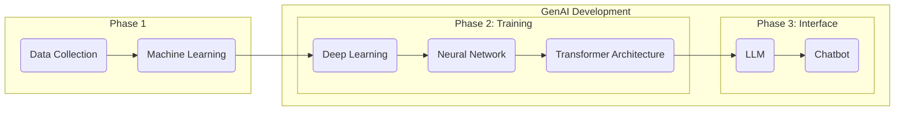

# Copywriting in the Age of AI 
**Generative artificial intelligence (GenAI)** tools have become prevalent across many creative, tech, and knowledge sectors, promising to automate repetitive tasks and increase productivity.[1](#cite-1) Their scope increases day by day, and many industries are rushing to adopt this technology.

BYU-Idaho is navigating the future of human-AI collaboration, preparing students for the future workforce by employing GenAI tools in faculty and student workflows.[2](#cite-2),[3](#cite-3)

The capacity of GenAI tools makes it easy for people to replace their own effort with machine-generated content, but current research demonstrates that this approach has an overall negative impact on quality and performance across many areas.[4](#cite-4),[5](#cite-5),[6](#cite-6) Yet, there is also evidence that human-AI collaboration can complement our capabilities, helping us rather than harming or hindering.[7](#cite-7) 

The conflicting data suggests there is an appropriate middle ground for GenAI, but finding that middle ground is easier said than done. Using the current models requires an apprehensive—*both comprehensive and skeptical*—approach. The apprehensive approach assumes that GenAI tools are going to stay relevant in the future, and that humanity will address and resolve the issues with GenAI, but in the meantime, individuals and organizations must define specific policies and guardrails to protect against overreliance on GenAI.

> #### **Consider This**
> **Key Takeaways:** For copywriters to use GenAI responsibly, they must know its possibilities, risks, and limitations to use it effectively, efficiently, and ethically. Its primary roles in copywriting are to **find**, **challenge**, and **inspect.**
> 
> ##### **What Are the Possibilities, Limitations, and Risks of AI Chatbots?**
> - **Possibilities:** human-AI collaboration and accelerated productivity, learning, creativity, reasoning, analysis, and research.
> - **Limitations:** tokens, context window, limited reasoning, no true understanding, and limited data access.
> - **Risks:** hallucinations, sycophancy, bias, cognitive overreliance, data privacy, copyright, research integrity, and plagiarism.

## Can Artificial Intelligence Keep Its Promises?
There is a group of enthusiastic developers and fans of GenAI who promise this technology will promote political and economic health and a better future for all. Furthermore, they claim individuals will one day have access to a 24/7 AI agent that will enable individuals to enhance personal relationships, career advancement, education, creativity, and fulfillment by enabling them to perform almost any task from their computers.[8](#cite-8)

AI enthusiasts promise what GenAI might be, but those promises do not describe what GenAI currently is. Copywriters in particular are promised that GenAI will augment and automate their tasks, leading to increased productivity and decreased mental drudgery. Some AI enthusiasts believe that copywriters, and other similar roles, are going to be completely replaced by GenAI. Nevertheless, as it stands, GenAI models have limitations and risks that prevent them from completely replacing the work and effort of copywriters.

GenAI enthusiasts may argue that the limitations and risks of AI do not demonstrate that copywriters cannot be replaced, only that GenAI requires human oversight to govern and verify outputs. The need for human oversight means that GenAI is not prepared to fulfill the enthusiasts' promises. Potentially, AI could be incorporated into a Copywriter's workflow to increase productivity, but that is not equivalent to the Copywriter role itself.

The purpose of *The AI Copywriting Manual* is to provide copywriters for BYU-Idaho at University Communications the knowledge and strategies they need to responsibly use GenAI tools effectively, efficiently, and ethically. This section provides an introduction to GenAI, exploring its proposed capabilities weighed against its limitations and risks, its development and training processes, and its appropriate use cases for copywriters.

***
"A computer can never be held accountable; therefore, a computer must never make a management decision."
***
*
– IBM Training Manual, 1979
*

## What Is Artificial Intelligence? 
**Artificial intelligence (AI)** is a popular term that refers to diverse technologies with different functions and purposes. It is generally described as technology that is meant to simulate human-like intelligence. GenAI is a modern adaptation of AI technologies meant to generate human-like creations such as text, code, images, math, videos, or any other form of content.[9](#cite-9) 

While much of the information presented here about AI development, training, and generated content might apply to other forms of content,[10](#cite-10) this manual focuses primarily on the tasks related to copywriting that can be replicated by GenAI, such as the following:

- **Research**
- **Planning and outlining**
- **Brainstorming and drafting**
- **Editing grammar, tone, and style**
- **Logical analysis**
- **Review and quality control**
- **Citation and reference generation**
- **Content creation**

Copywriters might feel intimidated by GenAI tools' capacity to generate vast amounts of text and feel that they will have to use them to keep up and stay relevant. However, copywriters should be aware of GenAI's underlying mechanics, specifically how AI models are developed and trained. The development process exposes key insights about the roles that AI can play in copywriting. 

GenAI is a product of a multi-step process; it wasn't created by a team of programmers meticulously coding every single prompt and output one by one. AI engineers built GenAI through a three-phase process: (1) collecting large amounts of text and training machines to read it, (2) constructing a language processing model and training it to respond, and (3) preparing the model to become an adaptable and helpful assistant.

### Phase One

AI models are trained in a process called **machine learning**, a branch of AI that performs data analysis tasks using mathematics and statistics to understand text.[11](#cite-11) By using a large amount of data, machine learning can start to guess relationships and recognize patterns between things without explicit programming.[12](#cite-12)

This textual data is gathered from across the internet, including web pages, books, repositories, articles, blogs, academic papers, Wikipedia, news archives, public forums, and more.[13](#cite-13)

The collection of textual data also introduces a few risks:

- The collection and training process itself is expensive. It requires large data centers, which have negative impacts on the environments around them.[14](#cite-14)
- There are ethical and legal concerns with data collection that include intellectual property rights and data privacy violations.[15](#cite-15) 
- Textual data is made up of contradicting contexts, styles, and types of text.[16](#cite-16)
- Models will unintentionally learn bias, misinformation, and confidential information from textual data.[17](#cite-17)
- GenAI tools were trained on mixed datasets with contradictory textual data, and with such high volumes of textual data, there is no guarantee that it is perfectly error-free, even when cleaned.[18](#cite-18)

Some of these risks are mitigated by a preprocessing step where data scientists clean the data by filtering out bad data and setting a specific standard for the machine to learn,[19](#cite-19) but it cannot resolve these issues completely. 

Machine learning can understand textual data by converting text into individual units called **tokens** (roughly ¾ of a word, including punctuation and formatting). Machine learning uses the numerical IDs assigned to each word to start building a statistical model of language. For example:

*Humans read:*

 The quick brown fox jumps over the lazy dog.

*AI reads:* 

 ["The", " quick", " brown", " fox", " jumps", " over", " the", " lazy", " dog", "."]
 [976, 4853, 19705, 68347, 65613, 1072, 290, 29082, 6446, 30]

For more complicated words, tokenization breaks them down into smaller parts:

*Humans read:*

 Supercalifragilisticexpialidocious.

*AI reads:*

 ["Super", " cal", " if", " rag", " il", " istic", " exp", " ial", " id", " ocious", "."]
 [17789, 5842, 366, 17764, 311, 6207, 8067, 563, 315, 170661, 13]

It's like learning math to understand English: the idea is that these AI models will be able to take the text, "I like to pet," and predict the next word based on the context. For instance, it might think there is a 50 percent chance the next word is dog.

AI is probabilistic, not deterministic, meaning that it doesn't ever understand the meaning of the word; it just finds the next word based on chance. This introduces one of AI's greatest limitations: **hallucinations:** the generation of entirely fabricated text that sounds plausible and authoritative. Copywriters need to understand that hallucinations are a feature, not a bug. Everything that AI generates is based on how it calculates tokens, but it doesn't recall, remember, research, or verify its outputs.

Some AI models, like Google Gemini, have access to search and retrieval systems, which increases their range of context and decreases the amount of guesswork they do. However, Gemini does not understand the concept of "don't believe everything you read on the internet," so fact-checking is still necessary. There is also no guarantee that it properly understood the source it was pulling from.

Hallucinations are one of the most important reasons why copywriters are still necessary, because they have the ability to verify information that GenAI can't. Copywriters can govern words and syntax, whereas GenAI can only make estimations. This limitation begins with machine learning, but as AI models become more advanced, hallucination only becomes more apparent, not less.

### Phase Two

**Deep learning** is a more advanced version of machine learning. It emerges when the statistical relationships created in machine learning are designed to have a network that resembles neural patterns found in the brain. This process is extremely complicated, but what emerges is a system called a **neural network**, which can start to process complex tasks that require pattern analysis, logical reasoning, and structured outputs.[20](#cite-20)

Deep learning allows machines to train themselves, as they are able to run both a training session and a checking session at the same time. By utilizing the large dataset developed earlier, the machine can train to recognize all the patterns found within and then check its own work. As the machines are trained, the neural networks grow.[21](#cite-21)

Once the neural network is developed, it is paired with multiple other neural networks to create **transformer architecture**, allowing the new model to perform multiple complex tasks simultaneously and begin **natural language processing**. Then the model is able to use the neural networks built to understand language to now create responses to textual inputs, allowing seamless human-AI communication.

Hallucinations are enhanced by transformer architecture because the information being processed has so many more neural networks to pass through. Errors will cascade, as each layer will have its own hallucination.[22](#cite-22)

### Phase Three

**Large language models** are the result of transformer architecture that has been trained for natural language processing. Once an LLM has been created, it is essentially a blank slate, yet it still maintains access to the vast training data.[23](#cite-23)

Converting an LLM into a **chatbot** requires an additional training stage called **fine-tuning**. In this final stage, it is trained to become a conversational system that manages the dialogue flow, personalized responses, and serves as a helpful, adaptable assistant using two strategies: **reinforcement learning from human feedback (RLHF)** and **direct preference optimization (DPO)**:[24](#cite-24)

* **RLHF** is a form of fine-tuning where humans rank different outputs to the same prompt. The goal is to train the LLM with a reward model to tailor its responses to reflect the higher-ranked outputs over the lower-ranked outputs. This fine-tuning strategy is meant to align outputs to be more accurate, helpful, and safe, but these are more like guidelines for the model, not hard-coded limits.[25](#cite-25)
* **DPO** is a newer version of RLHF where the preferences are not found in a separate model, but included directly into the model itself. The model trains itself to produce the kinds of responses people want to see based on the internal token mechanisms. However, this can have unintended consequences because human oversight is significantly decreased.

Both of these fine-tuning methods feed into two specific tendencies of hallucination: **sycophancy** and **overconfidence**:

* **Sycophancy** is the tendency for GenAI to reinforce opinions with flattery, praise, and subservience.[26](#cite-26) Since the human trainers tended to reward when LLMs confirmed their prior convictions and beliefs, the LLMs were trained to prioritize user experience rather than truth verification.
* **Overconfidence** is the tendency for GenAI to prefer its own generated text rather than human-written text.[27](#cite-27) Since LLMs generate text that is "mathematically sound" according to their internal statistical mechanics, generated text is more likely to align with what calculates as good writing. This is a type of GenAI confirmation bias.

While parameters are put in place to help, these behaviors can only be mitigated, but because they are emergent features, and unless the fundamental structure is changed, these problems will never go away. Therefore, copywriters using GenAI to write will undermine their own abilities because GenAI will take their text, adjust it to align with its own preferences, and confidently present it as an improved draft, while praising the original text and ideas at the same time. Since GenAI is outputting hallucinations, it cannot actually verify that its improved draft is objectively better, but it might convince the copywriter anyway.

Another emergent feature is that prolonged use tends to make GenAI outputs worse over time, called **the context window**, which is the finite space that AI models have to process information; it represents the information available to an AI model at a given time. The tokens that GenAI processes take up space, so it can only calculate a certain number of tokens at a time. Moreover, each token carries statistical weight, so the more information it has to process, the more it will struggle to produce helpful or even relevant responses.

Think of it like a conversation between you and a friend: you don't need to remember every time your friend says the word "the" because you understand the semantic meaning of the conversation. You don't have to break each word down and create a statistical representation in your mind, but if your friend were talking to AI instead of you, then it would need to make those calculations because it doesn't understand what your friend is saying. GenAI can't listen, even if it says it can, because it doesn't know what words really matter. Deep learning and natural language processing are there to convince the user that the AI is human-like. 

Despite the flaws, after the LLM has been trained to interact with users, it is deployed as a GenAI chatbot interface. These tools inherit all of the possibilities, limitations, and risks that have been discussed so far. This completes the process of developing GenAI tools.

### ***GenAI Step-By-Step***

## Using Artificial Intelligence
GenAI chatbots like ChatGPT, Google Gemini, or Microsoft Copilot are tools that BYU-Idaho copywriters will have access to through their official `@byui.edu` accounts. Using GenAI tools effectively requires a significant time investment that challenges the supposed productivity GenAI is promised to give users. Consider these two scenarios:

* **Slow but usable:** A copywriter is writing content for a website's landing page. They want to make sure that the output is stylistic, helpful, readable, and factual. So the copywriter spends time tailoring a prompt with a specific persona and the necessary context, such as the style guide, the goal of the website, and the format. They try out a few different prompts, adjusting each time for an improved output, while also managing the limitations of the context window and making sure the responses aren't factually incorrect. After the copywriter creates the perfect prompt, they edit the output, making their own adjustments, ensuring it sounds human-like. By the time they are finished, the copywriter questions whether this was an efficient and effective use of GenAI, given the time and effort required for oversight. 

* **Fast but unusable:** A copywriter is writing a blog post. They produce a quick prompt asking GenAI to write a blog about the subject without providing information or context. They get three to five different blogs. Then they ask GenAI to find the best version of the blog. Once selected, they ask AI to edit and revise for one final version. After the copywriter submits the blog, they realize that they took about 30 minutes to complete a task that would take at least several hours on their own. However, they didn't check themselves for hallucinations, misinformation, and poor-quality copy, potentially submitting something of very low quality. Still, it does at least guarantee the appearance of productivity.

Copywriters likely fall somewhere in between the two scenarios, but these demonstrate a general reality about using these tools: GenAI tools are only as effective and efficient as the copywriter using them. 

* The first copywriter embraced GenAI as a helpful assistant that they had to lead to success, but undermined their own ability to actually write the content themselves, and instead tailored a machine's output. 

* The second copywriter embraced GenAI as a content generator that requires only someone to prompt, but no one to oversee. 

Yet, the approach was the same; they believed that GenAI should perform the majority of the tasks in their role, with the only difference being the level of oversight they provided. Yes, GenAI has the ability to write all of the text for copywriters, but *human governance is in every word*, not just in prompting the machine. No, it is not about using AI to complete every task, but finding which tasks GenAI can complete without compromising human integrity, and remaining efficient, effective, and ethical.

*The AI Copywriting Manual* encourages copywriters to take responsibility for their tasks, adopting an apprehensive approach where GenAI is used in specific roles with high oversight. The roles this manual proposes are **find**, **challenge**, and **inspect.**

### Find
GenAI's hallucinations prevent it from becoming a truly effective research, summarizing, and note-taking tool. There is never a guarantee that it has generated an accurate response, even if its reasoning and syntax appear authoritative. Copywriters should not leverage GenAI as a replacement for traditional research methods and tools, but by taking advantage of the integrated search systems, they can efficiently augment the search for relevant sources.  

By using GenAI as a search tool for research materials, copywriters are able to quickly find sources that relate directly at a greater rate. It will still be up to them to verify the appropriateness, accuracy, and authority of each source. Tools like Google's Gemini, which are connected to systems like Google Search and Google Scholar, could easily be introduced into the copywriter's research strategy.

*Example: A copywriter is researching for a website but wants to find sources faster. They use Google Gemini's connections to Google Search to find reliable sources by using it as an advanced search engine. Instead of breaking down the question into topics and keywords, GenAI is able to use its natural language processing to break down the sentence and find web pages that address similar subjects.

### Challenge
Copywriters can assign GenAI tools user personas to test stress points and friction within their copy. It can offer various perspectives to challenge the copywriter's assumptions, offering a fast-paced review with various audiences. While not a total replacement, during the drafting and revising period, this feature can be used to sharpen thinking, especially when used with skepticism.

The principle behind Challenge is using GenAI to sharpen the copywriter's work by evaluating underlying assumptions, causal connections, logical thinking, and rhetorical strategy. GenAI shouldn't suggest methods to overcome these gaps, but it may help the copywriter see an issue they weren't aware of. The goal with Challenge is to use GenAI as a tool that strengthens copy through rigorous testing, not automatic rewriting. By assigning testing and analytical personas, the copywriter will be able to better reason through, defend, and explain decisions that they made.

* Example: A copywriter isn't sure about the blog post they are writing, so they give AI a role, asking it to play the part of the audience they are writing for. The copywriter asks it to look for potential areas where the information is incomplete or confusing. The copywriter then compares the evaluation to the text and decides what changes they can make and what they should keep.

### Inspect
GenAI is able to process large amounts of text almost instantaneously. Through that process, it is able to analyze, evaluate, and critique texts' weaknesses and strengths. The issue is that even with context and prompt engineering, GenAI will still make mistakes. GenAI should not be used as the only editing tool, and tone, style, and grammar should always be reviewed by humans, but it can quickly evaluate large amounts of text to identify large-scale patterns and structure.

GenAI should be given specific parameters before evaluating text, such as persona, style guidelines, and objectives. When going through the final audit, the copywriter can evaluate the AI reviews one at a time and still use their own judgment to determine what is best.

* Example: The copywriter just finished editing a page, but wants one last quick overview just in case there was something that they missed. They ask the AI to evaluate the text for any mistakes, but not to edit or change anything. The AI finds one sentence that repeats the word *the*, which they accidentally skimmed over. The copywriter reads over the page one last time with the AI reviews in mind and finds all the easy-to-miss errors.

These roles will be elaborated on in later sections of this manual. Before elaborating on the strategies, copywriters should understand the basics of general AI features and the specifics of the tools provided by BYU-Idaho.

# The Basic Features of AI
Using GenAI might seem simple at first, and for the most part, it is meant to be. A strong user interface and natural language processing make casual use of it seamless. For beginners, it might seem like a conversational version of Google, but instead of links, it is a chat interface.

For copywriters who use GenAI, relying on the chat without employing any other features will inhibit their ability to use these tools effectively, efficiently, and ethically. Moreover, one strategy that works for one AI tool might work differently for another. It is not enough to know the tools generally; copywriters must understand each feature, what its limitations are, how it functions, and how they can use it to enhance their copywriting.

## BYU-Idaho's AI Toolkit for Copywriters
Generally, the GenAI models copywriters use will share more similarities than differences.

The tool used for a given task may be determined by personal preference, specific features, native workspace, and tool capabilities. However, beyond specific features, the fundamental difference between AI models lies in where they are deployed, not in training, intelligence, or features.

It is impossible to say whether one conglomerate's training data is better than another's, so differentiating based on data collection and training is arbitrary, even if it is technically true. Since hallucination is inherent in AI, the dataset has more influence on voice and pattern recognition rather than knowledge and capability.

BYU-Idaho provides access to three AI tools: ChatGPT Edu, Google Gemini, and Microsoft Copilot 365. Find more details for the specific tools, features, and benefits of each on their respective pages, found below, including how to access them with a university-provided account. 

| Chatbot | Developer | Accessibility | Site | Deployment | How-To-Use |
|:--:|:--:|:--|:--|:--|:--|
| ChatGPT Edu | OpenAI | Requires CES Edu license. Must use a ChatGPT BYU-Idaho institutional account. | [Access ChatGPT](https://chatgpt.com/)| General-purpose AI workspace that can use uploaded materials and connected services, including Google Workspace, Microsoft, and more. | [ChatGPT Features](tool-guide/how-to-use-chatgpt.md)
| Google Gemini | Google AI | Must use a Gemini BYU-Idaho institutional account. | [Access Google Gemini](https://gemini.google.com/app)| Google's ecosystem, including Google Workspace and Search. | [Gemini Features](tool-guide/how-to-use-google-gemini.md)
| Microsoft Copilot 365 | Microsoft AI | Must use a Microsoft BYU-Idaho institutional account. | [Access Microsoft Copilot](https://copilot.microsoft.com/)| Microsoft's ecosystem, including Word, Outlook, Teams, and other Microsoft 365 applications. | [Copilot Features](tool-guide/how-to-use-microsoft-copilot.md)

Becoming familiar with each of the tools is encouraged, but ultimately the tool you spend the most time with depends on which one:

- Integrates into the workspace (Google Workspace, Microsoft 365, etc.)
- Provides the most useful features for the needs:
- Context window size, model capability, external application, etc...
- Supports the process of Find, Challenge, and Inspect

## Understanding Common GenAI Features

### Conversational Interface
The chat box is the first thing users see when they open up a GenAI tool. This feature acts as the main interface for exchanging messages with the AI. It lets users use natural language to interact with machines. 

The conversation exists inside a context window, keeping earlier messages together and allowing for follow-up prompts and questions. These conversations are saved and stored in the sidebar and memory for future use and access.

Controls let users edit their prompts, stop or regenerate outputs, and save, delete, and export chats.

### Response Editing and Navigation
Once a prompt is submitted, users are able to edit it, retroactively re-prompting the GenAI tool. Users have control over the flow of chat conversation, can improve and experiment with prompts, and reduce the context the AI has to process.

Users can also create duplicate chat conversations, making multiple versions, allowing them to save old outputs, test different answers with different models, and use different tools with the same context.

### Storage, Memory, and Personalization
The conversational interface is connected to a workspace that stores previous chats, customized tools, generated artifacts such as images and documents, continuous projects, and more. 

These features are found directly in the sidebar or in project folders and libraries. Users are able to access, reuse, edit, or delete these materials.

In the GenAI settings, users are able to access chat history and manage GenAI's memory and instructions. 

Memory is a passive tool that GenAI uses to help personalize responses. While not all chat history is treated as context for conversation, GenAI tools have a memory feature, a collection of data GenAI uses to create a user persona for future chats. This can be managed by deleting chat histories or directly disabling the memory feature.

Instructions allow users to directly input rules and context that GenAI will use to personalize each response. This could be personal information or output recommendations like "prefers short responses" or "write in bullet points."

When using school accounts, personal data is not used to train AI models, and many memory features are disabled. 

All of these features make up the information GenAI stores beyond its own database.

### Input and Context Controls
In the chat feature, users can include more than just text; they can also supply materials and designate what the GenAI should work with. This material becomes context in the conversation, allowing GenAI to anchor responses based on the provided material. 

- **Documents & Files:** PDFs, Word docs, CSVs, Excel files, & presentations for summarization or data analysis.
  
- **Images & Visuals:** Photos, charts, diagrams, and screenshots for object identification, math solving, or troubleshooting.
  
- **Audio & Voice:** Voice prompts, meeting recordings, and audio files for transcription and summarization.
  
- **Video:** Short clips and video files for scene description, object tracking, and content summaries.
  
- **Code Files:** Scripts and programming files (e.g., .py, .js, .html) for debugging, review, and optimization.
  
- **Connected Workspaces:** Direct integrations with cloud drives (like Google Workspace) to pull context without manual uploads.
  
- **Search and Source Grounding:** Web search tools that ground outputs in sources directly pulled from search engines (like Google Search).

Some of the content users upload will be saved to GenAI's storage features.

### Modes and Models
GenAI tools are not meant to be one-size-fits-all. Different tasks require different reasoning capabilities, tokenization cost, and speed. 

- **Models:** Within a GenAI tool, there are different models.

 For instance, ChatGPT Edu has multiple models that can functionally perform the same tasks, but do so at different rates. 

- **Modes:** Within a GenAI model, there are different modes.

For instance, ChatGPT Edu has both a chat mode and a work mode. The chat mode accesses two models that both prioritize instant answers. The work mode accesses four models with dials that allow the user to control their reasoning power.

Users who take advantage of GenAI modes and models can decide the token cost they pay and whether they want instant answers or in-depth reasoning.

### Reusable Assistants
GenAI tools can create, store, and maintain reusable assistants for recurring roles and tasks. Some GenAI tools come with pre-created assistants or tools to help users create their own customized assistants. 

Think of these assistants as highly tailored and reusable prompts for GenAI that implement the following:

- **Role:** How it is supposed to act, such as an editor, researcher, or more.
- **Instructions:** What it is supposed to do. Tasks that it should complete and how it should and shouldn't help the user. Rules governing tone, process, format, limitations, and decision-making.
- **Context:** Reference files, style guides, brand standards, product information, or other materials.
- **Tools:** Web search, file analysis, data analysis, image generation, or external applications.
- **Format:** Expectations for how the assistant should organize its responses.

### Automation and Background Work
Automation allows GenAI to work in the background without moment-to-moment user interference. The GenAI system may run processes on a schedule, respond to an event, monitor information, or complete multiple steps in sequence.

Normally, the user has to input a prompt to get a result, but with automation, the system continues operating after the initial instruction, allowing the user to work elsewhere.

### Sharing and Collaboration
Sharing and collaboration features allow users to distribute conversations, documents, prompts, assistants, generated artifacts, or workspaces to other people. These features transform AI from an individual tool into a team environment.

Sharing may involve:

- A link to a conversation.
- A copied response or generated artifact.
- A shared document or project.
- A reusable assistant made available to a team.
- Comments, annotations, or suggested revisions.
- Collaborative editing.
- Shared files and reference materials.
- Team libraries or organizational knowledge bases.
- Handoffs between people and AI tools.

### Generated Artifacts
Multimodal AI was trained to generate many different kinds of media artifacts. Depending on the model, it can range from small-scale replies to large multi-asset applications. It is important to recognize that these generated artifacts all stem from the same architecture as LLMs, but for different tools. Many of these artifacts are also made accessible through the deployment stage.

Below is a list containing many common artifacts across GenAI tools, and while not all-encompassing, it represents the range of generated content. A general rule of thumb is that if it's something that GenAI can upload, then it can probably create something like it.

#### Chat Response
An answer to a prompt delivered in the chat interface. This can range from a simple, single-sentence response to a full-fledged article. Its responses will be conversational and friendly, usually generating first-person responses, unless it is instructed not to.

#### Cited Answer
A response that includes links, references, quotations, or source attributions meant to support its claims. Generally, GenAI responds with a cited answer when it is specifically performing web searches.

#### Editable Page
A persistent workspace for developing content beside or within the AI conversation. Unlike a normal chat response, an editable page is intended for repeated revision. An editable page might have content it generated entirely by itself, written by the user, or a combination of both.

#### Word-Processing Document
A formally structured document designed for reading, editing, printing, or sharing. It may contain headings, paragraphs, footnotes, tables, images, page breaks, and other document elements. Word-processing documents may come in any file type and be integrated directly into a workspace.

#### Data Table
A structured arrangement of information in rows and columns, usually intended for reading, comparison, filtering, or further analysis. A data table may come in file formats, textual tables, or even spreadsheets. It may be populated by data it generated, the user provided, or a combination of both.

#### Diagram/Structured Visual
A visual representation of concepts, processes, hierarchies, relationships, systems, or sequences, and potentially a representation of numerical data that helps readers identify comparisons, trends, distributions, or relationships.

Visual artifacts may respond to user input or allow exploration rather than simply displaying fixed information.

#### Generated Image
A visual image created or modified from a text description, reference image, or editing instruction.

#### Generated Music
Music created or modified from a text description, reference image, or editing instruction.

#### Code Artifact
A block or file of computer code generated, modified, explained, or analyzed by AI. Code artifacts can include scripts, web components, templates, formulas, automation, and configuration files.

#### Website/Lightweight App
A collection of connected pages or an interactive digital experience that performs a specific communication or functional purpose. It may be a combination of any of the previous features above.

#### Research Report
A structured document that gathers, evaluates, synthesizes, and presents information from multiple sources. It may be a combination of any of the previous features above.

# Personal Accountability & AI
Personal accountability is crucial in the age of GenAI. This is revolutionary technology with unforeseen consequences, both positive and negative. Copywriters should approach this technology skeptically, understanding that this tool is meant to resemble human-like intelligence but is incapable of replacing it. Using GenAI unethically can have serious consequences at institutional, audience, and individual levels. 

 As GenAI increases in capability, copywriters must be aware of the increasing risk of mishandling private information, intellectual property, and research.  *The AI Copywriting Manual* provides practical guidelines for GenAI usage. By adhering to these guidelines, copywriters will be able to establish personal accountability as they use GenAI and create trust among themselves, their audience, and BYU-Idaho.

> #### **Consider This**
> **Key Takeaways:** For copywriters to use GenAI responsibly, they must use their authorized BYU-Idaho account, know how to safeguard private data, understand how plagiarism and copyright infringement relate to GenAI, and preserve research integrity.
> 
> ##### **How to Prevent the Ethical Misuse of GenAI**
> - **Data privacy:** BYU-Idaho provides official accounts that offer guaranteed data protections for three tools: ChatGPT EDU, Google Gemini, and Microsoft Copilot 365. They also have data classifications that demonstrate appropriate use cases.
> - **Plagiarism and copyright:** Copywriters must understand that copyright infringement and plagiarism are two different things; inappropriate GenAI use can lead to both.
> - **Research integrity:** GenAI hallucinations can lead to research misconduct, including fabrication and falsification. Copywriters should not use GenAI to summarize, explain, or analyze professional research.

## Data Privacy & AI

Many GenAI tools treat the text in the chat interface as training data for future models. The price for using these tools for free is any data that users might be sharing. This includes names, phone numbers, emails, and any private information that users share. These models may not deliberately store this data in their storage to share with others later; nevertheless, this information becomes a part of the model and creates a security risk if the information shared was sensitive or private. Giving GenAI private information freely, without data protection, acts as consent for its internal systems to use that data to train.[28](#cite-28) 
BYU-Idaho is committed to safeguarding data privacy. The official `@byui.edu` account gives students and faculty access to authorized AI tools, each approved with a specific data classification level: *public*, *internal*, *confidential*, and *restricted*.[29](#cite-29) Copywriters who are accessing the authorized tools with their BYU-Idaho accounts are safe to share data across the public, internal, and confidential classes. 

### Data Privacy Practices for Copywriters
*Don't Feed University Data or Private Information to Unapproved AI Tools*

Personally Identifiable Information and confidential or restricted university information should not be used with unapproved AI tools without approval. These tools train from chats, and they may accidentally expose private data to the public.

*Only Use University-Approved Tools*

 When using GenAI for work, use the university-approved tools (detailed below). BYU-Idaho has licenses and contracts in place that provide privacy and security to users. One of the key benefits is that the account can protect intellectual property because it limits AI from training on conversation data.

*Always Self-Check*

The Church Education System (CES) provides six principles for protecting data—Purpose Limitation, Data Minimization, Lawfulness, Transparency, Protection, and Duration—which are meant to encourage members to self-check their work.[30](#cite-30) If you are working with confidential information, you can use this [self-check guide](https://cesprivacy.org/00000193-1d0f-d940-adf7-dfcfa2e20001/cpc-global-privacy-principles-self-check-pdf) to ensure your work is safe.

*Ask For Help If You Are Not Sure*
  
When in doubt, leave it out. If you aren't sure whether something is appropriate or not, contact your supervisor, the AI committee, or [IT](https://td.byui.edu/TDClient/79/ITHelpCenter/Requests/Service/905/Request-an-IT-Project-Software-or-AI-Tool/Request) and ask for help.

> ##### Accidental Data Exposure
> If you accidentally input unauthorized data into an AI tool, tell your supervisor and contact [IT](https://td.byui.edu/TDClient/79/ITHelpCenter/Requests/Service/905/Request-an-IT-Project-Software-or-AI-Tool/Request) immediately.

### Data Classifications

* **Public:** Information approved for public release that should be protected against loss or change. 
* **Internal:** Moderately sensitive information which is generally accessible within the university to those with a legitimate university purpose and is not intended for entities or persons outside the university.
* **Confidential:** Highly sensitive information where an inappropriate loss, change, or disclosure could have substantial consequences to individuals and the university.
* **Restricted:** Information of the highest sensitivity where inappropriate loss, changes, or disclosure could have grave consequences to the university or its students.

| Public | Internal | Confidential | Restricted |
|:--:|:--:|:--:|:--:|
| `News` `Maps` `Events` `Public Websites` `Catalogs` | `Budgets` `Policies` `Procedures` `Survey Data` `Meeting Notes` `Course Content` `Authenticated Websites` | `Names` `Photos` `Grades` `Usernames` `I-Numbers` `Addresses` `Contact Info` `Transcripts` `Authenticated Websites` | `SSNs` `Bank Info` `Passwords` `Tax Records` `Legal Files` `Medical Records` `Credit Card Info` |

### Authorized Tools
The AI tools approved by BYU-Idaho are *ChatGPT*, *Copilot*, and *Gemini*. These three are standard GenAI tools.[31](#cite-31) The key differences are where they live, what they can see, and how they handle data:

#### OpenAI ChatGPT Edu
It's excellent for writing, editing, brainstorming, and building Custom GPTs. It requires a CES Edu license, which is available through student accounts, but must be accessed directly.

  * Public:✅
  * Internal:✅
  * Confidential:✅
  * Restricted:❗

Find out more about ChatGPT here: [Features of ChatGPT](tool-guide/how-to-use-chatgpt.md)
  
#### Microsoft Copilot
It can see emails, files, meetings, and calendar, making it powerful for work tasks tied to the M365 environment. Copywriters must use their BYU-Idaho Microsoft account.

  * Public:✅
  * Internal:✅
  * Confidential:✅
  * Restricted:❗

Find out more about Microsoft Copilot here: [Features of Microsoft Copilot](tool-guide/how-to-use-microsoft-copilot.md)

#### Google Gemini
It integrates with Google Workspace and Google Search. Copywriters must use their BYU-Idaho Google account.

  * Public:✅
  * Internal:✅
  * Confidential:✅
  * Restricted:❗

Find out more about Google Gemini here: [Features of Google Gemini](tool-guide/how-to-use-google-gemini.md)

## Copyright & AI
Copyright law is the legal right that gives creators control over their original works of authorship, stopping others from plagiarizing and using those works without explicit permission.[32](#cite-32) Under US law, everyone is a copyright owner, inasmuch as they have produced an original work.[33](#cite-33) Intellectual property, which is an intangible, often digital, artifact that communicates ideas originating from the human mind, is obtained through copyright laws.[34](#cite-34) (Artifacts refer to materials created to carry and communicate ideas and information.)[35](#cite-35) A copywriter's copy falls under copyright laws. When they write for a company, like BYU-Idaho, the company automatically owns it if the work is under "work made for hire."[36](#cite-36) Individual copywriters don't own their copy because BYU-Idaho is paying them for the rights to ownership.

Even with the institutional data privacy protections put in place, the copyright and plagiarism issues of GenAI authorship remain. When the main author of written work is GenAI, even if a series of thoughtful prompts produced it, the question remains: *Who owns this?*

According to the US Copyright Office, human authorship facilitates ownership of intellectual property, but when authorship originates with GenAI instead, ownership rights are lost.[37](#cite-37),[38](#cite-38) GenAI interrupts the traditional copyright workflow because it challenges the definition of author and introduces complications with plagiarism, authorship, and ownership. Even well-constructed, effortful prompts don't translate to ownership of generated artifacts because the machine, not the human, created the expressive work.[39](#cite-39) GenAI-created artifacts belong to the public domain and do not count as intellectual property for individuals or organizations. 

Deceptively hiding GenAI involvement or using GenAI to create an artifact while claiming it as original work is plagiarism, which violates BYU-Idaho's Honor Code.[40](#cite-40), 
[41](#cite-41) These kinds of artifacts cannot be copyrighted because they have no human authorship.[42](#cite-42) In extreme cases, using AI-generated artifacts may create copyright infringement by reproducing a copyrighted work without attribution, which goes from being an internal compliance issue to being a violation of copyright law.[43](#cite-43)

The principle for protecting intellectual property is avoiding GenAI authorship. In general, if GenAI creates text and then it is heavily edited, revised, or rearranged by humans, copyright will only protect the human-authored portion of the work.[44](#cite-44) To enforce this practice, if a company tries to register a major asset with the copyright office, it must disclose any GenAI involvement. This creates a gray area where certain parts of an artifact may count as intellectual property and other parts may be public domain.

The *find*, *challenge*, and *inspect* methods comply with university and legal standards for using GenAI, because they don't place GenAI in a role of authorship in any form.

### Copyright Infringement vs. Plagiarism
Though GenAI complicates both plagiarism and copyright, they are not the same thing. Plagiarism is an issue of intellectual honesty. Copyright is an issue of intellectual property. The following case study demonstrates how a copywriter using GenAI may plagiarize, infringe copyright law, or do both, and then how they can avoid it entirely.

*Important Note:* When referring to plagiarism, the term "ideas" doesn't refer to the concept or notion of something, but to explanations, hypotheses, theories, and original thought.[45](#cite-45) Under BYU-Idaho's Honor Code, stealing AI-generated ideas is plagiarism, but the practice of using GenAI to brainstorm only becomes a legal violation if it starts to perform the cognitive labor of developing that idea into an artifact.[46](#cite-46)

**Plagiarism:** A copywriter uses Google Gemini to generate a paragraph for an article that they are writing. They use prompt-engineering techniques, including samples of their own writing and sources, to construct a strong prompt. Once the paragraph is generated, the copywriter edits sentences and double-checks the facts. They include this paragraph in their blog without citing GenAI, incidentally taking credit for ideas in the paragraph generated by GenAI. This copywriter has committed plagiarism by presenting the reasoning capabilities of GenAI as their own without citations. However, since the paragraph isn't using intellectual property without permission, it isn't a copyright infringement.

**Copyright Infringement:** The same copywriter uses GenAI to generate another paragraph, using their sources as context. The GenAI tool restates the same ideas from the article almost verbatim, but it also generates a citation. The copywriter cites both the article and the GenAI tool in their works-cited page so they don't plagiarize. The copywriter essentially copied the entire work without permission, which may infringe the original author's rights over their artifact under copyright law. 

**Plagiarism & Copyright Infringement:** The same copywriter is working on a different blog. In this instance, they use a prompt asking GenAI to rephrase an article for a BYU-Idaho student audience. The GenAI tool restates the article, even directly copying some sentences word-for-word. The copywriter then submits the completed article to another chat and asks it to make the article sound more like them, and then submits that as the final version of their work without any citations. The copywriter plagiarizes by presenting the ideas of the original author and rewrites of the GenAI tool as their own, and also violates copyright by copying another author's artifact without permission.

**Avoiding Both:** A different copywriter wants to write a blog for the BYU-Idaho student audience about copyright, plagiarism, and GenAI. 

* **Find:** They start by using a GenAI web search feature to find sources related to the subjects. It finds sources and suggests ways of using them in the article. The copywriter reads the articles, checking for authority and relevancy, and takes careful notes on what information they want to use and keeps track of citations. 
* **Challenge:** Once they finish writing the first draft, they want to use GenAI to evaluate how the intended audience might react to the page. They give a GenAI tool a generic BYU-Idaho student persona and ask it to react to the text, but forbid it from editing or rewriting parts of the text. The tool points out areas where there might be friction, and the copywriter adjusts those areas without GenAI assistance.
* **Inspect:** After editing, the copywriter wants to do one last check to make sure that they are compliant with the BYU-Idaho writing style guide. They upload the article and ask GenAI to point out any mistakes they might have missed. Once the GenAI points out the issues, the copywriter double-checks the style guide and then manually edits those points.

Since the copywriter properly attributed each source and authored the blog with minimal GenAI assistance, they did not plagiarize any work or infringe another author's rights. The university is able to register the blog with the copyright office for protection without any issues of ownership or authorship.

### Transparency & Disclosure
The risks and limitations of GenAI as a tool, along with its ethical and legal problems, mean that copywriters should assume that using AI tools to directly influence the text is inappropriate unless it is otherwise stated. Organization leadership must approve when it's acceptable for a copywriter to use GenAI, but in general ***GenAI should never be used as an author or coauthor.***[47](#cite-47) In the case that permission is warranted or granted to use GenAI, copywriters are fully accountable for fully disclosing the use of AI in their work in a succinct but comprehensive statement.[48](#cite-48)

A transparent disclosure statement should include the following:

1. The specific AI model used (*CES ChatGPT Edu GPT-5.5*, or institutional *Google Gemini Edu 3.6* )
2. The author's purpose for using AI (grammar-checker, review, brainstorm, edit, research, etc.)
3. The portions of the work AI affected by degree (suggested a better introduction, cleaned passive voice misuse, checked for comma splices, etc.)
4. The methods and strategies used to prompt the AI (prompt engineering techniques, steps for data protection) 
5. The level of human oversight and steps taken to ensure quality (independently verified sources, approved and manually applied all edits)

A disclosure statement does not need to be in that order, but it does need to include each component. The detail of the disclosure statement must reflect the degree to which AI was used in a work.

A simple disclosure statement might look like: 

> The author of this work used the AI model *Google Gemini Edu 3.6* to brainstorm subjects for a copywriting manual. Their brainstorming process limited the AI model to producing single-sentence bullet points without elaborating on the ideas. The author used some of the ideas to independently create an outline without the use of AI.

For the first example, the line between brainstorming and drafting is thin, so the statement is provided to point out where the copywriter fell on that line. This keeps the author accountable and honest. Ideas can't be copyrighted, so this statement protects ownership. With proper citation, the artifact also doesn't fall under plagiarism.

A more developed disclosure statement might look like:

> The author of this work used the AI model *CES ChatGPT Edu GPT-5.5* and *Microsoft 365 Copilot Basic* to research topics and find sources for several subjects in a copywriting manual. The author used custom agents to search for scholarly sources and brainstorm research questions. The AI was not used to replace reading, verifying, or citing sources. The author independently accessed these sources and integrated proper research methods to the best of their ability without the use of AI.

For the second example, the GenAI didn't author anything, so the disclosure statement is provided to establish trust between the author and the audience. These kinds of statements may become increasingly warranted as audiences grow skeptical of GenAI use.

Copywriters should ask their supervisors and project managers about when to include a GenAI disclosure statement. Ultimately, it is up to the organization whether it will provide a statement or not; regardless, copywriters should always track GenAI usage in their work.

### AI Citation Style Guide
Since AI doesn't have clear authorship standards, the standards for citing have been adjusted to accommodate these tools. The impermanence of AI chats makes citations less helpful than standard citations. Each citation should be paired with a disclosure statement. Below is a guide to citing AI in common styles. BYU-Idaho copywriters will use Chicago, but APA and MLA are provided for exceptions.[49](#cite-49)

* [Chicago Style](#cite-cs)
* [MLA Style](#cite-mla)
* [APA Style](#cite-apa)

#####  [Chicago Style](#ref-cs)[50](#cite-50)
According to Chicago Style, AI tools do not need to be credited as a source, but authors should disclose AI usage with a brief statement. However, it does provide instructions for creating a formal citation if desired.

1. **Author:** The author will be labeled as the company that created the model, such as *Microsoft* for *Copilot*, *OpenAI* for *ChatGPT*, etc...
   * If context for that chat was provided in the text, include a brief statement before the author stating "Text generated by...".
   * If context for the chat wasn't provided, include a statement, abbreviating the prompt, such as Copilot, response to "find sources for citing AI"
2. **Name of AI Tool:** The brand name of the AI tool, such as *ChatGPT, Copilot, Gemini, etc.* 
3. **Version of AI Tool:** The exact model of the AI tool used, such as *CES ChatGPT Edu GPT-5.5*
4. **Publisher:** The name of the company that made the tool, such as *Microsoft, Google, OpenAI, etc.*
5. **Date:** The date the content was generated.
6. **Location:** Give the URL for the AI tool, such as *https://gemini.google.com/*

**Format:** Author, Title, Publisher, Date, URL for the tool.   

**Example**

* Context provided in text:

Text generated by ChatGPT, OpenAI, July 4, 2026, https://chatgpt.com/

* No context provided in text:

ChatGPT, response to "Where do I find fireworks," OpenAI, July 4, 2026, https://chatgpt.com/

#####  [MLA Style](#ref-mla)[51](#cite-51)
1. **Title of Source:** In MLA, AI-generated content is considered a source with *no author*.
Instead of providing an author,  create a title for the source, such as a brief, descriptive phrase detailing what was created by AI or the prompt. Use this as the title for in-text citations.
2. **Name of AI Tool:** The brand name of the AI tool, such as *ChatGPT, Copilot, Gemini, etc.* 
3. **Version of AI Tool:** The exact model of the AI tool used, such as *CES ChatGPT Edu GPT-5.5*
4. **Publisher:** The name of the company that made the tool, such as *Microsoft, Google, OpenAI, etc.*
5. **Date:** The date the content was generated.
6. **Location:** Give the URL for the AI tool, such as *https://gemini.google.com/*

**Format:** "Title of Source" prompts. *Name of AI Tool*, Version of AI Tool, Company, Date, URL.

**Example:** "Analyze this text from the perspective of a student" prompt. *Gemini*, Gemini 3.6 Thinking, Google, March 3, 2026, https://gemini.google.com/.

#####  [APA Style](#ref-apa)[52](#cite-52)
1. **Author:** The author will be labeled as the company that created the model, such as *Microsoft* for *Copilot*, *OpenAI* for *ChatGPT*, etc...
2. **Date:** The date the content was generated.
3. **Name of AI Tool:** The brand name of the AI tool, such as *ChatGPT, Copilot, Gemini, etc.*
4. **Version of AI Tool:** The exact model of the AI tool used, such as *CES ChatGPT Edu GPT-5.5*
5. **AI Designation:** Include `[Large language model]` after the version.
6. **Location:** Give the URL for the AI tool, such as *https://gemini.google.com/*

**Format:**

Author. (Date). *Name of AI Tool* (Version of AI Tool) [Large language model]. URL 

**Example:**

Microsoft. (2026). *Copilot* (ChatGPT 5.5 Basic) [Large language model]. https://copilot.microsoft.com/.

> ##### Using AI as a Source
> GenAI tools should not be cited or used as a primary or a secondary source for research. Doing so is a form of research misconduct. The purpose of citing GenAI is to establish authorship of generated artifacts, avoid charges of plagiarism, and protect intellectual property.
>
> The safest way to protect authorship and ownership is to remove GenAI from the authorship role entirely, but if copywriters are going to use it, then they must be clear about it.

## Research Integrity & AI
The data privacy and intellectual property issues surrounding AI deal with properly managing the tool externally. They arise despite the mechanics and safety features of GenAI because they are unintentional but not easily resolved. It involves understanding the boundaries of appropriate GenAI use. On the other hand, the issues with GenAI and research integrity arise because of its mechanics and features.

Research integrity is an important part of copywriting. The content copywriters create is used to influence, inform, and persuade people's decisions. They have a responsibility to be unbiased and well-informed. For some projects, that means copywriters need to do their research.

One of the things GenAI is promised to do is to hasten the research process, and that on its own is not a bad thing, but it depends on how that research is being performed. If GenAI is being used to allow researchers to find relevant, peer-reviewed, authentic articles at a faster rate, then that is fine. However, if GenAI is being used to summarize, compartmentalize, and even experiment with sources, then there are serious risks involved.

### AI Hallucination as Research Misconduct
GenAI is built on unreliable mechanics, which compromise its ability to summarize and understand articles. AI Hallucination means that all research performed by LLMs must at least be intensely scrutinized through human oversight.[53](#cite-53),[54](#cite-54)

The tokenization process means that when GenAI is analyzing a source and finding results, conclusions, or data, it is algorithmically and arbitrarily stringing together an output that is meant to appear authoritative and accurate, but has no realistic way to verify it. Beyond plagiarism, which has been discussed above, it breaches into other areas of research misconduct: fabrication and falsification.[55](#cite-55),[56](#cite-56),[57](#cite-57)

GenAI commits other forms of research misconduct beyond plagiarism, fabrication, and falsification. Instead of only claiming credit for original work, it will also hallucinate original information and give credit to fabricated sources. Since GenAI is trained to sound authoritative, it reflects the appearance of scholarship and research integrity by backing claims up with sources. The problem is that its claims and sources may not match, or be completely made up.

GenAI doesn't cognitively research. Whatever source it is using is transformed into tokens so that the underlying LLM structure can generate text. It uses probability to calculate how a summary might look, but repeatedly makes mistakes because it doesn't recognize the tokens as facts, only data points. This system lays the foundation for two risks: fabrication and falsification.

**Fabrication:** Making up sources, information, or results and using them to support an artifact as if they were real.[58](#cite-58) For instance:

* Creating false information and citing it from an official source. 
* Citing a source that does not exist. 
* Creating fake data, results, or information to support conclusions. 

GenAI fabricates information when it hallucinates sources, information, and results that don't exist.

**Falsification:** Altering existing information from a real source to support a claim that it would not otherwise support.[59](#cite-59) For instance:

* Taking words, claims, or information from a source out of context.
* Citing a source in a reference section when it does not support the artifact, especially if it wasn't explicitly referenced.
* Claiming that results, information, or words come from a source when the source does not claim those results.

GenAI falsifies information when it hallucinates altered information from a real source and presents it as factual and accurate. It is important to remember that when GenAI generates factual or useful information, it does so incidentally, not intentionally. Using GenAI as a source risks research misconduct because most things it hallucinates fall under plagiarism, fabrication, and falsification.

### Limits of AI in Original Research
Copywriters are not always experts in the things that they write about. Whether it be the audience, the content, or even the style they are working in, sometimes difficult research is necessary. GenAI appears to be a convenient tool because it can analyze, synthesize, and write about text almost instantaneously. Compare that to the hours a copywriter might have spent on that task, and it looks like the trade-off is great.

That is the appeal of using AI in research, but it undermines the necessity of the copywriter's responsibilities, knowledge, and skills. Using GenAI in research inappropriately creates a gap between the information and the researcher that wouldn't exist otherwise.[60](#cite-60)

For instance, the author of this manual was experimenting with using AI to find scholarly sources. The particular model was Copilot 365, and during this chat, the AI mentioned an acronym called p.o.t.a.t.o, which it said stood for *plain old text autoregressive text oracle*. It provided two sources for this phrase, sources that the author used previously and knew were reliable. 

However, after inspecting the source, the author only found fragments of the phrase, but not the phrase itself. The author decided to Google the phrase to see if it came from another source. The Gemini AI Overview feature said that the phrase was real and provided the same sources. It even went as far as saying that it was a p.o.t.a.t.o. However, there is no evidence that the p.o.t.a.t.o. exists.

This case study demonstrates overconfidence, sycophancy, and hallucination. Both Copilot and Gemini hallucinated the phrase p.o.t.a.t.o. and the source that it came from. Gemini prioritized agreeing with the user and was overly confident in its answer, claiming to be a part of the fabricated category. If the author assumed that the second tool didn't also hallucinate, they may have presented it in this manual as factual. 

That example was a small circumstance with a phrase that would be easy to fact-check. Larger projects, complicated data, and difficult articles might make it impossible to fact-check and verify every statement. There is a gap between what GenAI can produce and what the copywriter can understand. If GenAI were reliable, it would be a different story, but the current risks and limitations are inherent features, not circumstantial risks.

#### Understanding The Gap
Generated content might seem simple and easy to understand, but that is evidence of GenAI's ability to appeal to the user through its deployment training, not evidence of accuracy. Again, the appeal isn't even that GenAI is persuasive or well-written, but that it appears to take away a burden from the copywriter. As demonstrated beforehand, it should not be used for research. That includes answering questions, summarizing articles, processing data, or any area where human judgment, understanding, and overview are required.

One of the purposes of copywriting is to close the knowledge gap between the audience and the thing that they need. The copywriter is meant to make sure the gap is closed and that audiences understand everything they need. When GenAI performs the research, it may sound like it is bridging the gap, but the text is likely to introduce errors that a non-expert could not catch unless they had done the research themselves.[61](#cite-61) 

The responsibility of research cannot be passed off. Even simple fact-checks can easily be overlooked if copywriters are over-reliant on GenAI. When copywriters use GenAI to complete tasks on their behalf that they cannot verify, it creates a gap in responsibility and knowledge.

Overreliance on GenAI research robs copywriters of important research, reading, and writing skills. The long-term effects of deskilling important steps in the copywriting process are not currently known, but evidence suggests that offloading cognitive labor to GenAI is slowly driving cognitive decline.[62](#cite-62), [63](#cite-63) This may impact copywriters' ability to critically evaluate research on their own, further driving more reliance on generated research and knowledge. In this case, the gap between GenAI and human writers would become permanent, not just situational, and all the risks remain with no means of mitigation.

GenAI still has a role to play in the research process, but not in generating research. If the cost of saving time should be at the expense of understanding, then there was never a point to research in the first place. GenAI should be used to save time, so that more can be spent on increasing understanding.

## Citations
1.  https://www.goldmansachs.com/insights/articles/how-will-ai-affect-the-us-labor-market [↩ Back to text](#ref-1)
2.  https://www.byui.edu/ai/academics [↩ Back to text](#ref-2)
3.  https://www.unesco.org/en/artificial-intelligence/recommendation-ethics [↩ Back to text](#ref-3)
4.  https://www.mdpi.com/2075-4698/15/1/6 [↩ Back to text](#ref-4)
5.  https://news.harvard.edu/gazette/story/2025/11/is-ai-dulling-our-minds/ [↩ Back to text](#ref-5)
6.  https://tulanehullabaloo.com/74464/data/ai-reliance-may-have-detrimental-cognitive-effects-new-study-finds/ [↩ Back to text](#ref-6)
7.  https://mitsloan.mit.edu/press/new-mit-sloan-research-suggests-ai-more-likely-to-complement-not-replace-human-workers [↩ Back to text](#ref-7)
8.  https://about.fb.com/news/2026/08/the-future-is-for-everyone/ [↩ Back to text](#ref-8)
9.  https://www.ibm.com/think/topics/artificial-intelligence [↩ Back to text](#ref-9)
10.  https://sloanreview.mit.edu/article/how-genai-changes-creative-work/ [↩ Back to text](#ref-10)
11.  https://platform.openai.com/tokenizer [↩ Back to text](#ref-11)
12.  https://aws.amazon.com/what-is/machine-learning/ [↩ Back to text](#ref-12)
13.  https://help.openai.com/en/articles/7842364-how-chatgpt-and-our-foundation-models-are-developed [↩ Back to text](#ref-13)
14.  https://blog.ansi.org/ansi/ai-data-centers-carbon-water-energy-impact/ [↩ Back to text](#ref-14)
15.  https://iapp.org/news/a/generative-ai-and-intellectual-property-the-evolving-copyright-landscape [↩ Back to text](#ref-15)
16.  https://tan-hexiang.github.io/Blinded_by_Generated_Contexts/ [↩ Back to text](#ref-16)
17.  https://miamioh.edu/howe-center/hwac/resources-for-teaching-writing/assessing-bias-in-large-language-models.html [↩ Back to text](#ref-17)
18.  https://www.mayhemcode.com/2025/12/how-google-uses-reddit-comments-to.html [↩ Back to text](#ref-18)
19.  https://lakefs.io/blog/data-preprocessing-in-machine-learning/ [↩ Back to text](#ref-19)
20.  https://aws.amazon.com/what-is/neural-network/ [↩ Back to text](#ref-20)
21.  https://www.dataversity.net/articles/from-neural-networks-to-transformers-the-evolution-of-machine-learning/ [↩ Back to text](#ref-21)
22.  https://arxiv.org/html/2510.04933v1 [↩ Back to text](#ref-22)
23.  https://www.ibm.com/think/topics/large-language-models [↩ Back to text](#ref-23)
24.  https://www.ibm.com/think/topics/rlhf [↩ Back to text](#ref-24)
25.  https://www.superannotate.com/blog/direct-preference-optimization-dpo [↩ Back to text](#ref-25)
26.  https://arxiv.org/pdf/2310.13548 [↩ Back to text](#ref-26)
27.  https://arxiv.org/html/2509.24988v1 [↩ Back to text](#ref-27)
28.  https://link.springer.com/article/10.1007/s43681-026-01144-w [↩ Back to text](#ref-28)
29.  https://www.byui.edu/ai/data-classifications [↩ Back to text](#ref-29)
30.  https://cesprivacy.org/global-privacy-principles  [↩ Back to text](#ref-30)
31.  https://www.byui.edu/ai/tools [↩ Back to text](#ref-31)
32.  https://platform.openai.com/tokenizer [↩ Back to text](#ref-32)
33.  https://cesprivacy.org/global-privacy-principles [↩ Back to text](#ref-33)
34.  https://www.wipo.int/en/web/about-ip [↩ Back to text](#ref-34)
35.  https://doi.org/10.25300/MISQ/2013/37.2.02 [↩ Back to text](#ref-35)
36.  https://www.copyright.gov/circs/circ30.pdf [↩ Back to text](#ref-36)
37.  https://brandfolder.com/resources/digital-rights-management/ [↩ Back to text](#ref-37)
38.  https://www.copyright.gov/ai/ai_policy_guidance.pdf [↩ Back to text](#ref-38)
39.  https://copyrightalliance.org/ai-report-part-2-copyrightability/ [↩ Back to text](#ref-39)
40.  https://www.byui.edu/student-honor-office/academic-honesty [↩ Back to text](#ref-40)
41.  https://www.byui.edu/ai/academics/integrity [↩ Back to text](#ref-41)
42.  https://law.justia.com/cases/federal/appellate-courts/cadc/23-5233/23-5233-2025-03-18.html [↩ Back to text](#ref-42)
43.  https://martensenip.com/blog/2025/10/ai-copyright-infringement-understanding-ai-copyright/ [↩ Back to text](#ref-43)
44.  https://www.copyright.gov/ai/ai_policy_guidance.pdf [↩ Back to text](#ref-44)
45.  https://ori.hhs.gov/plagiarism-ideas [↩ Back to text](#ref-45)
46.  https://www.copyright.gov/what-is-copyright/ [↩ Back to text](#ref-46)
47.  https://www.cdc.gov/ai/resources/considerations-for-generative-ai-use-in-scientific-work.html [↩ Back to text](#ref-47)
48.  https://bradley.libguides.com/genAI/citing [↩ Back to text](#ref-48)
49.  https://content.byui.edu/file/869c6648-a3b7-4ecc-8987-852c6b710763/1/BYU-I%20AI%20Citation%20Style%20Guide.pdf  [↩ Back to text](#ref-49)
50.  https://www.chicagomanualofstyle.org/qanda/data/faq/topics/Documentation/faq0422.html  [↩ Back to text](#ref-50)
51.   https://apastyle.apa.org/blog/cite-generative-ai-reference  [↩ Back to text](#ref-51)
52.  https://style.mla.org/citing-generative-ai-updated-revised/  [↩ Back to text](#ref-52)
53.  https://pmc.ncbi.nlm.nih.gov/articles/PMC11224801/ [↩ Back to text](#ref-53)
54.  https://pmc.ncbi.nlm.nih.gov/articles/PMC13051339/ [↩ Back to text](#ref-54)
55.  https://ori.hhs.gov/definition-research-misconduct [↩ Back to text](#ref-55)
56.  https://www.kff.org/health-information-trust/how-ai-can-both-detect-and-enable-fraudulent-research/ [↩ Back to text](#ref-56)
57.  https://courses.ems.psu.edu/bioet533/node/654 [↩ Back to text](#ref-57)
58.  https://embassy.science/wiki/Theme:5f65272f-6e95-4768-8236-bc821a97f3d8 [↩ Back to text](#ref-58)
59.  https://embassy.science/wiki/Theme:047c3bec-1747-499b-b6d5-684cbfb81edd [↩ Back to text](#ref-59)
60.  https://pmc.ncbi.nlm.nih.gov/articles/PMC12872602/ [↩ Back to text](#ref-60)
61.  https://journals.sagepub.com/doi/10.1177/18758789261463098 [↩ Back to text](#ref-61)
62.  https://doi.org/10.1002/acp.70269Digital Object Identifier (DOI) [↩ Back to text](#ref-62)
63.  https://pmc.ncbi.nlm.nih.gov/articles/PMC12561928/ [↩ Back to text](#ref-63)
