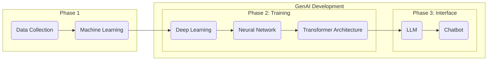
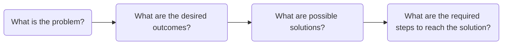
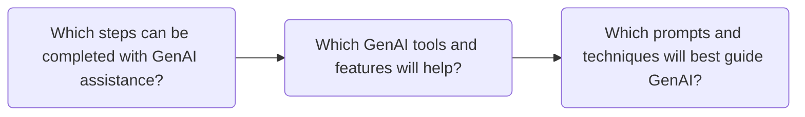

# Copywriting in the Age of AI 
**Generative artificial intelligence (GenAI)** tools have become prevalent across many creative, tech, and knowledge sectors, promising to automate repetitive tasks and increase productivity.[1](#cite-1) Their scope increases day by day, and many industries are rushing to adopt this technology.

BYU-Idaho is navigating the future of human-AI collaboration, preparing students for the future workforce by employing GenAI tools in faculty and student workflows.[2](#cite-2),[3](#cite-3)

The capacity of GenAI tools makes it easy for people to replace their own effort with machine-generated content, but current research demonstrates that this approach has an overall negative impact on quality and performance across many areas.[4](#cite-4),[5](#cite-5),[6](#cite-6) Yet, there is also evidence that human-AI collaboration can complement our capabilities, helping us rather than harming or hindering.[7](#cite-7) 

The conflicting data suggests there is an appropriate middle ground for GenAI, but finding that middle ground is easier said than done. Using the current models requires an apprehensive—*both comprehensive and skeptical*—approach. The apprehensive approach assumes that GenAI tools are going to stay relevant in the future, and that humanity will address and resolve the issues with GenAI, but in the meantime, individuals and organizations must define specific policies and guardrails to protect against overreliance on GenAI.

> #### **Consider This**
> **Key Takeaways:** For copywriters to use GenAI responsibly, they must know its possibilities, risks, and limitations to use it effectively, efficiently, and ethically. Its primary roles in copywriting are to **find**, **challenge**, and **inspect.**
> 
> ##### **What Are the Possibilities, Limitations, and Risks of AI Chatbots?**
> - **Possibilities:** human-AI collaboration and accelerated productivity, learning, creativity, reasoning, analysis, and research.
> - **Limitations:** tokens, context window, limited reasoning, no true understanding, and limited data access.
> - **Risks:** hallucinations, sycophancy, bias, cognitive overreliance, data privacy, copyright, research integrity, and plagiarism.

## Can Artificial Intelligence Keep Its Promises?
There is a group of enthusiastic developers and fans of GenAI who promise this technology will promote political and economic health and a better future for all. Furthermore, they claim individuals will one day have access to a 24/7 AI agent that will enable individuals to enhance personal relationships, career advancement, education, creativity, and fulfillment by enabling them to perform almost any task from their computers.[8](#cite-8)

AI enthusiasts promise what GenAI might be, but those promises do not describe what GenAI currently is. Copywriters in particular are promised that GenAI will augment and automate their tasks, leading to increased productivity and decreased mental drudgery. Some AI enthusiasts believe that copywriters, and other similar roles, are going to be completely replaced by GenAI. Nevertheless, as it stands, GenAI models have limitations and risks that prevent them from completely replacing the work and effort of copywriters.

GenAI enthusiasts may argue that the limitations and risks of AI do not demonstrate that copywriters cannot be replaced, only that GenAI requires human oversight to govern and verify outputs. The need for human oversight means that GenAI is not prepared to fulfill the enthusiasts' promises. Potentially, AI could be incorporated into a Copywriter's workflow to increase productivity, but that is not equivalent to the Copywriter role itself.

The purpose of *The AI Copywriting Manual* is to provide copywriters for BYU-Idaho at University Communications the knowledge and strategies they need to responsibly use GenAI tools effectively, efficiently, and ethically. This section provides an introduction to GenAI, exploring its proposed capabilities weighed against its limitations and risks, its development and training processes, and its appropriate use cases for copywriters.

***
"A computer can never be held accountable; therefore, a computer must never make a management decision."
***
*
– IBM Training Manual, 1979
*

## What Is Artificial Intelligence? 
**Artificial intelligence (AI)** is a popular term that refers to diverse technologies with different functions and purposes. It is generally described as technology that is meant to simulate human-like intelligence. GenAI is a modern adaptation of AI technologies meant to generate human-like creations such as text, code, images, math, videos, or any other form of content.[9](#cite-9) 

While much of the information presented here about AI development, training, and generated content might apply to other forms of content,[10](#cite-10) this manual focuses primarily on the tasks related to copywriting that can be replicated by GenAI, such as the following:

- **Research**
- **Planning and outlining**
- **Brainstorming and drafting**
- **Editing grammar, tone, and style**
- **Logical analysis**
- **Review and quality control**
- **Citation and reference generation**
- **Content creation**

Copywriters might feel intimidated by GenAI tools' capacity to generate vast amounts of text and feel that they will have to use them to keep up and stay relevant. However, copywriters should be aware of GenAI's underlying mechanics, specifically how AI models are developed and trained. The development process exposes key insights about the roles that AI can play in copywriting. 

GenAI is a product of a multi-step process; it wasn't created by a team of programmers meticulously coding every single prompt and output one by one. AI engineers built GenAI through a three-phase process: (1) collecting large amounts of text and training machines to read it, (2) constructing a language processing model and training it to respond, and (3) preparing the model to become an adaptable and helpful assistant.

### Phase One

AI models are trained in a process called **machine learning**, a branch of AI that performs data analysis tasks using mathematics and statistics to understand text.[11](#cite-11) By using a large amount of data, machine learning can start to guess relationships and recognize patterns between things without explicit programming.[12](#cite-12)

This textual data is gathered from across the internet, including web pages, books, repositories, articles, blogs, academic papers, Wikipedia, news archives, public forums, and more.[13](#cite-13)

The collection of textual data also introduces a few risks:

- The collection and training process itself is expensive. It requires large data centers, which have negative impacts on the environments around them.[14](#cite-14)
- There are ethical and legal concerns with data collection that include intellectual property rights and data privacy violations.[15](#cite-15) 
- Textual data is made up of contradicting contexts, styles, and types of text.[16](#cite-16)
- Models will unintentionally learn bias, misinformation, and confidential information from textual data.[17](#cite-17)
- GenAI tools were trained on mixed datasets with contradictory textual data, and with such high volumes of textual data, there is no guarantee that it is perfectly error-free, even when cleaned.[18](#cite-18)

Some of these risks are mitigated by a preprocessing step where data scientists clean the data by filtering out bad data and setting a specific standard for the machine to learn,[19](#cite-19) but it cannot resolve these issues completely. 

Machine learning can understand textual data by converting text into individual units called **tokens** (roughly ¾ of a word, including punctuation and formatting). Machine learning uses the numerical IDs assigned to each word to start building a statistical model of language. For example:

*Humans read:*

 The quick brown fox jumps over the lazy dog.

*AI reads:* 

 ["The", " quick", " brown", " fox", " jumps", " over", " the", " lazy", " dog", "."]
 [976, 4853, 19705, 68347, 65613, 1072, 290, 29082, 6446, 30]

For more complicated words, tokenization breaks them down into smaller parts:

*Humans read:*

 Supercalifragilisticexpialidocious.

*AI reads:*

 ["Super", " cal", " if", " rag", " il", " istic", " exp", " ial", " id", " ocious", "."]
 [17789, 5842, 366, 17764, 311, 6207, 8067, 563, 315, 170661, 13]

It's like learning math to understand English: the idea is that these AI models will be able to take the text, "I like to pet," and predict the next word based on the context. For instance, it might think there is a 50 percent chance the next word is dog.

AI is probabilistic, not deterministic, meaning that it doesn't ever understand the meaning of the word; it just finds the next word based on chance. This introduces one of AI's greatest limitations: **hallucinations:** the generation of entirely fabricated text that sounds plausible and authoritative. Copywriters need to understand that hallucinations are a feature, not a bug. Everything that AI generates is based on how it calculates tokens, but it doesn't recall, remember, research, or verify its outputs.

Some AI models, like Google Gemini, have access to search and retrieval systems, which increases their range of context and decreases the amount of guesswork they do. However, Gemini does not understand the concept of "don't believe everything you read on the internet," so fact-checking is still necessary. There is also no guarantee that it properly understood the source it was pulling from.

Hallucinations are one of the most important reasons why copywriters are still necessary, because they have the ability to verify information that GenAI can't. Copywriters can govern words and syntax, whereas GenAI can only make estimations. This limitation begins with machine learning, but as AI models become more advanced, hallucination only becomes more apparent, not less.

### Phase Two

**Deep learning** is a more advanced version of machine learning. It emerges when the statistical relationships created in machine learning are designed to have a network that resembles neural patterns found in the brain. This process is extremely complicated, but what emerges is a system called a **neural network**, which can start to process complex tasks that require pattern analysis, logical reasoning, and structured outputs.[20](#cite-20)

Deep learning allows machines to train themselves, as they are able to run both a training session and a checking session at the same time. By utilizing the large dataset developed earlier, the machine can train to recognize all the patterns found within and then check its own work. As the machines are trained, the neural networks grow.[21](#cite-21)

Once the neural network is developed, it is paired with multiple other neural networks to create **transformer architecture**, allowing the new model to perform multiple complex tasks simultaneously and begin **natural language processing**. Then the model is able to use the neural networks built to understand language to now create responses to textual inputs, allowing seamless human-AI communication.

Hallucinations are enhanced by transformer architecture because the information being processed has so many more neural networks to pass through. Errors will cascade, as each layer will have its own hallucination.[22](#cite-22)

### Phase Three

**Large language models** are the result of transformer architecture that has been trained for natural language processing. Once an LLM has been created, it is essentially a blank slate, yet it still maintains access to the vast training data.[23](#cite-23)

Converting an LLM into a **chatbot** requires an additional training stage called **fine-tuning**. In this final stage, it is trained to become a conversational system that manages the dialogue flow, personalized responses, and serves as a helpful, adaptable assistant using two strategies: **reinforcement learning from human feedback (RLHF)** and **direct preference optimization (DPO)**:[24](#cite-24)

* **RLHF** is a form of fine-tuning where humans rank different outputs to the same prompt. The goal is to train the LLM with a reward model to tailor its responses to reflect the higher-ranked outputs over the lower-ranked outputs. This fine-tuning strategy is meant to align outputs to be more accurate, helpful, and safe, but these are more like guidelines for the model, not hard-coded limits.[25](#cite-25)
* **DPO** is a newer version of RLHF where the preferences are not found in a separate model, but included directly into the model itself. The model trains itself to produce the kinds of responses people want to see based on the internal token mechanisms. However, this can have unintended consequences because human oversight is significantly decreased.

Both of these fine-tuning methods feed into two specific tendencies of hallucination: **sycophancy** and **overconfidence**:

* **Sycophancy** is the tendency for GenAI to reinforce opinions with flattery, praise, and subservience.[26](#cite-26) Since the human trainers tended to reward when LLMs confirmed their prior convictions and beliefs, the LLMs were trained to prioritize user experience rather than truth verification.
* **Overconfidence** is the tendency for GenAI to prefer its own generated text rather than human-written text.[27](#cite-27) Since LLMs generate text that is "mathematically sound" according to their internal statistical mechanics, generated text is more likely to align with what calculates as good writing. This is a type of GenAI confirmation bias.

While parameters are put in place to help, these behaviors can only be mitigated, but because they are emergent features, and unless the fundamental structure is changed, these problems will never go away. Therefore, copywriters using GenAI to write will undermine their own abilities because GenAI will take their text, adjust it to align with its own preferences, and confidently present it as an improved draft, while praising the original text and ideas at the same time. Since GenAI is outputting hallucinations, it cannot actually verify that its improved draft is objectively better, but it might convince the copywriter anyway.

Another emergent feature is that prolonged use tends to make GenAI outputs worse over time, called **the context window**, which is the finite space that AI models have to process information; it represents the information available to an AI model at a given time. The tokens that GenAI processes take up space, so it can only calculate a certain number of tokens at a time. Moreover, each token carries statistical weight, so the more information it has to process, the more it will struggle to produce helpful or even relevant responses.

Think of it like a conversation between you and a friend: you don't need to remember every time your friend says the word "the" because you understand the semantic meaning of the conversation. You don't have to break each word down and create a statistical representation in your mind, but if your friend were talking to AI instead of you, then it would need to make those calculations because it doesn't understand what your friend is saying. GenAI can't listen, even if it says it can, because it doesn't know what words really matter. Deep learning and natural language processing are there to convince the user that the AI is human-like. 

Despite the flaws, after the LLM has been trained to interact with users, it is deployed as a GenAI chatbot interface. These tools inherit all of the possibilities, limitations, and risks that have been discussed so far. This completes the process of developing GenAI tools.

### ***GenAI Step-By-Step***

## Using Artificial Intelligence
GenAI chatbots like ChatGPT, Google Gemini, or Microsoft Copilot are tools that BYU-Idaho copywriters will have access to through their official `@byui.edu` accounts. Using GenAI tools effectively requires a significant time investment that challenges the supposed productivity GenAI is promised to give users. Consider these two scenarios:

* **Slow but usable:** A copywriter is writing content for a website's landing page. They want to make sure that the output is stylistic, helpful, readable, and factual. So the copywriter spends time tailoring a prompt with a specific persona and the necessary context, such as the style guide, the goal of the website, and the format. They try out a few different prompts, adjusting each time for an improved output, while also managing the limitations of the context window and making sure the responses aren't factually incorrect. After the copywriter creates the perfect prompt, they edit the output, making their own adjustments, ensuring it sounds human-like. By the time they are finished, the copywriter questions whether this was an efficient and effective use of GenAI, given the time and effort required for oversight. 

* **Fast but unusable:** A copywriter is writing a blog post. They produce a quick prompt asking GenAI to write a blog about the subject without providing information or context. They get three to five different blogs. Then they ask GenAI to find the best version of the blog. Once selected, they ask AI to edit and revise for one final version. After the copywriter submits the blog, they realize that they took about 30 minutes to complete a task that would take at least several hours on their own. However, they didn't check themselves for hallucinations, misinformation, and poor-quality copy, potentially submitting something of very low quality. Still, it does at least guarantee the appearance of productivity.

Copywriters likely fall somewhere in between the two scenarios, but these demonstrate a general reality about using these tools: GenAI tools are only as effective and efficient as the copywriter using them. 

* The first copywriter embraced GenAI as a helpful assistant that they had to lead to success, but undermined their own ability to actually write the content themselves, and instead tailored a machine's output. 

* The second copywriter embraced GenAI as a content generator that requires only someone to prompt, but no one to oversee. 

Yet, the approach was the same; they believed that GenAI should perform the majority of the tasks in their role, with the only difference being the level of oversight they provided. Yes, GenAI has the ability to write all of the text for copywriters, but *human governance is in every word*, not just in prompting the machine. No, it is not about using AI to complete every task, but finding which tasks GenAI can complete without compromising human integrity, and remaining efficient, effective, and ethical.

*The AI Copywriting Manual* encourages copywriters to take responsibility for their tasks, adopting an apprehensive approach where GenAI is used in specific roles with high oversight. The roles this manual proposes are **find**, **challenge**, and **inspect.**

### Find
GenAI's hallucinations prevent it from becoming a truly effective research, summarizing, and note-taking tool. There is never a guarantee that it has generated an accurate response, even if its reasoning and syntax appear authoritative. Copywriters should not leverage GenAI as a replacement for traditional research methods and tools, but by taking advantage of the integrated search systems, they can efficiently augment the search for relevant sources.  

By using GenAI as a search tool for research materials, copywriters are able to quickly find sources that relate directly at a greater rate. It will still be up to them to verify the appropriateness, accuracy, and authority of each source. Tools like Google's Gemini, which are connected to systems like Google Search and Google Scholar, could easily be introduced into the copywriter's research strategy.

*Example: A copywriter is researching for a website but wants to find sources faster. They use Google Gemini's connections to Google Search to find reliable sources by using it as an advanced search engine. Instead of breaking down the question into topics and keywords, GenAI is able to use its natural language processing to break down the sentence and find web pages that address similar subjects.

### Challenge
Copywriters can assign GenAI tools user personas to test stress points and friction within their copy. It can offer various perspectives to challenge the copywriter's assumptions, offering a fast-paced review with various audiences. While not a total replacement, during the drafting and revising period, this feature can be used to sharpen thinking, especially when used with skepticism.

The principle behind Challenge is using GenAI to sharpen the copywriter's work by evaluating underlying assumptions, causal connections, logical thinking, and rhetorical strategy. GenAI shouldn't suggest methods to overcome these gaps, but it may help the copywriter see an issue they weren't aware of. The goal with Challenge is to use GenAI as a tool that strengthens copy through rigorous testing, not automatic rewriting. By assigning testing and analytical personas, the copywriter will be able to better reason through, defend, and explain decisions that they made.

* Example: A copywriter isn't sure about the blog post they are writing, so they give AI a role, asking it to play the part of the audience they are writing for. The copywriter asks it to look for potential areas where the information is incomplete or confusing. The copywriter then compares the evaluation to the text and decides what changes they can make and what they should keep.

### Inspect
GenAI is able to process large amounts of text almost instantaneously. Through that process, it is able to analyze, evaluate, and critique texts' weaknesses and strengths. The issue is that even with context and prompt engineering, GenAI will still make mistakes. GenAI should not be used as the only editing tool, and tone, style, and grammar should always be reviewed by humans, but it can quickly evaluate large amounts of text to identify large-scale patterns and structure.

GenAI should be given specific parameters before evaluating text, such as persona, style guidelines, and objectives. When going through the final audit, the copywriter can evaluate the AI reviews one at a time and still use their own judgment to determine what is best.

* Example: The copywriter just finished editing a page, but wants one last quick overview just in case there was something that they missed. They ask the AI to evaluate the text for any mistakes, but not to edit or change anything. The AI finds one sentence that repeats the word *the*, which they accidentally skimmed over. The copywriter reads over the page one last time with the AI reviews in mind and finds all the easy-to-miss errors.

These roles will be elaborated on in later sections of this manual. Before elaborating on the strategies, copywriters should understand the basics of general AI features and the specifics of the tools provided by BYU-Idaho.

# The Basic Features of AI
Using GenAI might seem simple at first, and for the most part, it is meant to be. A strong user interface and natural language processing make casual use of it seamless. For beginners, it might seem like a conversational version of Google, but instead of links, it is a chat interface.

For copywriters who use GenAI, relying on the chat without employing any other features will inhibit their ability to use these tools effectively, efficiently, and ethically. Moreover, one strategy that works for one AI tool might work differently for another. It is not enough to know the tools generally; copywriters must understand each feature, what its limitations are, how it functions, and how they can use it to enhance their copywriting.

## BYU-Idaho's AI Toolkit for Copywriters
Generally, the GenAI models copywriters use will share more similarities than differences.

The tool used for a given task may be determined by personal preference, specific features, native workspace, and tool capabilities. However, beyond specific features, the fundamental difference between AI models lies in where they are deployed, not in training, intelligence, or features.

It is impossible to say whether one conglomerate's training data is better than another's, so differentiating based on data collection and training is arbitrary, even if it is technically true. Since hallucination is inherent in AI, the dataset has more influence on voice and pattern recognition rather than knowledge and capability.

BYU-Idaho provides access to three AI tools: ChatGPT Edu, Google Gemini, and Microsoft Copilot 365. Find more details for the specific tools, features, and benefits of each on their respective pages, found below, including how to access them with a university-provided account. 

| Chatbot | Developer | Accessibility | Site | Deployment | How-To-Use |
|:--:|:--:|:--|:--|:--|:--|
| ChatGPT Edu | OpenAI | Requires CES Edu license. Must use a ChatGPT BYU-Idaho institutional account. | [Access ChatGPT](https://chatgpt.com/)| General-purpose AI workspace that can use uploaded materials and connected services, including Google Workspace, Microsoft, and more. | [ChatGPT Features](tool-guide/how-to-use-chatgpt.md)
| Google Gemini | Google AI | Must use a Gemini BYU-Idaho institutional account. | [Access Google Gemini](https://gemini.google.com/app)| Google's ecosystem, including Google Workspace and Search. | [Gemini Features](tool-guide/how-to-use-google-gemini.md)
| Microsoft Copilot 365 | Microsoft AI | Must use a Microsoft BYU-Idaho institutional account. | [Access Microsoft Copilot](https://copilot.microsoft.com/)| Microsoft's ecosystem, including Word, Outlook, Teams, and other Microsoft 365 applications. | [Copilot Features](tool-guide/how-to-use-microsoft-copilot.md)

Becoming familiar with each of the tools is encouraged, but ultimately the tool you spend the most time with depends on which one:

- Integrates into the workspace (Google Workspace, Microsoft 365, etc.)
- Provides the most useful features for the needs:
- Context window size, model capability, external application, etc...
- Supports the process of Find, Challenge, and Inspect

## Understanding Common GenAI Features

### Conversational Interface
The chat box is the first thing users see when they open up a GenAI tool. This feature acts as the main interface for exchanging messages with the AI. It lets users use natural language to interact with machines. 

The conversation exists inside a context window, keeping earlier messages together and allowing for follow-up prompts and questions. These conversations are saved and stored in the sidebar and memory for future use and access.

Controls let users edit their prompts, stop or regenerate outputs, and save, delete, and export chats.

### Response Editing and Navigation
Once a prompt is submitted, users are able to edit it, retroactively re-prompting the GenAI tool. Users have control over the flow of chat conversation, can improve and experiment with prompts, and reduce the context the AI has to process.

Users can also create duplicate chat conversations, making multiple versions, allowing them to save old outputs, test different answers with different models, and use different tools with the same context.

### Storage, Memory, and Personalization
The conversational interface is connected to a workspace that stores previous chats, customized tools, generated artifacts such as images and documents, continuous projects, and more. 

These features are found directly in the sidebar or in project folders and libraries. Users are able to access, reuse, edit, or delete these materials.

In the GenAI settings, users are able to access chat history and manage GenAI's memory and instructions. 

Memory is a passive tool that GenAI uses to help personalize responses. While not all chat history is treated as context for conversation, GenAI tools have a memory feature, a collection of data GenAI uses to create a user persona for future chats. This can be managed by deleting chat histories or directly disabling the memory feature.

Instructions allow users to directly input rules and context that GenAI will use to personalize each response. This could be personal information or output recommendations like "prefers short responses" or "write in bullet points."

When using school accounts, personal data is not used to train AI models, and many memory features are disabled. 

All of these features make up the information GenAI stores beyond its own database.

### Input and Context Controls
In the chat feature, users can include more than just text; they can also supply materials and designate what the GenAI should work with. This material becomes context in the conversation, allowing GenAI to anchor responses based on the provided material. 

- **Documents & Files:** PDFs, Word docs, CSVs, Excel files, & presentations for summarization or data analysis.
  
- **Images & Visuals:** Photos, charts, diagrams, and screenshots for object identification, math solving, or troubleshooting.
  
- **Audio & Voice:** Voice prompts, meeting recordings, and audio files for transcription and summarization.
  
- **Video:** Short clips and video files for scene description, object tracking, and content summaries.
  
- **Code Files:** Scripts and programming files (e.g., .py, .js, .html) for debugging, review, and optimization.
  
- **Connected Workspaces:** Direct integrations with cloud drives (like Google Workspace) to pull context without manual uploads.
  
- **Search and Source Grounding:** Web search tools that ground outputs in sources directly pulled from search engines (like Google Search).

Some of the content users upload will be saved to GenAI's storage features.

### Modes and Models
GenAI tools are not meant to be one-size-fits-all. Different tasks require different reasoning capabilities, tokenization cost, and speed. 

- **Models:** Within a GenAI tool, there are different models.

 For instance, ChatGPT Edu has multiple models that can functionally perform the same tasks, but do so at different rates. 

- **Modes:** Within a GenAI model, there are different modes.

For instance, ChatGPT Edu has both a chat mode and a work mode. The chat mode accesses two models that both prioritize instant answers. The work mode accesses four models with dials that allow the user to control their reasoning power.

Users who take advantage of GenAI modes and models can decide the token cost they pay and whether they want instant answers or in-depth reasoning.

### Reusable Assistants
GenAI tools can create, store, and maintain reusable assistants for recurring roles and tasks. Some GenAI tools come with pre-created assistants or tools to help users create their own customized assistants. 

Think of these assistants as highly tailored and reusable prompts for GenAI that implement the following:

- **Role:** How it is supposed to act, such as an editor, researcher, or more.
- **Instructions:** What it is supposed to do. Tasks that it should complete and how it should and shouldn't help the user. Rules governing tone, process, format, limitations, and decision-making.
- **Context:** Reference files, style guides, brand standards, product information, or other materials.
- **Tools:** Web search, file analysis, data analysis, image generation, or external applications.
- **Format:** Expectations for how the assistant should organize its responses.

### Automation and Background Work
Automation allows GenAI to work in the background without moment-to-moment user interference. The GenAI system may run processes on a schedule, respond to an event, monitor information, or complete multiple steps in sequence.

Normally, the user has to input a prompt to get a result, but with automation, the system continues operating after the initial instruction, allowing the user to work elsewhere.

### Sharing and Collaboration
Sharing and collaboration features allow users to distribute conversations, documents, prompts, assistants, generated artifacts, or workspaces to other people. These features transform AI from an individual tool into a team environment.

Sharing may involve:

- A link to a conversation.
- A copied response or generated artifact.
- A shared document or project.
- A reusable assistant made available to a team.
- Comments, annotations, or suggested revisions.
- Collaborative editing.
- Shared files and reference materials.
- Team libraries or organizational knowledge bases.
- Handoffs between people and AI tools.

### Generated Artifacts
Multimodal AI was trained to generate many different kinds of media artifacts. Depending on the model, it can range from small-scale replies to large multi-asset applications. It is important to recognize that these generated artifacts all stem from the same architecture as LLMs, but for different tools. Many of these artifacts are also made accessible through the deployment stage.

Below is a list containing many common artifacts across GenAI tools, and while not all-encompassing, it represents the range of generated content. A general rule of thumb is that if it's something that GenAI can upload, then it can probably create something like it.

#### Chat Response
An answer to a prompt delivered in the chat interface. This can range from a simple, single-sentence response to a full-fledged article. Its responses will be conversational and friendly, usually generating first-person responses, unless it is instructed not to.

#### Cited Answer
A response that includes links, references, quotations, or source attributions meant to support its claims. Generally, GenAI responds with a cited answer when it is specifically performing web searches.

#### Editable Page
A persistent workspace for developing content beside or within the AI conversation. Unlike a normal chat response, an editable page is intended for repeated revision. An editable page might have content it generated entirely by itself, written by the user, or a combination of both.

#### Word-Processing Document
A formally structured document designed for reading, editing, printing, or sharing. It may contain headings, paragraphs, footnotes, tables, images, page breaks, and other document elements. Word-processing documents may come in any file type and be integrated directly into a workspace.

#### Data Table
A structured arrangement of information in rows and columns, usually intended for reading, comparison, filtering, or further analysis. A data table may come in file formats, textual tables, or even spreadsheets. It may be populated by data it generated, the user provided, or a combination of both.

#### Diagram/Structured Visual
A visual representation of concepts, processes, hierarchies, relationships, systems, or sequences, and potentially a representation of numerical data that helps readers identify comparisons, trends, distributions, or relationships.

Visual artifacts may respond to user input or allow exploration rather than simply displaying fixed information.

#### Generated Image
A visual image created or modified from a text description, reference image, or editing instruction.

#### Generated Music
Music created or modified from a text description, reference image, or editing instruction.

#### Code Artifact
A block or file of computer code generated, modified, explained, or analyzed by AI. Code artifacts can include scripts, web components, templates, formulas, automation, and configuration files.

#### Website/Lightweight App
A collection of connected pages or an interactive digital experience that performs a specific communication or functional purpose. It may be a combination of any of the previous features above.

#### Research Report
A structured document that gathers, evaluates, synthesizes, and presents information from multiple sources. It may be a combination of any of the previous features above.

# Personal Accountability & AI
Personal accountability is crucial in the age of GenAI. This is revolutionary technology with unforeseen consequences, both positive and negative. Copywriters should approach this technology skeptically, understanding that this tool is meant to resemble human-like intelligence but is incapable of replacing it. Using GenAI unethically can have serious consequences at institutional, audience, and individual levels. 

 As GenAI increases in capability, copywriters must be aware of the increasing risk of mishandling private information, intellectual property, and research.  *The AI Copywriting Manual* provides practical guidelines for GenAI usage. By adhering to these guidelines, copywriters will be able to establish personal accountability as they use GenAI and create trust among themselves, their audience, and BYU-Idaho.

> #### **Consider This**
> **Key Takeaways:** For copywriters to use GenAI responsibly, they must use their authorized BYU-Idaho account, know how to safeguard private data, understand how plagiarism and copyright infringement relate to GenAI, and preserve research integrity.
> 
> ##### **How to Prevent the Ethical Misuse of GenAI**
> - **Data privacy:** BYU-Idaho provides official accounts that offer guaranteed data protections for three tools: ChatGPT EDU, Google Gemini, and Microsoft Copilot 365. They also have data classifications that demonstrate appropriate use cases.
> - **Plagiarism and copyright:** Copywriters must understand that copyright infringement and plagiarism are two different things; inappropriate GenAI use can lead to both.
> - **Research integrity:** GenAI hallucinations can lead to research misconduct, including fabrication and falsification. Copywriters should not use GenAI to summarize, explain, or analyze professional research.

## Data Privacy & AI

Many GenAI tools treat the text in the chat interface as training data for future models. The price for using these tools for free is any data that users might be sharing. This includes names, phone numbers, emails, and any private information that users share. These models may not deliberately store this data in their storage to share with others later; nevertheless, this information becomes a part of the model and creates a security risk if the information shared was sensitive or private. Giving GenAI private information freely, without data protection, acts as consent for its internal systems to use that data to train.[28](#cite-28) 
BYU-Idaho is committed to safeguarding data privacy. The official `@byui.edu` account gives students and faculty access to authorized AI tools, each approved with a specific data classification level: *public*, *internal*, *confidential*, and *restricted*.[29](#cite-29) Copywriters who are accessing the authorized tools with their BYU-Idaho accounts are safe to share data across the public, internal, and confidential classes. 

### Data Privacy Practices for Copywriters
*Don't Feed University Data or Private Information to Unapproved AI Tools*

Personally Identifiable Information and confidential or restricted university information should not be used with unapproved AI tools without approval. These tools train from chats, and they may accidentally expose private data to the public.

*Only Use University-Approved Tools*

 When using GenAI for work, use the university-approved tools (detailed below). BYU-Idaho has licenses and contracts in place that provide privacy and security to users. One of the key benefits is that the account can protect intellectual property because it limits AI from training on conversation data.

*Always Self-Check*

The Church Education System (CES) provides six principles for protecting data—Purpose Limitation, Data Minimization, Lawfulness, Transparency, Protection, and Duration—which are meant to encourage members to self-check their work.[30](#cite-30) If you are working with confidential information, you can use this [self-check guide](https://cesprivacy.org/00000193-1d0f-d940-adf7-dfcfa2e20001/cpc-global-privacy-principles-self-check-pdf) to ensure your work is safe.

*Ask For Help If You Are Not Sure*
  
When in doubt, leave it out. If you aren't sure whether something is appropriate or not, contact your supervisor, the AI committee, or [IT](https://td.byui.edu/TDClient/79/ITHelpCenter/Requests/Service/905/Request-an-IT-Project-Software-or-AI-Tool/Request) and ask for help.

> ##### Accidental Data Exposure
> If you accidentally input unauthorized data into an AI tool, tell your supervisor and contact [IT](https://td.byui.edu/TDClient/79/ITHelpCenter/Requests/Service/905/Request-an-IT-Project-Software-or-AI-Tool/Request) immediately.

### Data Classifications

* **Public:** Information approved for public release that should be protected against loss or change. 
* **Internal:** Moderately sensitive information which is generally accessible within the university to those with a legitimate university purpose and is not intended for entities or persons outside the university.
* **Confidential:** Highly sensitive information where an inappropriate loss, change, or disclosure could have substantial consequences to individuals and the university.
* **Restricted:** Information of the highest sensitivity where inappropriate loss, changes, or disclosure could have grave consequences to the university or its students.

| Public | Internal | Confidential | Restricted |
|:--:|:--:|:--:|:--:|
| `News` `Maps` `Events` `Public Websites` `Catalogs` | `Budgets` `Policies` `Procedures` `Survey Data` `Meeting Notes` `Course Content` `Authenticated Websites` | `Names` `Photos` `Grades` `Usernames` `I-Numbers` `Addresses` `Contact Info` `Transcripts` `Authenticated Websites` | `SSNs` `Bank Info` `Passwords` `Tax Records` `Legal Files` `Medical Records` `Credit Card Info` |

### Authorized Tools
The AI tools approved by BYU-Idaho are *ChatGPT*, *Copilot*, and *Gemini*. These three are standard GenAI tools.[31](#cite-31) The key differences are where they live, what they can see, and how they handle data:

#### OpenAI ChatGPT Edu
It's excellent for writing, editing, brainstorming, and building Custom GPTs. It requires a CES Edu license, which is available through student accounts, but must be accessed directly.

  * Public:✅
  * Internal:✅
  * Confidential:✅
  * Restricted:❗

Find out more about ChatGPT here: [Features of ChatGPT](#cite-gpt)

#### Google Gemini
It integrates with Google Workspace and Google Search. Copywriters must use their BYU-Idaho Google account.

  * Public:✅
  * Internal:✅
  * Confidential:✅
  * Restricted:❗

Find out more about Google Gemini here: [Features of Google Gemini](#cite-gem)
  
#### Microsoft Copilot
It can see emails, files, meetings, and calendar, making it powerful for work tasks tied to the M365 environment. Copywriters must use their BYU-Idaho Microsoft account.

  * Public:✅
  * Internal:✅
  * Confidential:✅
  * Restricted:❗

Find out more about Microsoft Copilot here: [Features of Microsoft Copilot](#cite-msoft)

## Copyright & AI
Copyright law is the legal right that gives creators control over their original works of authorship, stopping others from plagiarizing and using those works without explicit permission.[32](#cite-32) Under US law, everyone is a copyright owner, inasmuch as they have produced an original work.[33](#cite-33) Intellectual property, which is an intangible, often digital, artifact that communicates ideas originating from the human mind, is obtained through copyright laws.[34](#cite-34) (Artifacts refer to materials created to carry and communicate ideas and information.)[35](#cite-35) A copywriter's copy falls under copyright laws. When they write for a company, like BYU-Idaho, the company automatically owns it if the work is under "work made for hire."[36](#cite-36) Individual copywriters don't own their copy because BYU-Idaho is paying them for the rights to ownership.

Even with the institutional data privacy protections put in place, the copyright and plagiarism issues of GenAI authorship remain. When the main author of written work is GenAI, even if a series of thoughtful prompts produced it, the question remains: *Who owns this?*

According to the US Copyright Office, human authorship facilitates ownership of intellectual property, but when authorship originates with GenAI instead, ownership rights are lost.[37](#cite-37),[38](#cite-38) GenAI interrupts the traditional copyright workflow because it challenges the definition of author and introduces complications with plagiarism, authorship, and ownership. Even well-constructed, effortful prompts don't translate to ownership of generated artifacts because the machine, not the human, created the expressive work.[39](#cite-39) GenAI-created artifacts belong to the public domain and do not count as intellectual property for individuals or organizations. 

Deceptively hiding GenAI involvement or using GenAI to create an artifact while claiming it as original work is plagiarism, which violates BYU-Idaho's Honor Code.[40](#cite-40), 
[41](#cite-41) These kinds of artifacts cannot be copyrighted because they have no human authorship.[42](#cite-42) In extreme cases, using AI-generated artifacts may create copyright infringement by reproducing a copyrighted work without attribution, which goes from being an internal compliance issue to being a violation of copyright law.[43](#cite-43)

The principle for protecting intellectual property is avoiding GenAI authorship. In general, if GenAI creates text and then it is heavily edited, revised, or rearranged by humans, copyright will only protect the human-authored portion of the work.[44](#cite-44) To enforce this practice, if a company tries to register a major asset with the copyright office, it must disclose any GenAI involvement. This creates a gray area where certain parts of an artifact may count as intellectual property and other parts may be public domain.

The *find*, *challenge*, and *inspect* methods comply with university and legal standards for using GenAI, because they don't place GenAI in a role of authorship in any form.

### Copyright Infringement vs. Plagiarism
Though GenAI complicates both plagiarism and copyright, they are not the same thing. Plagiarism is an issue of intellectual honesty. Copyright is an issue of intellectual property. The following case study demonstrates how a copywriter using GenAI may plagiarize, infringe copyright law, or do both, and then how they can avoid it entirely.

*Important Note:* When referring to plagiarism, the term "ideas" doesn't refer to the concept or notion of something, but to explanations, hypotheses, theories, and original thought.[45](#cite-45) Under BYU-Idaho's Honor Code, stealing AI-generated ideas is plagiarism, but the practice of using GenAI to brainstorm only becomes a legal violation if it starts to perform the cognitive labor of developing that idea into an artifact.[46](#cite-46)

**Plagiarism:** A copywriter uses Google Gemini to generate a paragraph for an article that they are writing. They use prompt-engineering techniques, including samples of their own writing and sources, to construct a strong prompt. Once the paragraph is generated, the copywriter edits sentences and double-checks the facts. They include this paragraph in their blog without citing GenAI, incidentally taking credit for ideas in the paragraph generated by GenAI. This copywriter has committed plagiarism by presenting the reasoning capabilities of GenAI as their own without citations. However, since the paragraph isn't using intellectual property without permission, it isn't a copyright infringement.

**Copyright Infringement:** The same copywriter uses GenAI to generate another paragraph, using their sources as context. The GenAI tool restates the same ideas from the article almost verbatim, but it also generates a citation. The copywriter cites both the article and the GenAI tool in their works-cited page so they don't plagiarize. The copywriter essentially copied the entire work without permission, which may infringe the original author's rights over their artifact under copyright law. 

**Plagiarism & Copyright Infringement:** The same copywriter is working on a different blog. In this instance, they use a prompt asking GenAI to rephrase an article for a BYU-Idaho student audience. The GenAI tool restates the article, even directly copying some sentences word-for-word. The copywriter then submits the completed article to another chat and asks it to make the article sound more like them, and then submits that as the final version of their work without any citations. The copywriter plagiarizes by presenting the ideas of the original author and rewrites of the GenAI tool as their own, and also violates copyright by copying another author's artifact without permission.

**Avoiding Both:** A different copywriter wants to write a blog for the BYU-Idaho student audience about copyright, plagiarism, and GenAI. 

* **Find:** They start by using a GenAI web search feature to find sources related to the subjects. It finds sources and suggests ways of using them in the article. The copywriter reads the articles, checking for authority and relevancy, and takes careful notes on what information they want to use and keeps track of citations. 
* **Challenge:** Once they finish writing the first draft, they want to use GenAI to evaluate how the intended audience might react to the page. They give a GenAI tool a generic BYU-Idaho student persona and ask it to react to the text, but forbid it from editing or rewriting parts of the text. The tool points out areas where there might be friction, and the copywriter adjusts those areas without GenAI assistance.
* **Inspect:** After editing, the copywriter wants to do one last check to make sure that they are compliant with the BYU-Idaho writing style guide. They upload the article and ask GenAI to point out any mistakes they might have missed. Once the GenAI points out the issues, the copywriter double-checks the style guide and then manually edits those points.

Since the copywriter properly attributed each source and authored the blog with minimal GenAI assistance, they did not plagiarize any work or infringe another author's rights. The university is able to register the blog with the copyright office for protection without any issues of ownership or authorship.

### Transparency & Disclosure
The risks and limitations of GenAI as a tool, along with its ethical and legal problems, mean that copywriters should assume that using AI tools to directly influence the text is inappropriate unless it is otherwise stated. Organization leadership must approve when it's acceptable for a copywriter to use GenAI, but in general ***GenAI should never be used as an author or coauthor.***[47](#cite-47) In the case that permission is warranted or granted to use GenAI, copywriters are fully accountable for fully disclosing the use of AI in their work in a succinct but comprehensive statement.[48](#cite-48)

A transparent disclosure statement should include the following:

1. The specific AI model used (*CES ChatGPT Edu GPT-5.5*, or institutional *Google Gemini Edu 3.6* )
2. The author's purpose for using AI (grammar-checker, review, brainstorm, edit, research, etc.)
3. The portions of the work AI affected by degree (suggested a better introduction, cleaned passive voice misuse, checked for comma splices, etc.)
4. The methods and strategies used to prompt the AI (prompt engineering techniques, steps for data protection) 
5. The level of human oversight and steps taken to ensure quality (independently verified sources, approved and manually applied all edits)

A disclosure statement does not need to be in that order, but it does need to include each component. The detail of the disclosure statement must reflect the degree to which AI was used in a work.

A simple disclosure statement might look like: 

> The author of this work used the AI model *Google Gemini Edu 3.6* to brainstorm subjects for a copywriting manual. Their brainstorming process limited the AI model to producing single-sentence bullet points without elaborating on the ideas. The author used some of the ideas to independently create an outline without the use of AI.

For the first example, the line between brainstorming and drafting is thin, so the statement is provided to point out where the copywriter fell on that line. This keeps the author accountable and honest. Ideas can't be copyrighted, so this statement protects ownership. With proper citation, the artifact also doesn't fall under plagiarism.

A more developed disclosure statement might look like:

> The author of this work used the AI model *CES ChatGPT Edu GPT-5.5* and *Microsoft 365 Copilot Basic* to research topics and find sources for several subjects in a copywriting manual. The author used custom agents to search for scholarly sources and brainstorm research questions. The AI was not used to replace reading, verifying, or citing sources. The author independently accessed these sources and integrated proper research methods to the best of their ability without the use of AI.

For the second example, the GenAI didn't author anything, so the disclosure statement is provided to establish trust between the author and the audience. These kinds of statements may become increasingly warranted as audiences grow skeptical of GenAI use.

Copywriters should ask their supervisors and project managers about when to include a GenAI disclosure statement. Ultimately, it is up to the organization whether it will provide a statement or not; regardless, copywriters should always track GenAI usage in their work.

### AI Citation Style Guide
Since AI doesn't have clear authorship standards, the standards for citing have been adjusted to accommodate these tools. The impermanence of AI chats makes citations less helpful than standard citations. Each citation should be paired with a disclosure statement. Below is a guide to citing AI in common styles. BYU-Idaho copywriters will use Chicago, but APA and MLA are provided for exceptions.[49](#cite-49)

* [Chicago Style](#cite-cs)
* [MLA Style](#cite-mla)
* [APA Style](#cite-apa)

#####  [Chicago Style](#ref-cs)[50](#cite-50)
According to Chicago Style, AI tools do not need to be credited as a source, but authors should disclose AI usage with a brief statement. However, it does provide instructions for creating a formal citation if desired.

1. **Author:** The author will be labeled as the company that created the model, such as *Microsoft* for *Copilot*, *OpenAI* for *ChatGPT*, etc...
   * If context for that chat was provided in the text, include a brief statement before the author stating "Text generated by...".
   * If context for the chat wasn't provided, include a statement, abbreviating the prompt, such as Copilot, response to "find sources for citing AI"
2. **Name of AI Tool:** The brand name of the AI tool, such as *ChatGPT, Copilot, Gemini, etc.* 
3. **Version of AI Tool:** The exact model of the AI tool used, such as *CES ChatGPT Edu GPT-5.5*
4. **Publisher:** The name of the company that made the tool, such as *Microsoft, Google, OpenAI, etc.*
5. **Date:** The date the content was generated.
6. **Location:** Give the URL for the AI tool, such as *https://gemini.google.com/*

**Format:** Author, Title, Publisher, Date, URL for the tool.   

**Example**

* Context provided in text:

Text generated by ChatGPT, OpenAI, July 4, 2026, https://chatgpt.com/

* No context provided in text:

ChatGPT, response to "Where do I find fireworks," OpenAI, July 4, 2026, https://chatgpt.com/

#####  [MLA Style](#ref-mla)[51](#cite-51)
1. **Title of Source:** In MLA, AI-generated content is considered a source with *no author*.
Instead of providing an author,  create a title for the source, such as a brief, descriptive phrase detailing what was created by AI or the prompt. Use this as the title for in-text citations.
2. **Name of AI Tool:** The brand name of the AI tool, such as *ChatGPT, Copilot, Gemini, etc.* 
3. **Version of AI Tool:** The exact model of the AI tool used, such as *CES ChatGPT Edu GPT-5.5*
4. **Publisher:** The name of the company that made the tool, such as *Microsoft, Google, OpenAI, etc.*
5. **Date:** The date the content was generated.
6. **Location:** Give the URL for the AI tool, such as *https://gemini.google.com/*

**Format:** "Title of Source" prompts. *Name of AI Tool*, Version of AI Tool, Company, Date, URL.

**Example:** "Analyze this text from the perspective of a student" prompt. *Gemini*, Gemini 3.6 Thinking, Google, March 3, 2026, https://gemini.google.com/.

#####  [APA Style](#ref-apa)[52](#cite-52)
1. **Author:** The author will be labeled as the company that created the model, such as *Microsoft* for *Copilot*, *OpenAI* for *ChatGPT*, etc...
2. **Date:** The date the content was generated.
3. **Name of AI Tool:** The brand name of the AI tool, such as *ChatGPT, Copilot, Gemini, etc.*
4. **Version of AI Tool:** The exact model of the AI tool used, such as *CES ChatGPT Edu GPT-5.5*
5. **AI Designation:** Include `[Large language model]` after the version.
6. **Location:** Give the URL for the AI tool, such as *https://gemini.google.com/*

**Format:**

Author. (Date). *Name of AI Tool* (Version of AI Tool) [Large language model]. URL 

**Example:**

Microsoft. (2026). *Copilot* (ChatGPT 5.5 Basic) [Large language model]. https://copilot.microsoft.com/.

> ##### Using AI as a Source
> GenAI tools should not be cited or used as a primary or a secondary source for research. Doing so is a form of research misconduct. The purpose of citing GenAI is to establish authorship of generated artifacts, avoid charges of plagiarism, and protect intellectual property.
>
> The safest way to protect authorship and ownership is to remove GenAI from the authorship role entirely, but if copywriters are going to use it, then they must be clear about it.

## Research Integrity & AI
The data privacy and intellectual property issues surrounding AI deal with properly managing the tool externally. They arise despite the mechanics and safety features of GenAI because they are unintentional but not easily resolved. It involves understanding the boundaries of appropriate GenAI use. On the other hand, the issues with GenAI and research integrity arise because of its mechanics and features.

Research integrity is an important part of copywriting. The content copywriters create is used to influence, inform, and persuade people's decisions. They have a responsibility to be unbiased and well-informed. For some projects, that means copywriters need to do their research.

One of the things GenAI is promised to do is to hasten the research process, and that on its own is not a bad thing, but it depends on how that research is being performed. If GenAI is being used to allow researchers to find relevant, peer-reviewed, authentic articles at a faster rate, then that is fine. However, if GenAI is being used to summarize, compartmentalize, and even experiment with sources, then there are serious risks involved.

### AI Hallucination as Research Misconduct
GenAI is built on unreliable mechanics, which compromise its ability to summarize and understand articles. AI Hallucination means that all research performed by LLMs must at least be intensely scrutinized through human oversight.[53](#cite-53),[54](#cite-54)

The tokenization process means that when GenAI is analyzing a source and finding results, conclusions, or data, it is algorithmically and arbitrarily stringing together an output that is meant to appear authoritative and accurate, but has no realistic way to verify it. Beyond plagiarism, which has been discussed above, it breaches into other areas of research misconduct: fabrication and falsification.[55](#cite-55),[56](#cite-56),[57](#cite-57)

GenAI commits other forms of research misconduct beyond plagiarism, fabrication, and falsification. Instead of only claiming credit for original work, it will also hallucinate original information and give credit to fabricated sources. Since GenAI is trained to sound authoritative, it reflects the appearance of scholarship and research integrity by backing claims up with sources. The problem is that its claims and sources may not match, or be completely made up.

GenAI doesn't cognitively research. Whatever source it is using is transformed into tokens so that the underlying LLM structure can generate text. It uses probability to calculate how a summary might look, but repeatedly makes mistakes because it doesn't recognize the tokens as facts, only data points. This system lays the foundation for two risks: fabrication and falsification.

**Fabrication:** Making up sources, information, or results and using them to support an artifact as if they were real.[58](#cite-58) For instance:

* Creating false information and citing it from an official source. 
* Citing a source that does not exist. 
* Creating fake data, results, or information to support conclusions. 

GenAI fabricates information when it hallucinates sources, information, and results that don't exist.

**Falsification:** Altering existing information from a real source to support a claim that it would not otherwise support.[59](#cite-59) For instance:

* Taking words, claims, or information from a source out of context.
* Citing a source in a reference section when it does not support the artifact, especially if it wasn't explicitly referenced.
* Claiming that results, information, or words come from a source when the source does not claim those results.

GenAI falsifies information when it hallucinates altered information from a real source and presents it as factual and accurate. It is important to remember that when GenAI generates factual or useful information, it does so incidentally, not intentionally. Using GenAI as a source risks research misconduct because most things it hallucinates fall under plagiarism, fabrication, and falsification.

### Limits of AI in Original Research
Copywriters are not always experts in the things that they write about. Whether it be the audience, the content, or even the style they are working in, sometimes difficult research is necessary. GenAI appears to be a convenient tool because it can analyze, synthesize, and write about text almost instantaneously. Compare that to the hours a copywriter might have spent on that task, and it looks like the trade-off is great.

That is the appeal of using AI in research, but it undermines the necessity of the copywriter's responsibilities, knowledge, and skills. Using GenAI in research inappropriately creates a gap between the information and the researcher that wouldn't exist otherwise.[60](#cite-60)

For instance, the author of this manual was experimenting with using AI to find scholarly sources. The particular model was Copilot 365, and during this chat, the AI mentioned an acronym called p.o.t.a.t.o, which it said stood for *plain old text autoregressive text oracle*. It provided two sources for this phrase, sources that the author used previously and knew were reliable. 

However, after inspecting the source, the author only found fragments of the phrase, but not the phrase itself. The author decided to Google the phrase to see if it came from another source. The Gemini AI Overview feature said that the phrase was real and provided the same sources. It even went as far as saying that it was a p.o.t.a.t.o. However, there is no evidence that the p.o.t.a.t.o. exists.

This case study demonstrates overconfidence, sycophancy, and hallucination. Both Copilot and Gemini hallucinated the phrase p.o.t.a.t.o. and the source that it came from. Gemini prioritized agreeing with the user and was overly confident in its answer, claiming to be a part of the fabricated category. If the author assumed that the second tool didn't also hallucinate, they may have presented it in this manual as factual. 

That example was a small circumstance with a phrase that would be easy to fact-check. Larger projects, complicated data, and difficult articles might make it impossible to fact-check and verify every statement. There is a gap between what GenAI can produce and what the copywriter can understand. If GenAI were reliable, it would be a different story, but the current risks and limitations are inherent features, not circumstantial risks.

#### Understanding The Gap
Generated content might seem simple and easy to understand, but that is evidence of GenAI's ability to appeal to the user through its deployment training, not evidence of accuracy. Again, the appeal isn't even that GenAI is persuasive or well-written, but that it appears to take away a burden from the copywriter. As demonstrated beforehand, it should not be used for research. That includes answering questions, summarizing articles, processing data, or any area where human judgment, understanding, and overview are required.

One of the purposes of copywriting is to close the knowledge gap between the audience and the thing that they need. The copywriter is meant to make sure the gap is closed and that audiences understand everything they need. When GenAI performs the research, it may sound like it is bridging the gap, but the text is likely to introduce errors that a non-expert could not catch unless they had done the research themselves.[61](#cite-61) 

The responsibility of research cannot be passed off. Even simple fact-checks can easily be overlooked if copywriters are over-reliant on GenAI. When copywriters use GenAI to complete tasks on their behalf that they cannot verify, it creates a gap in responsibility and knowledge.

Overreliance on GenAI research robs copywriters of important research, reading, and writing skills. The long-term effects of deskilling important steps in the copywriting process are not currently known, but evidence suggests that offloading cognitive labor to GenAI is slowly driving cognitive decline.[62](#cite-62), [63](#cite-63) This may impact copywriters' ability to critically evaluate research on their own, further driving more reliance on generated research and knowledge. In this case, the gap between GenAI and human writers would become permanent, not just situational, and all the risks remain with no means of mitigation.

GenAI still has a role to play in the research process, but not in generating research. If the cost of saving time should be at the expense of understanding, then there was never a point to research in the first place. GenAI should be used to save time, so that more can be spent on increasing understanding.

# AI Prompt Engineering For Copywriters

**What is a prompt?** Prompts are textual inputs that contain instructions, questions, or commands meant to elicit a specific response or perform a particular task using GenAI.

A prompt can be as simple as a word or phrase, or as complex as an elaborate essay. It can be a one-off prompt in the form of a simple question, or a chain of prompts in conversational style. Effective prompts are able to deliberately direct and guide GenAI to repeatably and predictably complete specific tasks. 

**How does GenAI respond to prompts?** When reading a textual input, the prompt is broken down into tokens, and each token is given a specific weight, which is used to probabilistically generate a response. 

Natural language processing allows for words to be treated like math equations and units of code, meaning that GenAI doesn't respond to the words of a prompt, but to the web of probability those prompts create. Responses can be robotic and impersonal, or they can imitate conversing with another human, except the interlocutor is GenAI.

**What is prompt engineering?** The foundation of productive human-AI communication is prompt engineering, which is the process of creating and refining effective prompts. 

It is extremely difficult to track how GenAI actually weighs tokens and calculates answers, but in general, simple outputs need simple inputs, and more complicated outputs need more complicated inputs. Prompt engineering is meant to force focused outputs by providing detailed instructions that mitigate the arbitrary nature of tokenization. 

Prompt engineering has three main components: *1. problem decomposition*, *2. designing effective prompts*, and *3. techniques for prompting*. Copywriters who utilize the three components of prompt engineering will not only be able to use GenAI more effectively and efficiently, but will also be able to recognize when GenAI is helpful.

## Problem Decomposition
Problem decomposition is the process of dividing a task into multiple smaller, manageable steps. Decomposition makes challenging tasks easier, allowing each step to be understood, tested, and solved individually.  

Copywriters should formulate a specific, actionable plan when facing a challenging task before resorting to GenAI for its own sake. When Copywriters become over-reliant on GenAI by jumping to use it for every problem, they increase the chance of misusing it in ineffective, inefficient, and unethical ways. Problem decomposition solves this problem because it encourages Copywriters to seek out intuitive solutions that may include an appropriate use case for GenAI.

Furthermore, problem decomposition helps prompt engineering because GenAI tends to work better when it has fewer tokens and steps, overwhelming it by giving it one specific task at a time instead of the whole problem all at once. Deciding when and how to use GenAI is an important step, but Copywriters will only find those instances if they are actively engaged with the problem themselves. 

Prompt Engineering breaks problem decomposition into two parts: first, understanding the problem and proposing solutions, and second, determining if and how to use GenAI.

#### *Part 1*
The copywriter breaks a problem into manageable pieces, and then they propose potential solutions.

##### Step 1: *What is the problem?* 
A Copywriter is working on revising the newsletter inviting students to a cultural event. The newsletter needs grammar, style, and tone revisions, and the copywriter was specifically requested to ensure that the text has inclusive language for a multicultural audience. 

The first step of problem decomposition identifies and defines a specific, clear outcome, its major components, its moving parts, and challenges involved in completing it. For the assignment above, there are multiple steps, but one clear outcome: revise the copy to be inclusive, persuasive, and inviting to a multicultural audience.

There are several ways to go about this assignment, but it may be helpful to break it down into its unique problems, for instance: the copywriter needs to understand what the multicultural audience entails, what inclusive language will appeal to that audience, and how to make the newsletter formal but inviting, while revising noninclusive terms and phrases. This immediately gives them a framework to work with, allowing them to plan sufficiently.

##### Step 2: *What are the desired outcomes?*
The copywriter begins to define the requirements for each component while also developing a stricter standard. Writing for a multicultural audience will first require research, then testing and revising the language for readability and inclusiveness. After copyediting, the newsletter should be completely polished, adhering to the BYU-Idaho writing style guide. The copywriter notices that BYU-Idaho's writing style guide may clash with some inclusive language practices and create unintended confusion.

The second step of problem decomposition involves critically evaluating the intended outcomes and assessing whether they will resolve pain points or create unintentional problems. This is where things become less clear, and the challenges of resolving the problem begin to manifest. Acknowledging these potential issues before revising or researching will help focus the copywriting process and reduce erroneous outcomes.

##### Step 3: *What are possible solutions?*
After identifying the tension between BYU-Idaho's writing style guide and multicultural inclusive writing practices, the copywriter plans to use alternative inclusive language practices with less friction. After reviewing the text, the copywriter lists what can be improved and areas that require further research. Editing for compliance with the style guide is straightforward, but the copywriter needs more information on the audience.

The third step of problem decomposition finds specific, alternative resolutions for each challenge and determines which ones are best suited to achieve the intended outcome. The uncertainty of possibility becomes clarified as the variety of choices is narrowed into solutions. Each solution should be skeptically evaluated to ensure that it resolves the issue without creating unforeseen problems.

##### Step 4: *What are the required steps to reach the solution?*
With a specific solution in mind, the copywriter takes a moment to outline the exact steps. For this assignment, the steps are relatively straightforward: research inclusive language for a multicultural audience, revise the newsletter accordingly, and edit for compliance with BYU-Idaho's style guide. 

However, when starting the process, the copywriter has to complete several sub-steps for each task. The copywriter will need to find examples and guides for inclusive language, create audience personas, mark pain points in the newsletter, create several revised drafts, test the drafts against the audience personas and standards for inclusive language, check for readability, formatting, and visual hierarchy, and edit it to meet the writing style guide. 

The fourth step of problem decomposition defines and clarifies each step required to achieve the task so that the task will be completed thoroughly and completely. This is where the copywriter begins to think about the best methods to complete the task. 

Notice that steps 1-4 do not require any GenAI involvement. This is because these steps are necessary for determining if GenAI would even be helpful or appropriate. Before Copywriters become involved with the work, they should already have critically reviewed the task with problem decomposition. Only afterward will the copywriter be able to judge the efficacy of GenAI. 

Sometimes, after trial and error, they may return to part 1 of problem decomposition because a certain outcome did not resolve the problem as they expected. The ability to discern and judge an outcome is an important part of problem decomposition and one more reason why Copywriters need to approach AI.

#### *Part 2*
When Copywriters start asking "Which steps can be completed with GenAI assistance?", they should take into account its limitations and weaknesses before deciding to use it to summarize articles or provide reliable information. 

The copywriter determines that one of the steps can be appropriately completed with AI assistance, and then they identify exactly how it can help. Copywriters should work along the lines of *Find*, *Challenge*, and *Inspect.*

##### Step 5: *Which steps can be completed with GenAI assistance?*
The copywriter identifies three ways they can use GenAI to *find*, *challenge*, and *inspect*. For researching inclusive language and multicultural personas, the copywriter plans to use GenAI to *find* reputable and relevant articles and even professional research papers. Next, for testing the drafts against audience personas, the copywriter plans to have GenAI adopt each persona and *challenge* the newsletters. Finally, to ensure that the final draft is compliant with the writing style guide, the copywriter plans to have GenAI *inspect* it and identify any issues.

The fifth step of problem decomposition focuses on planning what tasks to use GenAI for. Copywriters should use the *Find*, *Challenge*, and *Inspect* framework to guide what tasks are appropriate.

##### Step 6: *Which GenAI tools and features will help?* 
The Copywriter identities pre-created GenAI agents that are dedicated to the roles of *find*, *challenge*, and *inspect*. They plan to use these to help complete the tasks they defined earlier. Similar tools will be provided in the following sections of this manual.

The sixth step of problem decomposition identifies the GenAI tools and features that will help complete the task. Copywriters can refer to the tool guide to learn about the tools and features available to them.

##### Step 7: ***Which prompts and techniques will best guide GenAI?***
The Copywriter experiments with effective prompt engineering and prompting techniques. They ask different questions about inclusive language writing and explore different sources. Through their research, they are able to develop better questions and use the GenAI tool to find relevant sources. Afterward, the copywriter submits the text they created using various prompts to the GenAI chat to evaluate the text with the audience personas they cultivated. Finally, they send the revised newsletter, which identifies minor compliance and readability issues. 

The seventh step of problem decomposition is the only stage where Copywriters are actively working with and using GenAI. While it is easy to use the chat interface with basic requests, such as: "does this newsletter sound good" or "how will this perform with SEO", it is generally more difficult to predict those outputs or use them efficiently, effectively, and ethically. Problem decomposition takes into account the risks and limitations of GenAI. 

When Copywriters are using GenAI, they should take into account how GenAI best receives and responds to prompts. After problem decomposition, the next step for prompt engineering is designing effective prompts.

## Designing Effective Prompts
Designing effective prompts requires breaking down inputs into a framework for constructing instructions that guide outputs. While there is no definitive framework for constructing prompts, the method presented below encompasses several design practices that are especially effective within the **Find**, **Challenge**, and **Inspect** framework. There are six parts to designing effective prompts: **Goal**, **Format**, **Style**, **Role**, **Context**, and **Examples**. 

 The **Goal** identifies the task, **Format** organizes the output, **Style** controls how the response is written, **Role** establishes the model's perspective and boundaries, **Context** supplies the necessary information, and **Examples** demonstrate the expected result. 
 
If the output is still incomplete or unsuitable, the copywriter can refine the prompt again. As each task is different, not every prompt will require each part, but in order to reduce the randomness of GenAI outputs, you will generally need **Goal** plus two to three other parts.

### 1. Goal: The intent and objective of the prompt and the output.
Effectively prompting GenAI requires that one be sure to include a specific, actionable directive for the output. Problem decomposition already provides an achievable task, but without a clearly stated goal that GenAI can understand, it will be all the more difficult to accomplish.

Think of it like this: when using GenAI, users are able to prompt the machine with little to no detail. For instance, a user could type: "I really enjoyed my homemade pizza and want to make it again. Can you help me?" GenAI understands that the objective is to help, but it does not understand what is actually helpful. 

The original prompt had a goal, which was to help the user, but the specifics were vague, so it guesses the user's intention. A clear prompt states the desired outcome. Only then will the output be focused and helpful. To build off of the prior example, the revised prompt should include something along the lines of: "Help me organize the recipe for the homemade pizza I made. Here are the details..." 

Here are a few principles for creating strong goals while prompt engineering:

#### **State the task with a clear action verb**
Start the goal with a verb that tells the model what operation to perform. The verb signals the kind of work you expect and helps the model choose a useful response. Words such as *find*, *compare*, *evaluate*, *revise*, and *classify* give clearer direction than broad requests such as *help*, *discuss*, or *look at*.

For example:

* ***Vague:*** Help me find sources about copywriting,
* ***Clear:*** Locate blogs and articles on the web about outdated copywriting practices.

#### **Name the intended outcome**
Tell the model what the task should help you accomplish. A task verb says what action to take; the intended outcome explains why that action matters or what the result should make possible. This context helps the model select relevant information and focus its response.

For example: 

* ***Task only:*** Assess whether this event description clearly communicates the benefits to freshmen students.
* ***Task and Outcome:*** Assess whether this event description clearly communicates the benefits to freshmen students so I can revise parts that may not persuade them.

#### **Set the scope**
Define the boundaries of the task so the model knows what to include and where to stop. Scope can specify the topic, time period, location, source types, number of items, or parts of a document to examine. Clear boundaries help keep the response relevant and prevent the model from making the task broader or narrower than intended.

For example: 

* ***Broad:*** Check this page for readability.
* ***Scoped:*** Inspect this web article for readability according to the Flesch–Kincaid grade level calculator.

#### **Separate complicated goals into multiple steps**
When a task requires several kinds of work, break it into clear, ordered steps. A request that asks the model to research, analyze, draft, and revise all at once can make it harder to tell which parts matter most. A sequence helps the model complete each stage and use the results from one step in the next.

For example:

* ***Combined request:*** Determine whether the language used in this web page is appropriate according to BYU-Idaho's honor code, and react to it with different audience personas from BYU-Idaho to see if this is clear, friendly, and compliant.
* ***Step-by-step goal:*** First, identify BYU-Idaho's honor code. Next, review whether the web page's content is compliant with the honor code. Finally, test a variety of reactions from students at BYU-Idaho to see if this content is clear and friendly.

### 2. Format: The framework and structure of the output.
Even when guided with a strong goal, GenAI is still probabilistically selecting the format of the output. For certain tasks, this may not matter, but when crafting a prompt that requires a repetitive or specific outcome, including instructions for the format of the output will help hone similar results. The format and the goal are closely linked together, because the format ultimately frames what the completed task looks like. Even with the best goal, GenAI may still not generate a usable output.

Think of it like this: users can input any amount of instructions that the GenAI can interpret. For instance, a user could type: "Help me organize the recipe for the homemade pizza I made. Here are the details..." GenAI understands what the goal is with all the necessary details, but it does not know the best way to format it.

The original prompt had a specific goal, but it guesses the best way to format it in a way that completes the instructions. The instructions that a user provides should be compatible with the format provided. 

The original prompt had a goal, which was to help the user, but the specifics were vague, so it guesses the user's intention. A clear prompt states the desired outcome. Only then will the output be focused and helpful. To build off of the prior example, the revised prompt should include something along the lines of: "Help me organize the recipe for the homemade pizza I made. Here are 
the details..."

Here are a few principles for creating strong output formats while prompt engineering:

#### **Choose the format and structure**
Tell GenAI how to organize the copy and what type of deliverable to produce. A clear structure helps the model understand how the information should be arranged and makes the output easier for the copywriter to review. Words such as *organize*, *outline*, *format*, and *structure* give more direction than broad requests such as *edit*, *improve*, or *help*.

For example:

* ***Vague:*** Help me edit this announcement about a student writing workshop.
* ***Clear:*** Identify grammar mistakes in the written announcement by creating a bulleted list of each mistake.

#### **Define what the response must include**
Identify the information, sections, or elements that the response must contain. A format may explain the overall structure, but required elements explain what belongs inside that structure. This helps prevent GenAI from leaving out important information or emphasizing details that are less useful to the audience.

For example:

- **Vague:** Make this workshop announcement more useful for students.
- **Clear:** Review this announcement for the missing information students need to attend the workshop.
- **Specific:** Review this human-written announcement from the perspective of a student; check for the workshop name, date, time, location, intended audience, registration instructions, contact information, and call to action. List any missing information separately rather than creating details.

#### **Guide exact or incomplete outputs**

Explain how GenAI should handle requirements that must be followed exactly and information that is missing. Copywriting tasks may include character limits, a specific number of options, wording that must remain unchanged, or details that require verification. Without these instructions, GenAI may alter important information, exceed the required length, or fill gaps with unsupported claims.

For example:

- **Vague:** Inspect this social media copy from this workshop announcement.
- **Clear:** Inspect these three social media posts from this announcement, and identify confusing parts.
- **Specific:** Inspect these three social media post options from this announcement. Check for the workshop name, date, time, and registration link. Identify whether it contains a clear call to action; do not add information that is not in the source, and write **[NEEDS VERIFICATION]** wherever a required detail is missing. The copywriter will review and revise the options before publishing.

### 3. Style: The GenAI's tone, diction, and syntax choices in the output.
Even when the goal, format, and context are clear, GenAI still has to decide how the response should sound. It may produce an answer that is technically correct but too formal, too casual, too complex, or inconsistent with the audience. For certain tasks, this may not matter, but when the wording and tone are important, style instructions help guide the way the output is communicated.

Style is closely connected to the purpose of the prompt. A recipe written for a professional chef may use different language than a recipe written for someone who has never cooked before. Without guidance, GenAI guesses the appropriate level of formality, complexity, and detail based on the information it has received. Its guess may not match the user's expectations.

Think of it like this: a user could ask, "Help me organize the recipe for the homemade pizza I made." GenAI might organize the recipe correctly, but it could write the instructions in a formal cookbook style, use technical cooking terms, or explain the process in a way that is difficult for a beginner to understand.

The original prompt had a clear goal and may have included a useful format, but it did not explain how the response should sound. A stronger prompt would include style instructions such as: "Write the recipe in a friendly, simple tone for a beginner. Use short sentences and explain any cooking terms."

When creating a prompt, consider who will read the response and how the response should make them feel. Clearly naming the desired tone, voice, level of formality, and complexity helps GenAI produce an answer that is not only accurate, but also appropriate for its intended audience.

Here are a few principles for creating a strong style while prompt engineering:

#### **Name the desired tone and voice**
Tell GenAI how the copy should sound and what personality it should communicate. Tone describes the feeling or attitude of the writing, such as friendly, confident, reassuring, or urgent. Voice describes the consistent personality or character of the organization or brand. Naming both helps GenAI revise copy for a specific audience without relying on its own assumptions.

For example:

- **Vague:** Adopt the voice of the audience persona.
- **Clear:** While reviewing the announcement, be sure to use a casual voice that is appropriate for the audience persona.
- **Specific:** Review this blog from the perspective of a student. When gauging the audience reaction, be sure to preserve the original meaning, avoid exaggerated claims, and identify any wording that may not match their voice.

#### **Set the level of formality and complexity**
Tell GenAI how formal the copy should be and how difficult it should be for the audience to understand. Formality affects word choice, sentence structure, and professionalism. Complexity affects vocabulary, sentence length, technical language, and the amount of explanation provided. These instructions help GenAI create copy that is appropriate for the intended audience.

For example:

- **Vague:** React to this blog with a professional tone.
- **Clear:** Inspect this blog for writing errors. The output should be professional and avoid technical jargon.
- **Specific:** Inspect this blog for grammatical errors according to BYU-Idaho's style guide. Identify mistakes using plain language, short sentences, and familiar vocabulary. Avoid unnecessary technical terms, explain any specialized terms, and preserve the original facts and meaning.

### 4. Role: The persona GenAI adopts to direct its reasoning, context, and outcomes.
GenAI can approach the same task in many different ways depending on the role it is given. A role provides the model with a perspective from which to interpret the instructions, make decisions, and shape the final response. Without a role, GenAI may provide a general answer that does not reflect the expertise or priorities needed for the task.

The role and the goal are closely linked together. If a user asks GenAI to organize a recipe, the result may be different depending on whether the model is acting as a professional cookbook editor, a nutritionist, a food historian, or a beginner cooking instructor. Each role brings different responsibilities, questions, and standards to the task.

Think of it like this: a user could ask, "Help me organize the recipe for the homemade pizza I made." GenAI may arrange the ingredients and instructions, but it does not know what perspective should guide the process. It may not know whether to focus on readability, nutritional information, culinary accuracy, or teaching a new cook.

A stronger prompt might say: "Act as a cookbook editor who specializes in clear recipes for beginner cooks. Organize my pizza recipe, identify missing information, and make the instructions easy to follow without changing the ingredients or cooking method."

This role gives GenAI more than a title. It establishes responsibilities and boundaries. The model now knows what kind of expertise to apply, what to pay attention to, and what outcome to prioritize. A well-chosen role can make the response more focused, but an unnecessarily broad or inappropriate role can lead the model away from the user's actual goal.

Here are a few principles for choosing a strong role while prompt engineering:

#### **Choose a role that fits the task**
Assign GenAI a role that matches the type of copywriting work it is being asked to support. A relevant role gives the model a useful perspective and helps it focus on the priorities of the task. An unrelated or overly broad role may cause GenAI to emphasize information that is not relevant to the audience, message, or purpose.

A role should support the copywriter's work rather than replace the copywriter's judgment. For example, a copy editor may focus on clarity and grammar, while an audience researcher may focus on reader needs and expectations.

For example:

- **Vague:** Act as a marketing expert and improve this webpage copy.
- **Clear:** Act as a copy editor who specializes in higher education and review this human-written webpage copy.
- **Specific:** Act as a higher-education copy editor. Review this human-written webpage copy for clarity, audience awareness, grammar, and consistency with a professional university voice. Identify specific areas for improvement and explain your recommendations. Do not add claims, change factual information, or present a fully rewritten version as final copy.

#### **Define the role's responsibilities**
Explain what the assigned role should pay attention to, what actions it should take, and what boundaries it must follow. Giving GenAI a title alone may not be enough to produce a useful response. Responsibilities turn the role into a clear set of expectations and help prevent the model from making unsupported decisions.

Defining responsibilities makes the role more useful and accountable. GenAI can provide an informed review, but the copywriter remains responsible for evaluating the recommendations, verifying the information, and deciding which changes belong in the final copy.

For example:

- **Vague:** Act as a copy editor and fix this announcement.
- **Clear:** Act as a copy editor responsible for checking this announcement for clarity, grammar, and missing information.
- **Specific:** Act as a copy editor responsible for reviewing this human-written announcement. Check its grammar, sentence clarity, audience awareness, and call to action. List each recommended change with an explanation, preserve the Copywriter'scopywriter's intended meaning, and mark unsupported or incomplete details as **[NEEDS VERIFICATION]**. Do not invent facts or make the final publishing decision.

### 5. Context: The additional information required for the GenAI to complete the prompt.
GenAI can only work with the information it has been given or can reliably infer. A prompt may have a clear goal, format, style, and role, but the output can still be incomplete if the model does not have enough context. Context gives GenAI the background, details, limitations, and reference material it needs to complete the task accurately.

Context is closely connected to the quality of the output. When important information is missing, GenAI may fill in the gaps by making assumptions. Those assumptions may seem reasonable, but they may not reflect what actually happened or what the user intended. Providing too little context can produce a generic answer, while providing irrelevant or excessive information can make the important details harder to identify.

Think of it like this: a user could ask, "Help me organize the recipe for my homemade pizza," and provide only the ingredients. GenAI would still be missing important information, such as the amount of each ingredient, the oven temperature, the cooking time, the order of the steps, and the size of the pizza. It may guess some of these details, but the resulting recipe may not accurately describe the user's pizza.

A stronger prompt would provide relevant background: "I made a 12-inch pizza using store-bought dough. I baked it at 450 degrees Fahrenheit for 14 minutes on a baking sheet. The toppings were tomato sauce, mozzarella, mushrooms, and basil. Organize these details into a recipe, and mark any information that is missing instead of guessing."

Trusted reference material can also improve the response. For example, the user might provide an existing recipe, a cooking standard, or a source they want GenAI to follow. At the same time, context should be limited to information that is relevant to the task. Private or sensitive information should be removed, generalized, or protected whenever it is not necessary for completing the prompt.

Here are a few principles for providing strong context while prompt engineering:

#### **Provide relevant background**
Give GenAI the information it needs to understand the purpose, audience, subject, and requirements of the copywriting task. Relevant background helps the model make better suggestions and reduces the need for it to guess. However, context should serve the task rather than include every available detail.

For example:

- **Vague:** Inspect this announcement for our audience.
- **Clear:** Examine this human-written announcement for university students.
- **Specific:** Reevaluate this human-written announcement for first-year university students who may be unfamiliar with the event. The goal is to explain what the event offers, why it may be useful, and how students can attend.

#### **Supply trusted reference material**
Give GenAI reliable sources, approved documents, or established guidelines that should inform the copywriting task. Reference material can help the model understand facts, terminology, brand requirements, and organizational standards. The copywriter must still verify the information and ensure that the final copy does not reproduce protected material improperly.

For example:

- **Vague:** React to an announcement about the university's new writing resources.
- **Clear:** Use the university's writing-center webpage as a source when checking this announcement.
- **Specific:** Review this human-written announcement using the university's official writing center webpage as the factual reference. Compare the announcement against the source, identify unsupported or outdated claims, and recommend corrections. Do not copy sentences from the webpage or add information that cannot be verified from an approved source.

#### **Explain specialized terms and requirements**
Define unfamiliar terms, abbreviations, audiences, brand standards, and other requirements that affect the task. GenAI may interpret specialized language differently from the copywriter or the intended audience. Explaining these terms gives the model the context it needs to make appropriate recommendations.

For example:

- **Vague:** Analyze this copy using our usual terminology.
- **Clear:** Analyze this copy using our usual terminology:
Features vs. Benefits: A feature is a factual detail of what a product does; a benefit is how it improves the user's life.
Pain Point: A specific problem, frustration, or challenge the audience faces.
Unique Selling Proposition (USP): What makes an offer different from every competitor.
Social Proof: Testimonials, reviews, or logos showing that others trust the product.
Scarcity & Urgency: Using limited availability (scarcity) or time pressure (urgency) to drive immediate action.

#### **Minimize and protect private data**

Provide only the information that GenAI needs to complete the task, and remove or generalize private, confidential, or restricted information whenever possible. Using an approved account or tool does not mean that every piece of information should be entered into a prompt. Copywriters should follow institutional data-classification requirements, use approved tools for protected information, and ask for guidance when they are unsure.

Minimizing data protects people and organizations while still giving GenAI enough context to support the task. When information may be confidential or restricted, the safest approach is to remove it, use a fictional substitute, or ask a supervisor or authorized support team before entering it into an AI tool.

For example:

- **Inappropriate:** Analyze this student email. 
- **Appropriate:** Review this fictionalized student email and recommend a professional response.

### 6. Examples: The model that shows the GenAI what an output should look like.
Examples give GenAI a concrete model for how to complete a task. While written instructions explain what the model should do, examples demonstrate what the result should look like. This can be especially helpful when the desired organization, level of detail, wording, or transformation is difficult to describe with instructions alone. Examples can be used in different amounts:

1. Zero-Shot: Inputting a prompt with no examples
2. One-Shot: Inputting a prompt with one example
3. Few-Shot: Inputting a prompt with two or more examples

Examples are closely connected to both format and style. If a user asks GenAI to organize a recipe, the model may understand the general goal but still be uncertain about the exact structure. Should the recipe include a title, serving size, preparation time, ingredient list, numbered steps, or cooking notes? A clear example helps answer these questions by showing the model the expected pattern.

##### **1. Zero-Shot: Inputting a prompt with no examples**

A zero-shot prompt asks GenAI to complete a task using only written instructions. No sample input or output is provided. The model must interpret the goal, format, style, role, and context from the prompt itself.

For example:

> "Organize my homemade pizza details into a clear recipe for a beginner. Include a title, ingredient list, preparation steps, cooking temperature, and cooking time."

This prompt explains what the user wants, but it does not show GenAI exactly what the finished recipe should look like. GenAI must determine the best organization and wording based on the instructions.

Zero-shot prompting is useful when the task is simple, familiar, or easy to explain. It is also helpful when the user wants GenAI to create something original rather than follow a specific pattern. However, the more precise or repetitive the desired output is, the more likely it is that examples will improve consistency.

##### **2. One-Shot: Inputting a prompt with one example**

A one-shot prompt includes one example of the desired input and output. The example gives GenAI a model to follow while it completes the new task. It shows the expected format, style, level of detail, and organization more clearly than instructions alone.

For example:

> **Example input:**  
> Ingredients: dough, tomato sauce, mozzarella, mushrooms, and basil.  
>  
> **Example output:**  
> **Simple Mushroom Pizza**  
>  
> **Ingredients:**  
> - Dough  
> - Tomato sauce  
> - Mozzarella  
> - Mushrooms  
> - Basil  
>  
> **Instructions:**  
> 1. Prepare the dough.  
> 2. Add the sauce and toppings.  
> 3. Bake until the crust is fully cooked.

The user could then add:

> "Now organize my pizza recipe using the same structure: dough, olive oil, garlic, tomatoes, mozzarella, and spinach."

The example teaches GenAI to use a title, separate the ingredients from the instructions, and present the process as a numbered list. One-shot prompting is useful when the desired output has a specific pattern that may be difficult to describe completely with instructions.

##### **3. Few-Shot: Inputting a prompt with two or more examples**

A few-shot prompt includes two or more examples for GenAI to study before completing the task. Multiple examples help the model identify the underlying pattern instead of relying on only one sample. They are especially useful when the task has several possible outcomes or requires consistent results across different inputs.

For example:

> **Example 1 input:**  
> Ingredients: dough, tomato sauce, mozzarella, and basil.  
>  
> **Example 1 output:**  
> **Margherita Pizza**  
>  
> **Ingredients:**  
> - Dough  
> - Tomato sauce  
> - Mozzarella  
> - Basil  
>  
> **Instructions:**  
> 1. Prepare the dough.  
> 2. Add the sauce and mozzarella.  
> 3. Bake until the crust is golden.  
> 4. Add basil before serving.
>
> **Example 2 input:**  
> Ingredients: dough, olive oil, garlic, chicken, and spinach.  
>  
> **Example 2 output:**  
> **Garlic Chicken Pizza**  
>  
> **Ingredients:**  
> - Dough  
> - Olive oil  
> - Garlic  
> - Chicken  
> - Spinach  
>  
> **Instructions:**  
> 1. Prepare the dough.  
> 2. Brush it with olive oil and garlic.  
> 3. Add the chicken and spinach.  
> 4. Bake until the crust is golden.

The user could then ask:

> "Using the same pattern, organize this recipe: dough, pesto, mozzarella, roasted peppers, and onions."

The two examples show GenAI that each recipe should include a descriptive title, an ingredient list, and numbered instructions. They also demonstrate the expected level of detail and the type of language to use.

Few-shot prompting is useful when consistency is especially important, such as classifying information, transforming text, extracting details, or generating multiple items in the same format. The examples should be accurate, relevant, and consistent with one another. If the examples contradict each other, GenAI may not know which pattern to follow.

In general, use zero-shot prompting when the task is straightforward, one-shot prompting when one example clearly demonstrates the desired result, and few-shot prompting when multiple examples are needed to establish a reliable pattern.

Here are a few principles for using strong examples while prompt engineering:

#### **Choose examples that match the task**
Use examples that represent the type of copywriting work GenAI is being asked to support. Relevant examples help the model identify the right pattern, audience, tone, and level of detail. Examples should be human-created, accurate, and appropriate for reuse. They should not be copied from protected work or contain private information.

For example:

* **Input:** Act as an advanced search engine. Help me find Boolean terms to use
  * **Example output:** "BYU-Idaho" AND "student demographics" AND "higher education"

#### **Show the expected input and output**
Provide both the material GenAI should work from and an example of the desired result. Showing the input and output makes the transformation clear and reduces the amount of guesswork required. This is especially helpful for editing, restructuring, summarizing, classifying, or adapting copy for a different audience.

For example:

* **Input:** Act as a BYU-Idaho Writing Style Guide. Use this provided example as a reference for how you should evaluate it.
  * **Example Output:** "6.9 Em Dashes. *Accounting is more than just math–it's the process of analyzing, collecting, and processing financial information.* Explanation: Uses a hyphen or short dash instead of an em dash without surrounding spaces.   Suggestion: Replace the hyphen with a proper em dash: math—it's the process..."

#### **Identify what the model should learn from each example**

Explain which qualities GenAI should notice and apply. An example can demonstrate many features at once, including organization, tone, sentence length, word choice, level of detail, or method of transformation. Identifying the intended lesson prevents GenAI from copying features that are not relevant to the task.

For example:

* **Input:** Your primary objective is to help Copywriters anticipate audience reception by identifying potential friction points, unmet expectations, rhetorical weaknesses, credibility concerns, and awareness mismatches.
  * **Example output:** "Our revolutionary AI-powered platform will instantly eliminate all communication friction and double your team's output overnight." Audience Reaction: Skeptical and weary. Over-promising causes an immediate loss of trust for a busy founder who knows software transitions take effort. Exaggerated Claims: Promising "instant" elimination of friction and "overnight" doubled output triggers skepticism.

Clear examples teach GenAI how to approach a task without asking it to reproduce someone else's work. The copywriter should select appropriate examples, explain what each example demonstrates, verify the output, and make the final decisions about the copy.

### **Bringing It Together**
The purpose of these principles is to help Copywriters create and improve directives in prompts so GenAI can provide more useful and predictable support. Each principle can improve a prompt on its own, but the strongest prompts combine all six: **Goal, Format, Style, Role, Context, and Examples**.

Refining a prompt also helps the copywriter understand the task more clearly. As the prompt develops, the copywriter may discover that the original goal was too broad, the required information was incomplete, or the desired output needed a different structure. Prompt refinement is therefore part of problem decomposition. A directive is only one part of the Copywriter'scopywriter's larger process of thinking, researching, reviewing, and making decisions.

The following examples demonstrate how a prompt can develop through three stages. Each stage includes all six rules, but the instructions become more precise as the prompt is refined. The final prompt also clarifies the Copywriter'scopywriter's responsibilities and keeps GenAI in a supporting role.

---

**## Find**

### **First Prompt**

> **Goal:** Find official BYU-Idaho webpages about scholarship and financial aid applications for 2026–2027.  
> **Format:** Provide a list of the pages and their links.  
> **Style:** Write a concise, professional summary.  
> **Role:** Act as a research assistant.  
> **Context:** Focus on current BYU-Idaho information for students.  
> **Examples:** Use a basic list format with the page title and link.

This prompt identifies the general task, but it does not define the categories, required information, search boundaries, or level of detail.

### **Refined Prompt**

> Research official BYU-Idaho webpages and articles about scholarship and financial-aid applications for the 2026–2027 academic year—act as a research assistant supporting a Copywriter. Separate the results into three categories: scholarship, financial aid, and both. For each page, provide the title, URL, publication or update date if available, category, and a one-sentence description. Use a concise, professional tone and identify information that cannot be verified. Present the results in a table.

This version clarifies the goal, structure, role, context, and required information. It also tells GenAI how to handle missing information.

### **Final Prompt**

> **Goal:** Identify every official BYU-Idaho webpage or article that provides information about applying for scholarships or financial aid during the 2026–2027 academic year so the copywriter can review the institution's current information.  
>
> **Format:** Present the results in a table with these columns: page title, category, publication or update date, relevant topic, URL, and summary. Separate pages into **Scholarship**, **Financial Aid**, and **Both**. Conclude with a list of missing, outdated, or conflicting information that requires human verification.  
>
> **Style:** Use concise, neutral, professional language. Do not make claims that are not supported by the official pages.  
>
> **Role:** Act as a research assistant for a university copywriter. Locate, organize, and summarize sources, but do not write final publication copy or make editorial decisions.  
>
> **Context:** Search only official BYU-Idaho webpages and articles that address the 2026–2027 application process. Prioritize current pages and identify the date of each source when available.  
>
> **Examples:** Use this format for each result:  
> **Page title | Category | Date | Topic | URL | Summary**  
> Example: **Scholarship Application Guide | Scholarship | 2026 | Application deadlines and requirements | [URL] | Explains the steps students must follow to apply.**  
>
> Verify every link and distinguish between information stated directly on a source and information that requires further review. The copywriter will verify the findings before using them in published work.

---

**## Challenge**

### **First Prompt**

> **Goal:** Review BYU-Idaho webpages about scholarship and financial-aid applications.  
> **Format:** Identify what is helpful or confusing on each page.  
> **Style:** Write from the perspective of a student.  
> **Role:** Act as a BYU-Idaho student who needs financial assistance.  
> **Context:** Consider freshman, international, single, married, and married students with families.  
> **Examples:** Provide a short assessment for each page.

This prompt establishes a perspective, but it does not explain how to create or apply the student perspective consistently.

### **Refined Prompt**

> Review official BYU-Idaho webpages about applying for scholarships and financial aid for 2026–2027. Create a fictional student persona based on the needs of students who may require financial assistance. Use that persona to assess each page for clarity, usefulness, confusing language, missing information, and possible barriers. Summarize the assessment for each page and include its link. Use an empathetic but objective tone, and distinguish personal reactions from verifiable facts.

This version prevents GenAI from treating a fictional perspective as a factual representation of every student.

### **Final Prompt**

> **Goal:** Evaluate whether official BYU-Idaho webpages about applying for scholarships and financial aid during 2026–2027 are clear, informative, and useful to a student who needs financial assistance.  
>
> **Format:** First, create one clearly labeled fictional student persona using relevant characteristics from several possible audiences, such as a first-year student, international student, single student, married student, or married student with a family. Then present the assessment in a table with these columns: page title, URL, helpful information, confusing information, missing information, potential student pain points, and recommended questions for the copywriter to investigate.  
>
> **Style:** Use an empathetic, objective, and accessible tone. Clearly separate the persona's perspective from factual observations about the webpages. Do not exaggerate the student's situation or claim that the assessment represents all students.  
>
> **Role:** Act as a student-experience reviewer supporting a university copywriter. Evaluate the pages from the persona's perspective, identify communication problems, and explain why they may affect the reader. Do not rewrite the webpages or make official policy decisions.  
>
> **Context:** Review only official BYU-Idaho pages and articles about 2026–2027 scholarship and financial-aid applications. Use the page content as the source of factual claims. If a concern depends on information that is not provided, label it **[NEEDS VERIFICATION]** rather than assuming it is true.  
>
> **Examples:** Use this assessment pattern for each page:  
> **Observation:** The deadline is easy to locate.  
> **Reader impact:** The student can quickly determine when to apply.  
> **Question:** Does the page explain what happens after the application is submitted?  
>
> Review every identified page, include the link to each page, and provide evidence for each assessment. The copywriter will review the findings and decide which recommendations should be investigated further.

---

**## Inspect**

### **First Prompt**

> **Goal:** Review the attached blog post for publication.  
> **Format:** Create a checklist of errors.  
> **Style:** Use a professional editorial tone.  
> **Role:** Act as a copy editor.  
> **Context:** Compare the blog post with BYU-Idaho's style guide.  
> **Examples:** List each error and explain how to fix it.

This prompt identifies the task, but it does not specify which standards to use, what kinds of issues to inspect, or how the findings should be organized.

### **Refined Prompt**

> Review the attached blog post for publication readiness using BYU-Idaho, CES, and AP style guidelines. Act as a copy editor supporting a university copywriter. Conduct a line-by-line review for grammar, punctuation, syntax, tone, brand terminology, number formatting, and trademark usage. Present each finding in a table with the line number, original text, issue, applicable rule, explanation, and recommended revision. Do not change the author's meaning or invent information.

This version defines the scope of the inspection and provides a usable output format.

### **Final Prompt**

> **Goal:** Conduct a publication-readiness inspection of the attached blog post using the applicable BYU-Idaho, CES, and AP style guidelines. Identify problems that could affect grammar, clarity, accuracy, tone, brand consistency, or publication standards.  
>
> **Format:** Present the findings in a structured table with these columns: line number, original text, issue category, applicable style rule, explanation, recommended revision, and verification status. Organize the findings by line number. Conclude with a summary of recurring issues and a list of questions that require the copywriter or editor to verify.  
>
> **Style:** Use a neutral, precise, and professional editorial tone. Explain each recommendation clearly without criticizing the author. Preserve the author's meaning and do not make unsupported factual changes.  
>
> **Role:** Act as a university copy editor conducting an audit for a Copywriter. Identify and explain potential problems, but do not present the edited blog post as final publication copy. The Copywriter or authorized editor will review and approve every change.  
>
> **Context:** Use the attached blog post as the material being inspected. Apply the relevant BYU-Idaho, CES, and AP style guidance available to the reviewer. Check grammar, punctuation, syntax, tone, brand terminology, number formatting, trademark usage, and consistency. If a rule or source cannot be verified, label it **[NEEDS VERIFICATION]** rather than presenting an assumption as fact.  
>
> **Examples:** Use this format for each finding:  
> **Line:** 12  
> **Original text:** "Students can access the resources online."  
> **Issue category:** Clarity  
> **Applicable rule:** Identify the specific style or editorial requirement.  
> **Explanation:** Explain why the wording may be unclear.  
> **Recommended revision:** Provide a concise revision for the copywriter to review.  
> **Verification status:** Confirmed by source or **[NEEDS VERIFICATION]**.  
>
> Inspect the blog post line by line, cite the relevant source or rule when possible, and distinguish confirmed errors from editorial recommendations. The final copywriter or editor remains responsible for verifying the findings and approving the published version.

## Prompt Techniques
Problem decomposition helps Copywriters determine what problem they are solving and which steps may benefit from GenAI. Prompt engineering then helps them construct a directive that communicates the task. Prompt techniques are the next part of the process: they are repeatable strategies for using prompts to guide, test, compare, and improve GenAI responses. Prompt techniques are different from prompt components:

* **Components** are what a prompt contains: Goal, Format, Style, Role, Context, and Examples.
* **Techniques** are how the copywriter uses prompts across one or more interactions. They should be selected according to the task, tested, and refined through human review. 

Techniques describe how the copywriter uses prompts across one or more interactions. For example, a Copywriter may use a role component in a single prompt, but perspective prompting is a technique when the copywriter asks GenAI to evaluate the same copy from several audience perspectives. Similarly, examples are a prompt component, while in-context learning is a technique that uses examples to guide GenAI's performance.

Techniques should be selected according to the task. Copywriters should test whether a technique improves the response, review the result against the original goal, and refine the process when necessary. No technique guarantees that GenAI will be accurate, unbiased, or suitable for publication. Human review remains necessary throughout the process.

The source organizes text-based prompting techniques into five broad categories: in-context learning, thought generation, decomposition, ensembling, and self-criticism. These categories include techniques for giving examples, encouraging structured reasoning, dividing complex problems, comparing multiple outputs, and revising responses.

### Responsible Use of Techniques
Responsible prompting requires more than selecting a technique that produces a fluent answer. Copywriters should decide whether GenAI is appropriate for the task, provide only the necessary information, protect confidential material, and verify the output before using it. The following techniques can help Copywriters obtain more useful responses while keeping human judgment central.

### 1. Decomposition and planning
Decomposition divides a complex task into smaller tasks that GenAI can address one at a time. This technique follows directly from the problem-decomposition process described earlier. Instead of asking GenAI to solve an entire communication problem, the copywriter identifies the individual questions, decisions, and actions that make up the work.
For example, revising a student newsletter may involve several separate tasks:

1. Identify the newsletter's purpose and intended audience.
2. Review the draft for grammar and syntax.
3. Evaluate whether the tone is warm and professional.
4. Check whether the language is inclusive and accessible.
5. Compare the content with the applicable style guide.
6. Identify missing information.
7. Develop revision recommendations.
8. Produce a final draft for human review.

The copywriter may use GenAI to assist with some of these steps, but should not assume that GenAI should complete all of them. The copywriter first determines what needs to be done and then decides which steps require human judgment, research, or approval.

Decomposition can also be performed within a prompt. For example:

> First identify the newsletter's primary audience and communication goal. Next, list any information that appears to be missing. Then evaluate the draft for tone, clarity, and inclusive language. Do not rewrite the newsletter.

This approach gives GenAI a plan and makes the response easier to inspect. For particularly complex tasks, the copywriter can use a sequence of prompts in which the output from one step becomes context for the next.

Decomposition is most useful when the task involves several types of work, such as research, analysis, drafting, and editing. It is less useful when a task is already simple and well-defined. Adding unnecessary steps can make the process slower without improving the result.

### 2. Clarification and rephrasing
Clarification and rephrasing techniques help resolve ambiguity before GenAI produces a final response. GenAI may respond to an unclear prompt by making assumptions about the audience, purpose, tone, source material, or desired output. Those assumptions may not match the Copywriter'scopywriter's intentions.

A Copywriter can ask GenAI to identify ambiguity before beginning the task:

> Review this assignment and identify any unclear instructions, missing information, or conflicting requirements. Ask no more than three questions that would materially improve the result.

The copywriter can also ask GenAI to restate the task:

> Rephrase the assignment as a specific editing task. State the goal, audience, required changes, and expected format. Do not begin editing yet.

Rephrasing can expose problems in the original prompt. The copywriter may discover that "make this better" actually means "make this shorter," "make this more persuasive," "align it with the style guide," or "make it easier for first-year students to understand." These are different tasks and require different evaluation criteria.

Clarification is especially important when the prompt contains broad verbs such as help, improve, review, or make better. More precise verbs, such as compare, classify, revise, evaluate, summarize, or identify, make the requested operation easier to interpret.

A clarification technique should not be used to avoid making decisions. The copywriter remains responsible for answering the questions, confirming assumptions, and deciding whether the proposed interpretation is appropriate.

### 3. Prompt chaining
Prompt chaining uses two or more connected prompts to complete a larger workflow. Each prompt performs a particular operation, and the response from one interaction may become the context for the next.

For example, a Copywriter evaluating a webpage could use this chain:

**Prompt 1: Identify the audience**

> Identify the likely audiences for this webpage. For each audience, describe its information needs and possible questions.

**Prompt 2: Evaluate the content**

> Using the audience analysis above, identify information that is clear, confusing, missing, or difficult to locate.

**Prompt 3: Evaluate the content**

> Based on the evaluation, create a prioritized list of recommendations—separate confirmed problems from issues that require human verification.

Prompt chaining gives the Copywriter opportunities to review the work between stages. The copywriter can correct a mistaken audience assumption before allowing it to influence the recommendations or draft.

A chain should have a clear stopping point and a defined purpose for each prompt. If a response contains unsupported information, the copywriter should correct or remove it before passing it into the next step. Errors can otherwise move through the chain and become increasingly difficult to identify.

### 4. Multiple responses and comparison
Ensembling is a technique in which multiple prompts or multiple responses are used to address the same task. The responses can then be compared or combined into a final result. In practical copywriting work, this technique is useful for ideation, alternative perspectives, and identifying possible weaknesses.

For example, a Copywriter might ask GenAI to create three calls to action:

> Write three calls to action for this webpage. Version one should emphasize clarity, version two should emphasize urgency, and version three should emphasize reassurance. Preserve the original facts and audience.

The copywriter can then compare the responses using criteria such as:
- Does the wording communicate the intended action?
- Does it match the audience's knowledge and expectations?
- Does it preserve the organization's voice?
- Does it make unsupported promises?
- Is it accessible and easy to understand?
- Does it fit the available space?

Multiple responses can also be used to examine a factual or editorial question from different perspectives:
Evaluate this announcement as a first-year student, an international student, and an editor responsible for institutional style. Identify points of agreement and disagreement among the three evaluations.

The purpose of comparison is not to assume that the most common answer is correct. GenAI can produce the same incorrect claim multiple times, and several similar responses may reflect the same assumption. The copywriter must compare responses against reliable sources, project requirements, and human expertise.

Generating multiple responses also requires additional time and resources. It should be used when the value of comparison justifies that cost, such as when the task is creative, ambiguous, high-impact, or difficult to evaluate using only one response.

### 5. Critique, refinement, and verification
Critique and refinement techniques use one response to produce feedback, identify weaknesses, and develop a better response. A basic workflow is:

1. Generate an initial response.
2. Ask GenAI to identify errors, omissions, risks, or inconsistencies.
3. Review the critique.
4. Ask GenAI to revise the response using valid feedback.
5. Verify the revised response against the original task and reliable sources.

For example:

> Review the draft for unclear claims, unsupported information, audience barriers, inconsistent tone, and style-guide concerns. Identify each issue, explain why it matters, and label whether it is confirmed or requires human verification. Do not revise the draft yet.

After reviewing the critique, the copywriter might prompt:

> Revise only the issues supported by the source material and the approved style requirements. Preserve the author's meaning. Mark any unresolved issue as [NEEDS VERIFICATION].

This technique can improve a response, but GenAI's critique is not independent evidence. The same system may overlook an error in its first response and fail to identify it during the critique. Verification is therefore a separate human responsibility.

Verification may include checking claims against official sources, confirming links, reviewing dates, consulting a style guide, testing the copy with the intended audience, or asking an authorized subject-matter expert to review the result. GenAI should not be treated as the final authority for factual, legal, ethical, medical, financial, or institutional decisions.

#### Perspective and style prompting
Perspective prompting asks GenAI to evaluate or develop copy from a defined point of view. A Copywriter might request an assessment from the perspective of a first-year student, accessibility reviewer, subject-matter expert, or copy editor.

A useful perspective prompt defines both the perspective and its limits:

> Act as a student-experience reviewer supporting a university copywriter. Evaluate this webpage from the perspective of a first-year student who is unfamiliar with the institution. Identify confusing language, missing information, and possible barriers. Do not claim that the assessment represents every student, and do not make official policy decisions.

Style prompting controls the characteristics of the response, such as tone, level of formality, sentence length, vocabulary, or reading level. Style instructions should be specific:

> Use a concise, welcoming, and professional tone. Prefer plain language and active voice. Do not use exaggerated claims or informal humor.

A role or perspective does not give GenAI real expertise or lived experience. Copywriters should treat role prompting as a way to organize an evaluation, not as evidence that GenAI genuinely represents a particular audience.

#### Output-control techniques
Output-control techniques specify how GenAI should organize its response. They can request a table, checklist, outline, ranked list, revision log, or labeled assessment.

For example:

> Present the findings in a table with these columns: issue, original wording, category, explanation, recommended revision, and verification status. Separate confirmed issues from editorial recommendations.

Output controls make responses easier to compare and review. They can also prevent GenAI from omitting important categories. However, a required format does not guarantee that the information in the format is accurate. Copywriters should inspect whether each field is complete and whether the categories are being applied consistently.

A useful output-control prompt also defines what GenAI should not do:

> Do not invent sources, add facts, rewrite sections that do not require revision, or present recommendations as confirmed errors.

#### Iterative prompt refinement
Iterative prompt refinement involves improving a prompt based on the response it produces. The copywriter begins with a reasonable directive, reviews the result, identifies what was missing or misunderstood, and adjusts the prompt.

For example:

- **Initial prompt:** "Review this announcement for clarity."
- **Refined prompt:** "Review this announcement for clarity for first-year students. Identify sentences that may be difficult to understand and explain why."
- **Further refined prompt:** "Review this announcement for first-year students who may be unfamiliar with university terminology. Present each concern in a table with the original sentence, concern, reader impact, and recommended revision. Preserve the original facts and identify missing information separately."

Each refinement addresses a specific weakness in the earlier instruction. The copywriter should avoid adding instructions to make the prompt longer. The goal is to make the task, criteria, boundaries, and expected output clearer.

Prompt refinement is also a form of problem decomposition. As the copywriter revises a prompt, they may discover that the original goal was too broad, the audience was undefined, the source material was incomplete, or the output required several separate tasks. In this way, prompting remains part of the copywriter's larger process of thinking, researching, reviewing, and making decisions.

The final response is not necessarily the final product. Prompt techniques help GenAI provide more useful support, but the copywriter remains responsible for evaluating the output, verifying important information, applying professional judgment, and approving any copy before publication.

#  [Features of ChatGPT](#ref-gpt)
One of the chatbots available to BYU-Idaho students is ChatGPT, a multimodal GenAI tool developed by OpenAI. It functions as a family of AI models built to process and generate text, code, images, audio, and video, and can access custom GPTs and Plugins.

Beyond the basics of using AI Tools, found here: [How To Use AI Tools](how-to-use-ai-tools.md), this guide helps Copywriters understand and use the features of ChatGPT.

**How ChatGPT Operates**
* The website and app **[https://chatgpt.com/](https://chatgpt.com/)** functions as an multimodal GenAI chatbot.
* Beyond the stand-alone chat window, ChatGPT supports voice on the web, iOS, and Android; it can also work with browsers and computers through agent tools.
* ChatGPT provides the AI features in developer platforms like **[Open AI Developers](https://developers.openai.com/)**.

**Why Use ChatGPT?**

* **Custom GPTs:** Copywriters can use or create custom GPTs that give AI a specific role or function. These can also be given content that it will always reference and access when generating responses. 
* **AI Agents:** Operate as an independent and automatic assistant that can complete specific tasks in various software applications such as Outlook, Teams, or even Google Workspace  
* **Plugins:** Allow specific tasks to be connected with specific apps, integrating external applications into chats and projects.
* **Models:** Allow precise control over a variety of models with different capabilities by giving the user control over the rate of tokenization.

##### *Note On Data Privacy*

> Enterprise-grade data boundaries protect official *@byui.edu* accounts. Unlike free personal accounts where prompts can be used to train public models, any submissions on the university network are completely private.
> 
> They are never used to train OpenAI's models, never reviewed by humans, and remain strictly within university control. However, data such as SSNs, bank account information, or anything else should never be shared with these tools.

## Getting Started With ChatGPT

### Signing Up

Here are the step-by-step instructions for setting up ChatGPT:

> #### 1. **Go to ChatGPT**.
> * Navigate to **[https://chatgpt.com](https://chatgpt.com)**. Click the **"Log In"** button.  
> * *(If you are already signed in to a personal account, click your profile icon and select Log out or switch accounts).*

> #### 2. **Enter Your BYU-Idaho Email Address**.
> * On the sign-in page, enter your full **BYU-Idaho email address** (e.g., *username@byui.edu*) and click Continue.
> * *(You must use your full **@byui.edu email** address rather than just your username).*

> #### 3. **Complete Authentication**.
> * You will be redirected to the single sign-on page. Enter your Church account credentials and complete **Multi-Factor Authentication (MFA)** if prompted.
> * Once authenticated, you will return to ChatGPT. Click your profile icon to ensure your *@byui.edu* email is listed.
> * *(You may be signed in automatically if you already have an active BYU-Idaho SSO session in your browser).*

> [!WARNING]
>:warning: **Use Your Institutional Account**
> 
> ***If you use a personal account, no institutional data protections are in place—treat it as public-level only. Remember it will train on your conversations.***

### Library

ChatGPT has a *Library* feature that stores generated images, files, and other saved assets for easy access. Copywriters can quickly revisit content they have created or uploaded without searching through previous conversations.

### Projects

ChatGPT has a *Projects* feature that allows users to organize related chats, files, and instructions into a dedicated workspace. Projects are useful for long-term writing assignments, ongoing research, and recurring workflows.

After you have signed in to your *@byui.edu* account, select **Projects** from the sidebar and create a new project.

**Key Features of Projects:**

* **Shared Context:** Files, instructions, and related conversations remain available throughout the project.
* **File Management:** Upload source materials once and reference them across multiple chats.
* **Persistent Instructions:** Create project-specific guidelines that remain active throughout the workspace.
* **Long-Term Organization:** Keep research, drafts, notes, and conversations together.

### Scheduled Tasks

ChatGPT has a *Scheduled Tasks* feature that allows users to create reminders and recurring tasks. Notifications can be delivered on supported devices even when ChatGPT is not actively open.

After you have signed in to your *@byui.edu* account, navigate to the sidebar and select **Tasks** to create and manage reminders.

### GPTs

ChatGPT has a feature called *GPTs* (Custom GPTs), specialized versions of ChatGPT configured for particular purposes. Instead of repeatedly providing the same instructions at the beginning of every chat, a GPT can retain custom instructions, knowledge files, and enabled capabilities.

OpenAI provides a large catalog of GPTs for common use cases, and organizations can create additional GPTs tailored to their own workflows.

After you have signed in to your *@byui.edu* account, navigate to **GPTs** in the sidebar to browse available GPTs.

More on creating a GPT for Copywriters can be found here: [AI Agents for Copywriters]()

**Key Features of GPTs:**

* **Custom Instructions & Personas:** Define specific behavior, tone, rules, and response formats.
* **Knowledge Base Uploads:** Attach files that the GPT consistently references when generating responses.
* **Capabilities:** Enable features such as web search, image generation, and data analysis.
* **External Actions:** Connect GPTs to approved third-party services or APIs.

### Sharing Conversations

ChatGPT allows users to create shareable links for conversations and generated content.

> #### Removing access:
>
> Shared conversations can be deleted or unshared at any time. Once removed, previously generated links will no longer provide access to the conversation.

**How It Works:**

* **Generating Links:** ChatGPT creates a shareable URL containing a snapshot of a conversation.
* **What Others See:** Anyone with Access to the link can view the shared conversation content.
* **Privacy & Anonymity:** Personal account information is not displayed within the shared conversation.

### Models: Luna, Terra, Sol, and More

ChatGPT provides access to multiple model families with different capabilities and strengths. OpenAI periodically introduces new models so that the available options may change over time.

Model families determine the core capabilities of the AI, while computational modes determine how much reasoning effort the model applies to a task.

**Model Families**

* **Luna:** Optimized for fast general-purpose conversation and content creation.
* **Terra:** Designed for stronger reasoning, research, and analytical work.
* **Sol:** Flagship model family intended for advanced writing, problem-solving, and multimodal workflows.

### Chat vs. Work Models

ChatGPT Edu includes multiple computational modes designed for different levels of speed, reasoning, and analysis.

The mode you choose determines how much computational effort ChatGPT spends working through your prompt before generating a response.

#### The Model Scale

ChatGPT models generally exist along the following spectrum:

* **Light:** Fastest responses and lowest computational effort.
* **Standard:** Balanced speed and quality.
* **Work:** Increased reasoning and analysis.
* **Max:** Highest level of reasoning and computational effort available.

#### Differences Between the Modes

* **Light:** Optimized for speed and efficiency. Best for quick questions, brainstorming, summaries, and routine drafting.

* **Standard:** Balances response quality and performance. Suitable for most copywriting, editing, and research tasks.

* **Work:** Allocates additional reasoning resources to a task. Better for research-heavy writing, source analysis, outlining complex projects, and detailed content development.

* **Max:** Uses the greatest amount of reasoning and processing available. Best for advanced research, multi-source synthesis, strategy documents, difficult coding tasks, and complex analytical work.

## More Tools For Copywriters

ChatGPT has many other tools that assist with advanced workflow, but there are only a few that are directly applicable for Copywriters. You can find these by clicking the Tools button beneath the chat input box.

#### Study Mode

An interactive learning mode built for developing understanding rather than directly providing answers. Study Mode acts as a tutor or thought partner, breaking down complex topics into guided questions, explanations, quizzes, exercises, and other learning activities.

#### Canvas

A dedicated workspace within ChatGPT meant to allow you to work side-by-side with the interactive chat feature. Canvas opens a separate editing workspace where you can directly modify text or code while collaborating with ChatGPT, making drafting, revision, and formatting much easier.

#### Deep Research

An autonomous research agent within ChatGPT. When given a complex prompt, Deep Research creates a multi-step research process, gathers information from online sources, analyzes findings, and synthesizes the material into a detailed cited report.

#   [Features of Google Gemini](#ref-gem) 
One of the chatbots available to BYU-Idaho students is Google Gemini, a multimodal GenAI tool developed by Google. It functions as a family of AI models built to process and generate text, code, images, audio, and video, and can access Google Workspace, Search, and developer tools.

Beyond the basics of using AI Tools, found here: [How To Use AI Tools](how-to-use-ai-tools.md), this guide helps Copywriters understand and use the features of Google Gemini.

**How Gemini Operates**
* The website and app **[https://gemini.google.com/app](https://gemini.google.com/app)** functions as an multimodal GenAI chatbot.
* Beyond the stand-alone chat window, Gemini can also function as an agent on Android, Wear OS, and Chrome.
* Gemini provides the AI features in **[Google Search](https://www.google.com/webhp)**, **[Google Cloud](https://cloud.google.com/?_gl=1*1iynvdg*_up*MQ..*_gs*MQ..&gclid=Cj0KCQjw4orUBhCjARIsAIbF3qx_Vr61r-29PSSPpVkuJyQ5tkAXZTw8c_loJ9x18MgThwv_U2QhPhMaAga4EALw_wcB&gclsrc=aw.ds)**, and developer platforms like **[Google AI Studio](https://aistudio.google.com/prompts/new_chat?project=gen-lang-client-0122606831)**.

**Why Use Gemini?**

* **Google Workspace:** Gemini is useful for Copywriters who are accessing materials from their Google Drive or utilizing other Google Products.
* **Google Search:** Gemini grounds its responses in Google Search, making it easy for Copywriters to fact-check information with direct link citations. You can ask natural questions, and Gemini can find sources for you to read.
* **NotebookLM:** Gemini powers and utilizes **[NotebookLM](https://notebook.google.com/)**, allowing Copywriters to ground their data in specific documents and notes.

##### *Note On Data Privacy*

> Enterprise-grade data boundaries protect official *@byui.edu* accounts. Unlike free personal accounts where prompts can be used to train public models, any submissions on the university network are completely private.
> 
> They are never used to train Google's models, never reviewed by humans, and remain strictly within university control. However, data such as SSNs, bank account information, or anything else should never be shared with these tools.

## Getting Started With Gemini

### Signing Up

Here are the step-by-step instructions for setting up Gemini:

> #### 1. **Go to Gemini**.
> * Navigate to **[https://gemini.google.com/app](https://gemini.google.com/app)**. Click the **"Sign In"** button in the top-right corner.  
> * *(If you are already signed in to a personal Google account, click your profile icon in the top right and select Add another account).*

> #### 2. **Enter Your BYU-Idaho Email Address**.
> * On the Google sign-in page, enter your full **BYU-Idaho email address** (e.g., *username@byui.edu*) and click Next.
> * *(You must use your full **@byui.edu email** address rather than just your username).*

> #### 3. **Complete Authentication**.
> * You will be redirected to the single sign-on page. Enter your Church account credentials and complete **Multi-Factor Authentication (MFA)** if prompted.
> * Once authenticated, you will return to Gemini. Click your profile icon in the top-right corner to ensure your *@byui.edu* email is listed.
> * *(You may be signed in automatically if you already have an active BYU-Idaho SSO session in your browser).*

> [!WARNING]
>:warning: **Use Your Institutional Account**
> 
> ***If you use a personal Google account, no institutional data protections are in place—treat it as public-level only. Remember it will train on your conversations.***

### Library 
Gemini has a *Library* feature that holds your saved, pinned, and recent assets for easy access in the sidebar. Key components include:

* **Pinned & Recent Chats:** Access to important conversation threads, research sessions, or ongoing projects.
* **Custom Gems:** A collection of all the personalized AI assistants you have created or copied with the *Gem* tool.
* **Saved Prompts & Canvas Files:** Links to prompt templates or draft documents you are developing with the *Canvas* tool.
* **Notebooks:** Direct links to your created *Gemini Notebooks (NotebookLM)*.

### Connected Apps
Gemini has an opt-in *Connected Apps* feature that connects to your account and other Google apps. 

After you have signed in to your *@byui.edu* account, navigate to the Settings icon: :gear:, and find and click the icon labeled *"Connected Apps"*.

Once you are on that page, you will be able to toggle the switch, allowing you to provide access to the account or not.

 #### Shortcut Tags
 Shortcut tags (e.g., the `@` symbol) are used to pull information from or execute commands across specific **Connected Apps** directly within your prompt thread, allowing you to direct Gemini to query specific apps. Connected Apps feature must be enabled to use this feature.
 
 | Common `@` Commands | What It Does | Example |
 |:---:|:-----|:-----|
 | `@Gmail` | Search, summarize, or draft emails from your primary inbox. | *`@Gmail` summarize the key points from the latest email sent by John*
 | `@Google Drive` | Retrieve notes, analyze spreadsheets, or extract details from files stored in your Drive. | *`@Google Drive` find the project proposal draft and outline the budget section.*
 | `@Google Calendar` | Check availability or manage upcoming schedule details. | *`@Google Calendar` what meetings do I have scheduled for tomorrow afternoon?* |
 | `@Youtube` | Find specific video summaries, pull timestamps, or search for video topics. | *`@Youtube` find a beginner tutorial on Python functions and summarize it.* |

### Gems
Gemini has a feature called *Gems*, custom versions of Google Gemini designed to act as specialized AI assistants for specific, repetitive tasks. Instead of repeating similar instructions from previous tasks every time you start a new chat, a custom Gem retains those baseline rules.

Google includes built-in Gems ready to use, such as Brainstormer, Career Guide, Coding Partner, and Writing Editor. You can use them right away, or you can copy them and tailor them to suit your needs.

After you have signed in to your *@byui.edu* account, navigate to the Settings icon: :gear:, and find and click the icon labeled *"Gems"*. Near the top, you will see a list of premade gems. If you click the three-dots (ellipsis menu), you can make a copy to edit, or if you click the *"+ New Gem"* button, you can create a new one from scratch.

More on creating a Gem for Copywriters can be found here: [AI Agents for Copywriters]()

**Key Features of Gems:** 

* **Custom Instructions & Personas:** You can define a specific role, tone, output structure, or strict set of rules for the Gem to follow.
* **Knowledge Base Uploads:** You can attach source files (PDFs, style guides, product specs) or connect Google Drive documents directly to a Gem so it always grounds its responses in your specific references.

### Your Public Links
Gemini has a feature called *Your Public Links*, a settings management menu that allows you to view, manage, and delete all shareable URL links you have previously created for your chat sessions.

After you have signed in to your *@byui.edu* account, navigate to the Settings icon: :gear:, and find and click the icon labeled *"Your Public Links"*.

> #### Removing access:
> You can delete individual public links or click *"Delete all links"* to invalidate them. Once deleted, anyone trying to open the link will see a message stating that the chat no longer exists. 

**How It Works:**

* **Generating Links:** When you click the Share icon underneath a response or chat session, Gemini creates a unique, public webpage containing that conversation snapshot.
* **What Others See:** Anyone who receives the link can view the shared text, generated images, or artifacts. Unless restricted by account type, they can also click "Continue this chat" to fork the prompt thread into their own Gemini workspace.
* **Privacy & Anonymity:** Your name, email, and Google account details are not attached to the public page or URL—only the chat content itself is visible.

### Flash vs. Thinking vs. Pro
Google offers different Gemini model variants tailored to distinct speeds, reasoning capabilities, and complexity levels: 3.6 Flash, 3.6 Thinking, and 3.1 Pro.

These models differ in token usage, with the more advanced models taking up more space in the context window faster because of the reasoning tokens being used.

The model you should use depends on how advanced the task is and how much help you need in a given time.

**Differences Between the Models**

* **Flash:** Designed to be responsive and efficient. It handles routine, everyday tasks nearly instantaneously.
* **Thinking:** Features built-in logical reasoning steps. Before returning a response, it breaks down prompts and cross-checks its own answers. It excels at math, troubleshooting, prompt execution, and problem-solving.
* **Pro:** Provides contextual analysis for multi-file projects and maintains coherence across long conversations.

**How To Access**: At the top of the chat interface, click the `^` icon (by default, it may display Flash) to manually switch between Flash, Thinking, or Pro.

## More Tools For Copywriters
Gemini has many other tools that assist with advanced workflow, but there are only a few that are directly applicable for Copywriters. You can find these by clicking the ➕ icon on the chat interface.

#### Guided Learning
An interactive study mode built for training comprehension rather than directly offering answers. Guided learning acts as a tutor or thought partner, breaking down complex topics into multi-step problems, questions, quizzes, diagrams, and interactive activities.

#### Canvas
A dedicated workspace within Gemini, meant to allow you to work side-by-side with the interactive chat feature. Canvas opens a split view where you can directly modify text or code on one side while prompting Gemini on the other, making inline editing and formatting much easier.

#### Deep Research
An autonomous research agent within Gemini. When given a complex prompt, Deep Research creates a multi-step research plan. Once you approve the research plan, it gathers and analyzes data from web search and uploaded documents, synthesizing it into a fully cited report.

#### Session Management & Forking
Organizational features for managing your chat history and exploring different ideas. Session Management and Forking work together to allow you to label, save, and jump between conversation threads. 

## How To Use Gemini Notebook
Gemini has a feature called Gemini Notebook (otherwise known as NotebookLM), an AI-powered research and note-taking assistant. Unlike the standard Gemini chatbot, which integrates Google Search exclusively, Gemini Notebook is built specifically for implementing your selected sources.

After you have signed in to your *@byui.edu* account, navigate to the Settings icon: :gear:, and find and click the icon labeled *"Gemini Notebook"*. You can then access any notebooks that you have created in Gemini Notebook.

### How Notebook Operates
The website and app **[https://notebook.google/](https://notebook.google/)** function as a multimodal GenAI chatbot that is connected to Google Gemini through the cloud. It has three main features that work in tandem: Sources, Chat, and Studio. These features are found in three tabs at the top of the screen, once you have created a new notebook:

#### Sources
The Source Tab is the first and most important step in building a notebook. This is where the source materials are uploaded, organized, and maintained. These sources can be PDFs, text files, Google Docs, web links, YouTube URLs, and more. Source materials can be gathered in two ways—manually or automatically:

* **Automatically:** The search feature uses Gemini to search the Web or your Drive and automatically find sources based on the prompt you have given. 

* **Manually:** You can manually select sources from the Web, your Drive, or files you upload directly for the GenAI to use in the chat feature.

#### Chat
The chat feature functions like a normal GenAI chatbot, but it uses the compendium of sources you have already provided. It will analyze the provided source materials whenever it generates a response, using them as contextual reinforcement for the tokenization process, instead of relying on its own database directly. 

#### Studio
The studio feature converts the content of the provided sources into specific tools for analysis and studying. These tools include: audio and video overview, mind maps, flash cards, reports, slide decks, infographics, and data tables. Like the chat feature, the studio will primarily draw from the source materials.

# #   [Features of Microsoft Copilot 365](#ref-msoft)
One of the AI tools available to BYU-Idaho students is Microsoft Copilot 365, Microsoft's multimodal GenAI assistant. Copilot can understand and generate text, code, images, and other content while integrating with Microsoft 365 apps, web search, and enterprise data sources.

Beyond the basics of using AI Tools, found here: [How To Use AI Tools](how-to-use-ai-tools.md), this guide helps Copywriters understand and use the features of Microsoft Copilot 365.

**How Copilot 365 Operates**
- The website and app **[https://copilot.microsoft.com/](https://copilot.microsoft.com/)** functions as an multimodal GenAI chatbot.
- Beyond the stand-alone chat window, Copilot is available across web browsers, Windows, Mac, mobile devices, and Microsoft Edge, allowing users to access the same AI assistant across multiple platforms.
- Copilot provides AI features throughout the Microsoft ecosystem, including Microsoft 365 apps such as Word, Excel, PowerPoint, Outlook, OneNote, and Teams. Depending on licensing, Copilot can also access organizational data through Microsoft Graph.

**Why Use Copilot 365?**
- **Microsoft 365 Integration:** Copilot is especially useful for Copywriters who work with Word, PowerPoint, Outlook, Teams, OneNote, or files stored in Microsoft 365. It can help draft content, summarize documents, and streamline everyday tasks.
- **Enterprise Security and Permissions:** Copilot respects existing Microsoft 365 security, compliance, and permission settings, ensuring users only access information they are authorized to view.

##### *Note On Data Privacy*

> Enterprise-grade data boundaries protect official *@byui.edu* accounts. Unlike free personal accounts where prompts can be used to train public models, any submissions on the university network are completely private.
> 
> They are never used to train models, never reviewed by humans, and remain strictly within university control. However, data such as SSNs, bank account information, or anything else should never be shared with these tools.

## Getting Started With Copilot

### Signing Up

Here are the step-by-step instructions for setting up Copilot:

> #### 1. **Go to Copilot**.
> * Navigate to **https://copilot.microsoft.com**. Click the **"Sign In"** button in the top-right corner.
> * *(If you are already signed in to a personal Microsoft account, click your profile icon in the top right and select Add account or Sign in with another account.)*

> #### 2. **Enter Your BYU-Idaho Email Address**.
> * On the Microsoft sign-in page, enter your full **BYU-Idaho email address** (e.g., *username@byui.edu*) and click Next.
> * *(You must use your full **@byui.edu email** address rather than just your username.)*

> #### 3. **Complete Authentication**.
> * You will be redirected to the BYU-Idaho single sign-on page. Enter your Church account credentials and complete **Multi-Factor Authentication (MFA)** if prompted.
> * Once authenticated, you will return to Copilot. Click your profile icon in the top-right corner to ensure your *@byui.edu* email is listed.
> * *(You may be signed in automatically if you already have an active BYU-Idaho SSO session in your browser.)*

> [!WARNING]
> :warning: **Use Your Institutional Account**
>
> ***If you use a personal Microsoft account, institutional data protections may not apply. Use your BYU-Idaho account when working with university-related content and data.***

### Library
Copilot has a *Library* feature that stores images and documents for easy access, found in the sidebar. Copywriters can reference both uploaded and generated materials here.

### Microsoft 365 Integration
Copilot is deeply integrated with Microsoft 365 applications and services. Depending on your license and permissions, Copilot can access information from Microsoft apps and organizational data.

After you have signed in to your *@byui.edu* account, Copilot can work with content stored in your Microsoft 365 environment.

#### Connected Microsoft Apps

Copilot can interact with information from various Microsoft applications.

| Application | What It Does | Example |
|:---:|:-----|:-----|
| **Outlook** | Search, summarize, prioritize, and draft emails. | *Summarize unread emails related to the Fall Campaign project.* |
| **Word** | Create, summarize, rewrite, and edit documents. | *Create a first draft based on this project outline.* |
| **Excel** | Analyze data, generate formulas, identify trends, and create charts. | *Analyze this spreadsheet and identify enrollment trends.* |
| **PowerPoint** | Build presentations and summarize slide decks. | *Create a presentation from this article draft.* |
| **Teams** | Summarize meetings, chats, and action items. | *What decisions were made during yesterday's marketing meeting?* |
| **OneNote** | Search notes and organize information. | *Summarize my notes from the content planning notebook.* |
| **SharePoint & OneDrive** | Find, retrieve, and summarize organizational files. | *Locate the style guide and summarize the brand voice section.* |

### Agents
Copilot includes a feature called *Agents*, custom AI assistants designed to perform specialized or repetitive tasks. Agents allow users to save instructions, workflows, and business processes so they do not need to be re-entered for every conversation.

Microsoft provides a growing collection of prebuilt agents, and organizations can create their own custom agents tailored to specific roles and responsibilities.

After you have signed in to your *@byui.edu* account, select **Agents** from the Copilot interface or Agent Store to browse available agents.

More on creating an agent for Copywriters can be found here: [AI Agents for Copywriters]()

**Key Features of Agents:**

- **Custom Instructions & Roles:** Define specific tasks, workflows, response structures, and operating rules.
- **Organizational Knowledge:** Agents can use approved Microsoft 365 content and business data.
- **Workflow Automation:** Agents can automate recurring business processes and multi-step tasks.
- **Reusable Expertise:** Build specialized assistants for research, marketing, documentation, project management, and more.

### Sharing Conversations
Copilot allows users to share conversations and generated content with others.

> #### Removing access:
>
> Shared content can be managed or deleted from your Copilot history. Once removed, previously shared content may no longer be accessible through the generated link.

**How It Works:**

- **Generating Links:** Shared conversations generate a unique URL containing the selected chat content.
- **What Others See:** Recipients can view the shared conversation, generated content, and attached outputs.
- **Privacy & Permissions:** Shared content follows the permissions and policies associated with your Microsoft account and organization.

## Working with Files and Microsoft 365 Content

One of Copilot's strongest capabilities is grounding responses in uploaded files and Microsoft 365 content. Unlike a standard chatbot that relies primarily on web data and model knowledge, Copilot can analyze the specific documents you provide.

### How File Grounding Operates

Files can be uploaded directly into chat or accessed through Microsoft 365 applications, depending on permissions and licensing.

Common supported sources include:

- PDFs
- Word documents
- Excel spreadsheets
- PowerPoint presentations
- OneNote content
- SharePoint files
- OneDrive files

### Chat

The chat experience functions like a standard GenAI chatbot but can incorporate uploaded files and Microsoft 365 content into its responses. Copilot references these materials when generating answers, summaries, analyses, or recommendations.

## More Tools For Copywriters

Copilot has many other tools that assist with advanced workflow, but there are only a few that are directly applicable for Copywriters. You can find these throughout the Copilot interface, depending on your license and enabled features.

#### Copilot Pages

A dedicated workspace within Copilot that allows you to work side-by-side with AI-generated content. Pages creates a persistent collaborative canvas where you can collect responses, refine drafts, organize research, and continuously build on previous work without losing context.

#### Deep Research

An autonomous research tool within Copilot. When given a complex prompt, Deep Research creates a multi-step research process, gathers information from approved sources, analyzes findings, and synthesizes the results into a comprehensive cited report.

#### Session Management

Organizational features for managing chat history and ongoing projects. Session Management allows you to save, revisit, and continue previous conversations while maintaining context across related work.

## Citations
1.  https://www.goldmansachs.com/insights/articles/how-will-ai-affect-the-us-labor-market [↩ Back to text](#ref-1)
2.  https://www.byui.edu/ai/academics [↩ Back to text](#ref-2)
3.  https://www.unesco.org/en/artificial-intelligence/recommendation-ethics [↩ Back to text](#ref-3)
4.  https://www.mdpi.com/2075-4698/15/1/6 [↩ Back to text](#ref-4)
5.  https://news.harvard.edu/gazette/story/2025/11/is-ai-dulling-our-minds/ [↩ Back to text](#ref-5)
6.  https://tulanehullabaloo.com/74464/data/ai-reliance-may-have-detrimental-cognitive-effects-new-study-finds/ [↩ Back to text](#ref-6)
7.  https://mitsloan.mit.edu/press/new-mit-sloan-research-suggests-ai-more-likely-to-complement-not-replace-human-workers [↩ Back to text](#ref-7)
8.  https://about.fb.com/news/2026/08/the-future-is-for-everyone/ [↩ Back to text](#ref-8)
9.  https://www.ibm.com/think/topics/artificial-intelligence [↩ Back to text](#ref-9)
10.  https://sloanreview.mit.edu/article/how-genai-changes-creative-work/ [↩ Back to text](#ref-10)
11.  https://platform.openai.com/tokenizer [↩ Back to text](#ref-11)
12.  https://aws.amazon.com/what-is/machine-learning/ [↩ Back to text](#ref-12)
13.  https://help.openai.com/en/articles/7842364-how-chatgpt-and-our-foundation-models-are-developed [↩ Back to text](#ref-13)
14.  https://blog.ansi.org/ansi/ai-data-centers-carbon-water-energy-impact/ [↩ Back to text](#ref-14)
15.  https://iapp.org/news/a/generative-ai-and-intellectual-property-the-evolving-copyright-landscape [↩ Back to text](#ref-15)
16.  https://tan-hexiang.github.io/Blinded_by_Generated_Contexts/ [↩ Back to text](#ref-16)
17.  https://miamioh.edu/howe-center/hwac/resources-for-teaching-writing/assessing-bias-in-large-language-models.html [↩ Back to text](#ref-17)
18.  https://www.mayhemcode.com/2025/12/how-google-uses-reddit-comments-to.html [↩ Back to text](#ref-18)
19.  https://lakefs.io/blog/data-preprocessing-in-machine-learning/ [↩ Back to text](#ref-19)
20.  https://aws.amazon.com/what-is/neural-network/ [↩ Back to text](#ref-20)
21.  https://www.dataversity.net/articles/from-neural-networks-to-transformers-the-evolution-of-machine-learning/ [↩ Back to text](#ref-21)
22.  https://arxiv.org/html/2510.04933v1 [↩ Back to text](#ref-22)
23.  https://www.ibm.com/think/topics/large-language-models [↩ Back to text](#ref-23)
24.  https://www.ibm.com/think/topics/rlhf [↩ Back to text](#ref-24)
25.  https://www.superannotate.com/blog/direct-preference-optimization-dpo [↩ Back to text](#ref-25)
26.  https://arxiv.org/pdf/2310.13548 [↩ Back to text](#ref-26)
27.  https://arxiv.org/html/2509.24988v1 [↩ Back to text](#ref-27)
28.  https://link.springer.com/article/10.1007/s43681-026-01144-w [↩ Back to text](#ref-28)
29.  https://www.byui.edu/ai/data-classifications [↩ Back to text](#ref-29)
30.  https://cesprivacy.org/global-privacy-principles  [↩ Back to text](#ref-30)
31.  https://www.byui.edu/ai/tools [↩ Back to text](#ref-31)
32.  https://platform.openai.com/tokenizer [↩ Back to text](#ref-32)
33.  https://cesprivacy.org/global-privacy-principles [↩ Back to text](#ref-33)
34.  https://www.wipo.int/en/web/about-ip [↩ Back to text](#ref-34)
35.  https://doi.org/10.25300/MISQ/2013/37.2.02 [↩ Back to text](#ref-35)
36.  https://www.copyright.gov/circs/circ30.pdf [↩ Back to text](#ref-36)
37.  https://brandfolder.com/resources/digital-rights-management/ [↩ Back to text](#ref-37)
38.  https://www.copyright.gov/ai/ai_policy_guidance.pdf [↩ Back to text](#ref-38)
39.  https://copyrightalliance.org/ai-report-part-2-copyrightability/ [↩ Back to text](#ref-39)
40.  https://www.byui.edu/student-honor-office/academic-honesty [↩ Back to text](#ref-40)
41.  https://www.byui.edu/ai/academics/integrity [↩ Back to text](#ref-41)
42.  https://law.justia.com/cases/federal/appellate-courts/cadc/23-5233/23-5233-2025-03-18.html [↩ Back to text](#ref-42)
43.  https://martensenip.com/blog/2025/10/ai-copyright-infringement-understanding-ai-copyright/ [↩ Back to text](#ref-43)
44.  https://www.copyright.gov/ai/ai_policy_guidance.pdf [↩ Back to text](#ref-44)
45.  https://ori.hhs.gov/plagiarism-ideas [↩ Back to text](#ref-45)
46.  https://www.copyright.gov/what-is-copyright/ [↩ Back to text](#ref-46)
47.  https://www.cdc.gov/ai/resources/considerations-for-generative-ai-use-in-scientific-work.html [↩ Back to text](#ref-47)
48.  https://bradley.libguides.com/genAI/citing [↩ Back to text](#ref-48)
49.  https://content.byui.edu/file/869c6648-a3b7-4ecc-8987-852c6b710763/1/BYU-I%20AI%20Citation%20Style%20Guide.pdf  [↩ Back to text](#ref-49)
50.  https://www.chicagomanualofstyle.org/qanda/data/faq/topics/Documentation/faq0422.html  [↩ Back to text](#ref-50)
51.   https://apastyle.apa.org/blog/cite-generative-ai-reference  [↩ Back to text](#ref-51)
52.  https://style.mla.org/citing-generative-ai-updated-revised/  [↩ Back to text](#ref-52)
53.  https://pmc.ncbi.nlm.nih.gov/articles/PMC11224801/ [↩ Back to text](#ref-53)
54.  https://pmc.ncbi.nlm.nih.gov/articles/PMC13051339/ [↩ Back to text](#ref-54)
55.  https://ori.hhs.gov/definition-research-misconduct [↩ Back to text](#ref-55)
56.  https://www.kff.org/health-information-trust/how-ai-can-both-detect-and-enable-fraudulent-research/ [↩ Back to text](#ref-56)
57.  https://courses.ems.psu.edu/bioet533/node/654 [↩ Back to text](#ref-57)
58.  https://embassy.science/wiki/Theme:5f65272f-6e95-4768-8236-bc821a97f3d8 [↩ Back to text](#ref-58)
59.  https://embassy.science/wiki/Theme:047c3bec-1747-499b-b6d5-684cbfb81edd [↩ Back to text](#ref-59)
60.  https://pmc.ncbi.nlm.nih.gov/articles/PMC12872602/ [↩ Back to text](#ref-60)
61.  https://journals.sagepub.com/doi/10.1177/18758789261463098 [↩ Back to text](#ref-61)
62.  https://doi.org/10.1002/acp.70269Digital Object Identifier (DOI) [↩ Back to text](#ref-62)
63.  https://pmc.ncbi.nlm.nih.gov/articles/PMC12561928/ [↩ Back to text](#ref-63)
