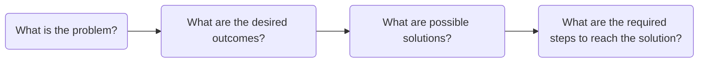
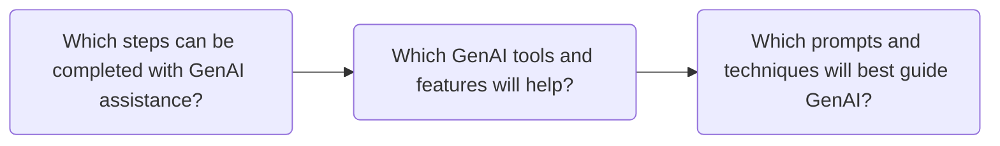

# AI Skills For Copywriters

1. Input -> Output

* **What is A Prompt?** A prompt is an input that uses GenAI's natural language processing to request it to perform a specific task. This is the foundation of modern human-AI communication. A prompt can be as simple as a word or phrase, or as complex as an elaborate essay. It can be a one-off prompt in the form of a simple question, or a chain of prompts in conversational style. Since prompts use natural language processing, prompting can be robotic and impersonal, or it can be like conversing with another human, except the interlocutor is GenAI. Effective prompts are able to deliberately direct and guide GenAI to complete specific tasks. Simple tasks need simple prompts, but more complicated tasks need more complicated prompts.

* **How Does AI Respond to Prompts?** Writing effective prompts requires understanding how GenAI reads, analyzes, and responds to prompts. Each prompt is broken down into tokens, and each token is given a specific weight. It is extremely difficult to track how GenAI actually weighs tokens and calculates answers, but to put it simply, it uses probability. Natural language processing allows for words to be treated like math equations and units of code. So, GenAI doesn't respond to the words of a prompt, but to the web of probability those prompts create. This means that all GenAI answers are randomly generated responses

Effective prompting is meant to mitigate the randomness of GenAI responses by providing instructions to reinforce the tokenization process and generate relevant and focused responses. While responses are still randomly generated the tokens use to generate them are more focused on the prompt. The next step is to find the strategies and techniques for effective prompts. The process of creating and refining prompts is known as prompt engineering. Prompt engineering has three main components: 1. problem decomposition, 2. the parts of prompts, and 3. techniques for prompting. Copywriters who utilize the three components of prompt engineering will not only be able to use GenAI more effectively and efficiently, but will also be able to recognize when GenAI is helpful.

## Prompt Engineering

### Problem Decomposition
Before using GenAI for its own sake, Copywriters should have a specific plan with a problem that they want to solve with GenAI. The should not become over reliant on GenAI by jumping to it for every problem. That increases the chances of misusing it in ineffective, inefficient, and unethical ways. GenAI tends to work better when it has less tokens and steps overwhelming it, so prompt engineering aims to give it one specific task at a time instead of the whole problem all at once. 

The first step of prompt engineering is problem decomposition. Deciding when and how to use GenAI is an important step, but Copywriters will only find those instances if they are actively engaged with the problem themselves. Prompt Engineering breaks problem decomposition into two parts.

**Part 1:** The Copywriter breaks a problem into manageable pieces, and then they propose potential solutions.

***What is the problem?*** Copywriters identify and define a goal in their own words, and then they identify its moving parts, major components, and potential challenges.

* **Example:** A Copywriter is working on revising the newsletter inviting students to a cultural event . The newsletter needs grammar, style, and tone revisions, and the Copywriter was specifically requested to ensure that the text has inclusive language for a multicultural audience.

***What are the desired outcomes?*** Copywriters think beyond the problem by critically evaluating the intended outcomes and whether they resolve pain points or create unintentional problems.

* **Example:** After copyediting, the newsletter should be completely polished, adhere to BYUI style guides, and be warm and inviting — but still professional — to the multicultural student audience.

***What are possible solutions?*** Copywriters find specific and alternative ways to meet the intended outcomes and then select the best one to resolve the problem.

* **Example:** After reviewing the text, the Copywriter lists where it can be improved well as areas that the Copywriter needs to do more research in. Editing for compliance with the BYUI style guide is straightforward, but the Copywriter needs more information on the audience.

***What are the required steps to reach the solution?*** Copywriters define each step to reaching the solution so they can work towards it efficiently and ethically.

* **Example:** The Copywriter must review and revise the text, then research the audience, find inclusive language, and test possible edits with audience personas before selecting the final version.

All of these steps do not require GenAI involvement to complete because they are here to determine if GenAI would even be required. Before GenAI becomes involved with the work, Copywriters should already have critically reviewed the work to their best ability.

**Part 2:** The Copywriter determines that one of the steps can be appropriately completed with AI assistance, and then they identify exactly how it can help. Copywriters should work along the lines of *Find*, *Challenge*, and *Inspect.*

***Which steps can be completed with GenAI assistance?*** Copywriters define which specific steps can be completed with GenAI assistance.

* **Example:** The Copywriter uses GenAI to *inspect* the edits they made to the text, finding anything they might have missed, and double-checking style guide nuances. They can also use *find* to locate sources for research and *challenge* to try out different audience personas for the final text.

***Which GenAI tools and features will help?*** Copywriters explore the various tools and features to determine which one will help complete the specific task.

* **Example:** The Copywriter finds pre-created GenAI agents that are dedicated to the roles of *Find*, *Challenge*, and *Inspect.* They use these to help complete the tasks they defined earlier.

***Which prompts and techniques will best guide GenAI?*** Copywriters experiment with effective prompt writing and prompting techniques. This is the only stage they are directly using the GenAI tools.

* **Example:** The Copywriter submits the text they created with multiple prompts instructing the GenAI chat to evaluate the text from multiple audience personas. They include specific instructions and use prompting techniques to improve outputs. Since they are using pre-made agents, they don't have to start prompting from scratch.

While it is easy to use the chat interface with basic requests, such as: "does this newsletter sound good" or "how will this perform with SEO", it is generally more difficult to predict those outputs or use them efficiently, effectively, and ethically. Problem decomposition takes into account the risks and limitations of GenAI.

When Copywriters start asking "Which steps can be completed with GenAI assistance?", they should take into account hallucinations before deciding to use it to summarize articles or provide reliable information. When they are using GenAI to assist them they should take into account how GenAI best receives instructions. Hence, after problem decomposition the next part of prompt engineering is writing the right prompt.

### Designing Effective Prompts
Designing effective prompts is straightforward because LLMs were primarily designed to process natural language. Overall, plain text is the most effective way to prompt GenAI tools, even when compared with other formats like Markdown or JSON.

https://arxiv.org/pdf/2607.19257
https://arxiv.org/abs/2505.12837
https://arxiv.org/abs/2411.10541

#### 1. Goal: 

The intent and objective of the prompt.

#### 2. Format: 

The framework and structure of the output.

#### 3. Style: 

The GenAI's tone, diction, and syntax choices in output.

#### 4. Role: 

The persona GenAI adopts to help direct the reasoning process, the context of the conversation,  the outcomes of said conversation.

#### 5. Context: 

The additional information required for the GenAI to complete the prompt.

#### 6. Examples:

1. Zero-Shot: Inputting a prompt with no exemplars
2. One-Shot: Inputting a prompt with one exemplar
3. Few-Shot: Inputting a prompt with two or more exemplars

### Prompt Techniques

#### 

## 

https://arxiv.org/abs/2511.05764
https://learnprompting.org/docs/advanced/decomposition/introduction
https://mitsloanedtech.mit.edu/ai/basics/effective-prompts/
https://arxiv.org/pdf/2406.06608
https://www.cell.com/patterns/fulltext/S2666-3899(25)00108-4
file:///Users/andersoncullen/Downloads/161283-prompt-engineering-for-chatgpt-a-quick-guide-to-techniques-tips-and-best-practices.pdf
https://jet.scholasticahq.com/article/161283.pdf

How to Use AI to Create Content Outlines
How to Get Ideas from AI without the Output Sounding Generic, Formulaic, or Robotic
How to Write Effective Prompts that Captures Specific Brand, Tone, Voice, and Audience Pain Points

Be Specific
The more detailed your prompt is, the more on-target your answer will be.
Provide Context
If you ask an LLM what the weather is, it will respond by asking you where you are located.
Use Examples
Using an example of the format you want your output to resemble gives the LLM a reference point to refer to when generating an answer.
Explain Desired Output
AI can theoretically produce an infinite number of different outputs. Telling it how to format your output will help you reach your desired result.

Define a Role
It is often helpful to tell an AI who to be. For example “you are a UX researcher…”
Iterate and Refine
Engineering prompts is not asking a question, it is crafting a conversation. Sometimes it takes multiple adjustments to your prompt to get the right output.
Experiment & Understand Limitations
AI is powerful, but not perfect. Watch out for hallucinations and cross-check your information.

  
Use when…
Example
Zero-Shot Prompting
Use when the task is simple, well-understood, or frequently encountered.
Doing math, finding quick definitions, summarizing, etc.
One-Shot Prompting
Tasks that need more specific guidance or when the model struggles with ambiguity.
Creating a user persona template, content generation, etc.
Few-Shot Prompting
Complex tasks requiring multiple examples to establish patterns.
Writing a usability testing script, performing analysis, etc.

Zero-Shot Prompting:
Asking an LLM a question or task without providing examples.
The LLM relies on it’s trained knowledge to respond.
One-Shot Prompting:
You provide one example to the LLM before asking it to perform a similar task.
This gives the LLM a basic idea of what you expect.
Few-Shot Prompting
You provide multiple examples (2+) to the LLM.
This helps the LLM understand patterns and nuances for more accurate and relevant responses.

LLM-friendly content is designed to be easily understood by computer models, lowering the risk of miscommunication. Using LLM-friendly content will result in:

Improved parsing and interpretation
Enhanced accuracy
Reduced ambiguity
Consistency and reproducibility

What is easier to read: a single, unconnected paragraph or a bulleted list?

Writing in Markdown helps LLMs define a clear structure for how to interpret input.

Writing prompts using Markdown inherently adds clarity to your prompt without adding extra tokens. 
It gives structures to what an LLM can “see.” 
Cleaner inputs → fewer misunderstandings → cleaner outputs

Markdown provides emphasis on the tokens that are most important.
Most LLMs use Markdown to output responses.

Writing in Markdown helps LLMs define a clear structure for how to interpret input.

Writing prompts using Markdown inherently adds clarity to your prompt without adding extra tokens. 
It gives structures to what an LLM can “see.” 
Cleaner inputs → fewer misunderstandings → cleaner outputs

Markdown provides emphasis on the tokens that are most important.
Most LLMs use Markdown to output responses.

Established and Emerging AI Skills 

AI Skills & Fluency 

Faculty and students need strong definitions and descriptions of AI skills to best use them to support learning, not supplant it. 

1. Prompt Engineering 

Definition: Learning how to write inputs for generative AI tools in a way that produces specific, high-quality outputs. To enhance the relevance and accuracy of the generated content, give the machine: 

Step-by-step instructions 

Examples of what you want 

Rules and restraints 

The Hands-On Approach: Prompt engineering is a continual process. Continue to improve AI's outputs by reviewing and rewriting your prompts. Adopt a hands-on mindset by: 

Not assuming that AI will give you high-quality results with little effort 

Resisting the temptation to rely on simple, ineffective prompts 

BYU-Idaho Course Example: A programming student writes a structured prompt to generate a Python test suite. In their input, they: 

Include a sample of the code they have written 

Provide specific details about the project 

Ask for a review of the code (not a rewrite) 

Give it the role of a QA Engineer 

2. Problem Identification and Description 

Definition: Understanding the tasks when generative AI tools are or aren't useful and appropriate. AI is better at completing specific tasks with clear instructions than vague, complex ones. 

Identifying and Describing Tasks: AI is only as effective as your ability to use it. If you come across a task where AI assistance is appropriate and useful, then the next step is to identify and describe the specific assignment. When using AI to execute a task, employ: 

Clear definitions to identify the task. 

Task decomposition to split the tasks into smaller, actionable steps. 

Prompt engineering to describe to AI how to complete each step. 

If you aren't sure if a task is appropriate for AI use, ask yourself: 

Does it require my original judgment or voice? 

Would automating this task be more efficient and effective than doing it myself? 

Am I using this to pass off AI-generated work as my own? 

BYU-Idaho Course Example: A marketing student identifies that a case study's primary failure is brand dilution. Before consulting a generative AI tool, the student defines the specific demographics and market variables that could be causing failure. In their prompt, the student identifies that the best use of AI is helping to brainstorm repositioning strategies. 

3. Role, Content, Context, and Format Expectations 

Definition: Giving generative AI tools conditional elements during prompt engineering to help it complete tasks, such as: 

Role: What it should act like, defining its expertise and tone.  

Content: The facts it needs to know, giving it materials to work with. 

Context: Background information that ensures relevance to the task and the audience. 

Format: How the final answer should look, including how to construct the output. 

Prompts With a Framework: While identifying and describing tasks is helpful, without a framework, generative AI will default to generic, surface-level output. Laying out these expectations makes your prompts more effective by reducing the:  

Need for back-and-forth follow-up 

Amount of prompts needed to complete a task 

Off-target outputs  

BYU-Idaho Course Example: A communication student prompts: "Act as a Creative Director (Role). Evaluate this draft based on Gestalt principles (Content) for a non-profit logo project (Context). Provide a bulleted list of 5 actionable improvements (Format)." 

4. Critical AI Evaluation 

Definition: Because generative AI is fallible, the ability to spot when an output is biased, hallucinating, or off target is extremely important. 

Even with a refined prompt, AI will still make mistakes that require an overview with a critical eye. 

Key Evaluation Criteria: AI systems, while powerful, are prone to several recurring errors and failures that can have serious consequences, such as: 

Hallucinations 

Bias 

Ethical Missteps 

Flawed Decision-Making 

Since AI cannot be held accountable for the information it gives, you are responsible for factchecking and decision-making. This skill is about making sure the work is polished and reliable enough to put your name on it in a professional setting. 

BYU-Idaho Course Example: A student uses AI to summarize a conference talk but notices a subtle misinterpretation of a doctrinal point; they cross-reference the official transcript to correct the error. 

[BYU-Idaho Prompt Library](https://promptlibrary.byui.edu/welcome)

Prompt Engineering: Key Takeaways

How AI Reads: AI models break down your words into "tokens." The way your prompt is tokenized affects how the AI interprets it. Clear formatting and correct spelling help the AI "see" your prompt accurately.
Tips for Great Prompts:
Be Specific: The more detail you give, the closer the AI's answer will be to what you want.
Give Context: Don't make the AI guess! Tell it what it needs to know (like your location for weather).
Show, Don't Just Tell: Use examples of the output format you're looking for. This is a super effective way to guide the AI.
Explain the Output: Clearly describe how you want the final response to look or be organized.
Setting Rules (Be Firm!): You can tell the AI exactly what to do or not to do.
Use "YOU MUST" to enforce a rule.
Use "YOU MUST NOT" to prevent something.

Make Content "AI-Friendly": Writing clearly and using formatting like bullet points makes it easier for the AI to understand, leading to more accurate and consistent results.
Additional Tips for Prompt Engineering
Here are a few more things that can help you get the best results when working with AI:
Iterate and Refine: Your first prompt might not be perfect. Think of it as a conversation – try a prompt, see the result, and then make small adjustments to get closer to what you want. It's a process of tweaking and improving!
Define the AI's Role: Sometimes it helps to tell the AI who it should be. For example, you could say "Act as a helpful study buddy" or "You are a creative writing assistant." This can guide its style and focus.
Understand Limitations: Remember that AI models are powerful tools, but they aren't perfect. They can sometimes generate incorrect information (called "hallucinations") or reflect biases from the data they were trained on. Always double-check important details.
Experiment! Don't be afraid to try different ways of phrasing your prompts, using different formats, or experimenting with the zero-shot, one-shot, and few-shot techniques. The more you practice, the better you'll get at understanding how the AI responds.
Remember, practicing with different prompts and seeing how the AI responds is the best way to improve your prompt engineering skills!

