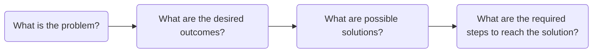
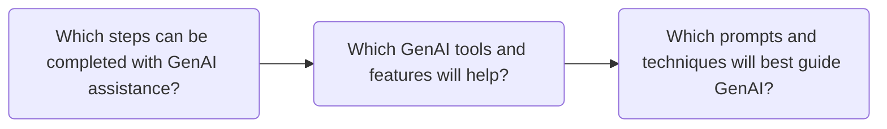

# AI Prompt Engineering For Copywriters

**What is A Prompt?** A prompt is an input that uses GenAI's natural language processing to request it to perform a specific task. This is the foundation of modern human-AI communication, which  can be robotic and impersonal, or like conversing with another human, except the interlocutor is GenAI. 

A prompt can be as simple as a word or phrase, or as complex as an elaborate essay. It can be a one-off prompt in the form of a simple question, or a chain of prompts in conversational style. Simple tasks need simple prompts, but more complicated tasks need more complicated prompts. Effective prompts are able to deliberately direct and guide GenAI to complete specific tasks. 

**How Does AI Respond to Prompts?** All GenAI answers are randomly generated responses. Natural language processing allows for words to be treated like math equations and units of code, meaning that GenAI doesn't respond to the words of a prompt, but to the web of probability those prompts create.

Writing effective prompts requires understanding how GenAI reads, analyzes, and responds to prompts. Each prompt is broken down into tokens, and each token is given a specific weight. It is extremely difficult to track how GenAI actually weighs tokens and calculates answers, but to put it simply, it uses probability. It is meant to mitigate the randomness of GenAI responses by providing instructions to reinforce the tokenization process and generate relevant and focused responses.

The process of creating and refining prompts is known as prompt engineering. Prompt engineering has three main components: *1. problem decomposition*, *2. the parts of prompts*, and *3. techniques for prompting*. Copywriters who utilize the three components of prompt engineering will not only be able to use GenAI more effectively and efficiently, but will also be able to recognize when GenAI is helpful.

## Problem Decomposition
Before using GenAI for its own sake, Copywriters should have a specific plan with a problem that they want to solve with GenAI. The should not become over reliant on GenAI by jumping to it for every problem. That increases the chances of misusing it in ineffective, inefficient, and unethical ways. GenAI tends to work better when it has less tokens and steps overwhelming it, so prompt engineering aims to give it one specific task at a time instead of the whole problem all at once. 

The first step of prompt engineering is problem decomposition. Deciding when and how to use GenAI is an important step, but Copywriters will only find those instances if they are actively engaged with the problem themselves. Prompt Engineering breaks problem decomposition into two parts.

**Part 1:** The Copywriter breaks a problem into manageable pieces, and then they propose potential solutions.

***What is the problem?*** Copywriters identify and define a goal in their own words, and then they identify its moving parts, major components, and potential challenges.

* **Example:** A Copywriter is working on revising the newsletter inviting students to a cultural event . The newsletter needs grammar, style, and tone revisions, and the Copywriter was specifically requested to ensure that the text has inclusive language for a multicultural audience.

***What are the desired outcomes?*** Copywriters think beyond the problem by critically evaluating the intended outcomes and whether they resolve pain points or create unintentional problems.

* **Example:** After copyediting, the newsletter should be completely polished, adhere to BYUI style guides, and be warm and inviting — but still professional — to the multicultural student audience.

***What are possible solutions?*** Copywriters find specific and alternative ways to meet the intended outcomes and then select the best one to resolve the problem.

* **Example:** After reviewing the text, the Copywriter lists where it can be improved well as areas that the Copywriter needs to do more research in. Editing for compliance with the BYUI style guide is straightforward, but the Copywriter needs more information on the audience.

***What are the required steps to reach the solution?*** Copywriters define each step to reaching the solution so they can work towards it efficiently and ethically.

* **Example:** The Copywriter must review and revise the text, then research the audience, find inclusive language, and test possible edits with audience personas before selecting the final version.

All of these steps do not require GenAI involvement to complete because they are here to determine if GenAI would even be required. Before GenAI becomes involved with the work, Copywriters should already have critically reviewed the work to their best ability.

**Part 2:** The Copywriter determines that one of the steps can be appropriately completed with AI assistance, and then they identify exactly how it can help. Copywriters should work along the lines of *Find*, *Challenge*, and *Inspect.*

***Which steps can be completed with GenAI assistance?*** Copywriters define which specific steps can be completed with GenAI assistance.

* **Example:** The Copywriter uses GenAI to *inspect* the edits they made to the text, finding anything they might have missed, and double-checking style guide nuances. They can also use *find* to locate sources for research and *challenge* to try out different audience personas for the final text.

***Which GenAI tools and features will help?*** Copywriters explore the various tools and features to determine which one will help complete the specific task.

* **Example:** The Copywriter finds pre-created GenAI agents that are dedicated to the roles of *Find*, *Challenge*, and *Inspect.* They use these to help complete the tasks they defined earlier.

***Which prompts and techniques will best guide GenAI?*** Copywriters experiment with effective prompt writing and prompting techniques. This is the only stage they are directly using the GenAI tools.

* **Example:** The Copywriter submits the text they created with multiple prompts instructing the GenAI chat to evaluate the text from multiple audience personas. They include specific instructions and use prompting techniques to improve outputs. Since they are using pre-made agents, they don't have to start prompting from scratch.

While it is easy to use the chat interface with basic requests, such as: "does this newsletter sound good" or "how will this perform with SEO", it is generally more difficult to predict those outputs or use them efficiently, effectively, and ethically. Problem decomposition takes into account the risks and limitations of GenAI.

When Copywriters start asking "Which steps can be completed with GenAI assistance?", they should take into account hallucinations before deciding to use it to summarize articles or provide reliable information. When they are using GenAI to assist them they should take into account how GenAI best receives instructions. Hence, after problem decomposition the next part of prompt engineering is writing the right prompt.

## Designing Effective Prompts
Designing effective prompts is straightforward because LLMs were primarily designed to process natural language. Overall, plain text is the most effective way to prompt GenAI tools, even when compared with other formats like Markdown or JSON. In other words, using natural, grammatically correct text is the best known way to prompt GenAI.

https://arxiv.org/pdf/2607.19257
https://arxiv.org/abs/2505.12837
https://arxiv.org/abs/2411.10541

Well constructed prompts can be broken down into several parts. There is not a single definitive method for breaking prompts down into parts. The method presented here is meant to encompass parts of effective prompts that can help with Find, Challenge, and Inspect. Not every part will be required for every prompt because each task is different, but Copywriters that understand each part will be able to reduce the randomness of GenAI outputs.

### 1. Goal: The intent and objective of the prompt and the output.
Effectively prompting GenAI requires that one be sure to include a specific, actionable directive for the output. Problem decomposition already provides an achievable task, but without a clearly stated goal that GenAI can understand, it will all the more difficult to accomplish.

Think of it like this: when using GenAI, users are able to prompt the machine with little to no detail. For instance, a user could type: "I really enjoyed my homemade pizza and want to make it again. Can you help me?" GenAI understands that the objective is to help, but it does not understand what actually is helpful. 

The original prompt had a goal, which was to help the user, but the specifics were vague, so it guesses the users intention. A clear prompt states the desired outcome. Only then will the output be focused and helpful. To build off of the prior example, the revised prompt should include something along the lines of: "Help me organize the recipe for the homemade pizza I made. Here are the details..." 

Here are a few principles for creating strong goals while prompt engineering:

#### **State the task with a clear action verb**
Start the goal with a verb that tells the model what operation to perform. The verb signals the kind of work you expect and helps the model choose a useful response. Words such as *find*, *compare*, *evaluate*, *revise*, and *classify* give clearer direction than broad requests such as *help*, *discuss*, or *look at*. For example:

**Find:**

* ***Vague:*** Help me find sources about copywriting,
* ***Clear:*** Locate blogs and articles on the web about outdated copywriting practices.
* ***Specific:*** Identify blogs and articles on the web that detail outdated copywriting practices and provide the five most recently published.

**Challenge:**

* ***Vague:*** React to this blog.
* ***Clear:*** Evaluate this blog for readability.
* ***Specific:*** Evaluate this blog for readability, identify sentences that are difficult to follow, and then explain why.

**Inspect:**

* ***Vague:*** Check the grammar.
* ***Clear:*** Verify this blog according to BYU-Idaho's style guide.
* ***Specific:*** Evaluate the grammar, syntax, and style guide of this blog according to BYU-Idaho's style guide and create a revision checklist.

#### **Name the intended outcome**
Tell the model what the task should help you accomplish. A task verb says what action to take; the intended outcome explains why that action matters or what the result should make possible. This context helps the model select relevant information and focus its response. For example: 

**Find:**

* ***Task only:*** Find examples of effective calls to action on nonprofit donation pages.
* ***Task and Outcome:*** Find examples of effective calls to action on nonprofit donation pages so I can improve the donation page I’m writing.
  
**Challenge:**

* ***Task only:*** Assess whether this event description clearly communicates the benefits to freshmen students.
* ***Task and Outcome:*** Assess whether this event description clearly communicates the benefits to freshmen students so I can revise parts that may not persuade them.

**Inspect:**

* ***Task only:***  Check this email campaign for consistent product names, prices, and calls to action.
* ***Task and Outcome:***  Check this email campaign for consistent product names, prices, and calls to action, then create a correction list so I can prepare it for publication.

#### **Set the scope**
Define the boundaries of the task so the model knows what to include and where to stop. Scope can specify the topic, time period, location, source types, number of items, or parts of a document to examine. Clear boundaries help keep the response relevant and prevent the model from making the task broader or narrower than intended.

**Find:**

* ***Broad:*** Find sources about student experiences at BYU-Idaho.
* ***Scoped:*** Find five journal articles published since 2020 about student experiences at BYU-Idaho.

**Challenge:**

* ***Broad:*** Evaluate this from the perspective of a freshman student.
* ***Scoped:*** Evaluate this web page's content from the perspective of a freshman student at BYU-Idaho from ages 18-22.

**Inspect:**

* ***Broad:*** Check this page for readability.
* ***Scoped:*** Inspect this web article for readability according to the Flesch–Kincaid grade level calculator.

#### **Separate complicated goals into multiple steps**
When a task requires several kinds of work, break it into clear, ordered steps. A request that asks the model to research, analyze, draft, and revise all at once can make it harder to tell which parts matter most. A sequence helps the model complete each stage and use the results from one step in the next.

**Find:**

* ***Combined request:*** Research the audience, review our web page information, and find relevant sources about the topic.
* ***Step-by-step goal:*** First, research the target audience and web page topics. Next, find the most relevant information about those topics.

**Challenge:**

* ***Combined request:*** Determine whether the language used in this web page is appropriate according to BYU-Idaho's honor code, and react to it with different audience personas from BYU-Idaho to see if this is clear, friendly, and compliant.
* ***Step-by-step goal:*** First, identify BYU-Idaho's honor code. Next, review the web page's content is compliant with the honor code. Finally, test a variety of reactions from students at BYU-Idaho to see if this content is clear and friendly.

**Inspect:**

* ***Combined request:*** Review the email I am preparing to see if it is error-free and write me a checklist of all the mistakes. Also, look for sentences that are too long or confusing.
* ***Step-by-step goal:*** First, identify BYU-Idaho's style guide. Second, review this email according to the style guide and conventional grammar rules and sentence structure. Third, identify sentences that are longer than 10 words, have passive voice misuse, or are not clearly stated. Finally, write an editing checklist.

### 2. Format: The framework and structure of the output.
Even when guided with a strong goal, GenAI is still probabilistically selecting the format of the output. For certain tasks this may not matter, but when crafting a prompt that requires a repetitive or specific outcome, including instructions for the format of the output will help hone similar results. The format and the goal are closely linked together, because the format ultimately frames what the completed task looks like. Even with the best goal, GenAI may still not generate a usable output.

Think of it like this: users can input any amount of instructions which the GenAI can interpret. For instance, a user could type: "Help me organize the recipe for the homemade pizza I made. Here are the details..." GenAI understands what the goal is with all the necessary details, but it does not know the best way to format it.

The original prompt had a specific goal, but it guesses the best way to format it in a way that completes the instructions. The instructions that a uses provides should be compatible the the format provided. 

The original prompt had a goal, which was to help the user, but the specifics were vague, so it guesses the users intention. A clear prompt states the desired outcome. Only then will the output be focused and helpful. To build off of the prior example, the revised prompt should include something along the lines of: "Help me organize the recipe for the homemade pizza I made. Here are 
the details..."

Here are a few principles for creating strong output formats while prompt engineering:

#### **Choose the format and structure**

Tell GenAI how to organize the copy and what type of deliverable to produce. A clear structure helps the model understand how the information should be arranged and makes the output easier for the Copywriter to review. Words such as *organize*, *outline*, *format*, and *structure* give more direction than broad requests such as *edit*, *improve*, or *help*.

For example:

- **Vague:** Help me edit this announcement about a student writing workshop.
- **Clear:** Organize this human-written announcement into copy for a university webpage.
- **Specific:** Organize this human-written announcement into university webpage copy with a headline, a two-sentence introduction, an event-details section, and a final call to action. Preserve the original meaning and identify any missing information instead of inventing it.

#### **Define what the response must include**

Identify the information, sections, or elements that the response must contain. A format may explain the overall structure, but required elements explain what belongs inside that structure. This helps prevent GenAI from leaving out important information or emphasizing details that are less useful to the audience.

For example:

- **Vague:** Make this workshop announcement more useful for students.
- **Clear:** Revise this announcement so it includes the information students need to attend the workshop.
- **Specific:** Review this human-written announcement and organize it so it includes the workshop name, date, time, location, intended audience, registration instructions, contact information, and call to action. List any missing information separately rather than creating details.

#### **Guide exact or incomplete outputs**

Explain how GenAI should handle requirements that must be followed exactly and information that is missing. Copywriting tasks may include character limits, a specific number of options, wording that must remain unchanged, or details that require verification. Without these instructions, GenAI may alter important information, exceed the required length, or fill gaps with unsupported claims.

For example:

- **Vague:** Create social media copy from this workshop announcement.
- **Clear:** Prepare three social media posts from this announcement, each under 280 characters.
- **Specific:** Prepare three social media post options from this human-written announcement, each under 280 characters. Keep the workshop name, date, time, and registration link exactly as provided. Use a clear call to action, do not add information that is not in the source, and write **[NEEDS VERIFICATION]** wherever a required detail is missing. The Copywriter will review and revise the options before publishing.

### 3. Style: The GenAI’s tone, diction, and syntax choices in the output.
Even when the goal, format, and context are clear, GenAI still has to decide how the response should sound. It may produce an answer that is technically correct but too formal, too casual, too complex, or inconsistent with the audience. For certain tasks this may not matter, but when the wording and tone are important, style instructions help guide the way the output is communicated.

Style is closely connected to the purpose of the prompt. A recipe written for a professional chef may use different language than a recipe written for someone who has never cooked before. Without guidance, GenAI guesses the appropriate level of formality, complexity, and detail based on the information it has received. Its guess may not match the user’s expectations.

Think of it like this: a user could ask, “Help me organize the recipe for the homemade pizza I made.” GenAI might organize the recipe correctly, but it could write the instructions in a formal cookbook style, use technical cooking terms, or explain the process in a way that is difficult for a beginner to understand.

The original prompt had a clear goal and may have included a useful format, but it did not explain how the response should sound. A stronger prompt would include style instructions such as: “Write the recipe in a friendly, simple tone for a beginner. Use short sentences and explain any cooking terms.”

When creating a prompt, consider who will read the response and how the response should make them feel. Clearly naming the desired tone, voice, level of formality, and complexity helps GenAI produce an answer that is not only accurate, but also appropriate for its intended audience.

Here are a few principles for creating a strong style while prompt engineering:

#### **Name the desired tone and voice**

Tell GenAI how the copy should sound and what personality it should communicate. Tone describes the feeling or attitude of the writing, such as friendly, confident, reassuring, or urgent. Voice describes the consistent personality or character of the organization or brand. Naming both helps GenAI revise copy for a specific audience without relying on its own assumptions.

For example:

- **Vague:** Make this announcement sound better.
- **Clear:** Revise this human-written announcement using a friendly and encouraging tone.
- **Specific:** Revise this human-written announcement using a friendly, encouraging voice that makes students feel welcome and capable. Preserve the original meaning, avoid exaggerated claims, and identify any wording that may not match the university’s voice.

#### **Set the level of formality and complexity**

Tell GenAI how formal the copy should be and how difficult it should be for the audience to understand. Formality affects word choice, sentence structure, and professionalism. Complexity affects vocabulary, sentence length, technical language, and the amount of explanation provided. These instructions help GenAI create copy that is appropriate for the intended audience.

For example:

- **Vague:** Rewrite this explanation so students can understand it.
- **Clear:** Rewrite this human-written explanation in simple language for university students.
- **Specific:** Rewrite this human-written explanation for first-year university students using plain language, short sentences, and familiar vocabulary. Avoid unnecessary technical terms, explain any specialized terms that must remain, and preserve the original facts and meaning. The Copywriter will review the revision for accuracy and tone before publication.

### 4. Role: The persona GenAI adopts to direct its reasoning, context, and outcomes.
GenAI can approach the same task in many different ways depending on the role it is given. A role provides the model with a perspective from which to interpret the instructions, make decisions, and shape the final response. Without a role, GenAI may provide a general answer that does not reflect the expertise or priorities needed for the task.

The role and the goal are closely linked together. If a user asks GenAI to organize a recipe, the result may be different depending on whether the model is acting as a professional cookbook editor, a nutritionist, a food historian, or a beginner cooking instructor. Each role brings different responsibilities, questions, and standards to the task.

Think of it like this: a user could ask, “Help me organize the recipe for the homemade pizza I made.” GenAI may arrange the ingredients and instructions, but it does not know what perspective should guide the process. It may not know whether to focus on readability, nutritional information, culinary accuracy, or teaching a new cook.

A stronger prompt might say: “Act as a cookbook editor who specializes in clear recipes for beginner cooks. Organize my pizza recipe, identify missing information, and make the instructions easy to follow without changing the ingredients or cooking method.”

This role gives GenAI more than a title. It establishes responsibilities and boundaries. The model now knows what kind of expertise to apply, what to pay attention to, and what outcome to prioritize. A well-chosen role can make the response more focused, but an unnecessarily broad or inappropriate role can lead the model away from the user’s actual goal.

Here are a few principles for choosing a strong role while prompt engineering:

#### **Choose a role that fits the task**

Assign GenAI a role that matches the type of copywriting work it is being asked to support. A relevant role gives the model a useful perspective and helps it focus on the priorities of the task. An unrelated or overly broad role may cause GenAI to emphasize information that is not relevant to the audience, message, or purpose.

A role should support the Copywriter’s work rather than replace the Copywriter’s judgment. For example, a copy editor may focus on clarity and grammar, while an audience researcher may focus on reader needs and expectations.

For example:

- **Vague:** Act as a marketing expert and improve this webpage copy.
- **Clear:** Act as a copy editor who specializes in higher education and review this human-written webpage copy.
- **Specific:** Act as a higher-education copy editor. Review this human-written webpage copy for clarity, audience awareness, grammar, and consistency with a professional university voice. Identify specific areas for improvement and explain your recommendations. Do not add claims, change factual information, or present a fully rewritten version as final copy.

#### **Define the role’s responsibilities**

Explain what the assigned role should pay attention to, what actions it should take, and what boundaries it must follow. Giving GenAI a title alone may not be enough to produce a useful response. Responsibilities turn the role into a clear set of expectations and help prevent the model from making unsupported decisions.

Defining responsibilities makes the role more useful and accountable. GenAI can provide an informed review, but the Copywriter remains responsible for evaluating the recommendations, verifying the information, and deciding which changes belong in the final copy.

For example:

- **Vague:** Act as a copy editor and fix this announcement.
- **Clear:** Act as a copy editor responsible for checking this announcement for clarity, grammar, and missing information.
- **Specific:** Act as a copy editor responsible for reviewing this human-written announcement. Check its grammar, sentence clarity, audience awareness, and call to action. List each recommended change with an explanation, preserve the Copywriter’s intended meaning, and mark unsupported or incomplete details as **[NEEDS VERIFICATION]**. Do not invent facts or make the final publishing decision.

### 5. Context: The additional information required for the GenAI to complete the prompt.
GenAI can only work with the information it has been given or can reliably infer. A prompt may have a clear goal, format, style, and role, but the output can still be incomplete if the model does not have enough context. Context gives GenAI the background, details, limitations, and reference material it needs to complete the task accurately.

Context is closely connected to the quality of the output. When important information is missing, GenAI may fill in the gaps by making assumptions. Those assumptions may seem reasonable, but they may not reflect what actually happened or what the user intended. Providing too little context can produce a generic answer, while providing irrelevant or excessive information can make the important details harder to identify.

Think of it like this: a user could ask, “Help me organize the recipe for my homemade pizza,” and provide only the ingredients. GenAI would still be missing important information, such as the amount of each ingredient, the oven temperature, the cooking time, the order of the steps, and the size of the pizza. It may guess some of these details, but the resulting recipe may not accurately describe the user’s pizza.

A stronger prompt would provide relevant background: “I made a 12-inch pizza using store-bought dough. I baked it at 450 degrees Fahrenheit for 14 minutes on a baking sheet. The toppings were tomato sauce, mozzarella, mushrooms, and basil. Organize these details into a recipe, and mark any information that is missing instead of guessing.”

Trusted reference material can also improve the response. For example, the user might provide an existing recipe, a cooking standard, or a source they want GenAI to follow. At the same time, context should be limited to information that is relevant to the task. Private or sensitive information should be removed, generalized, or protected whenever it is not necessary for completing the prompt.

Here are a few principles for providing strong context while prompt engineering:

#### **Provide relevant background**

Give GenAI the information it needs to understand the purpose, audience, subject, and requirements of the copywriting task. Relevant background helps the model make better suggestions and reduces the need for it to guess. However, context should serve the task rather than include every available detail.

For example:

- **Vague:** Improve this announcement for our audience.
- **Clear:** Revise this human-written announcement for university students.
- **Specific:** Revise this human-written announcement for first-year university students who may be unfamiliar with the event. The goal is to explain what the event offers, why it may be useful, and how students can attend. Preserve the original facts, identify missing information, and do not invent event details.

#### **Supply trusted reference material**

Give GenAI reliable sources, approved documents, or established guidelines that should inform the copywriting task. Reference material can help the model understand facts, terminology, brand requirements, and organizational standards. The Copywriter must still verify the information and ensure that the final copy does not reproduce protected material improperly.

For example:

- **Vague:** Write an announcement about the university’s new writing resources.
- **Clear:** Use the university’s writing-center webpage as a source when reviewing this announcement.
- **Specific:** Review this human-written announcement using the university’s official writing-center webpage as the factual reference. Compare the announcement against the source, identify unsupported or outdated claims, and recommend corrections. Do not copy sentences from the webpage or add information that cannot be verified from an approved source.

#### **Explain specialized terms and requirements**

Define unfamiliar terms, abbreviations, audiences, brand standards, and other requirements that affect the task. GenAI may interpret specialized language differently from the Copywriter or the intended audience. Explaining these terms gives the model the context it needs to make appropriate recommendations.

For example:

- **Vague:** Rewrite this copy using our usual terminology.
- **Clear:** Rewrite this copy using university terminology that students can understand.
- **Specific:** Rewrite this human-written copy for students using the term **“academic support”** to describe tutoring, writing assistance, and study resources. Do not use unexplained abbreviations, internal department names, or technical language. If a specialized term is necessary, define it in plain language before using it.

#### **Minimize and protect private data**

Provide only the information that GenAI needs to complete the task, and remove or generalize private, confidential, or restricted information whenever possible. Using an approved account or tool does not mean that every piece of information should be entered into a prompt. Copywriters should follow institutional data-classification requirements, use approved tools for protected information, and ask for guidance when they are unsure.

Minimizing data protects people and organizations while still giving GenAI enough context to support the task. When information may be confidential or restricted, the safest approach is to remove it, use a fictional substitute, or ask a supervisor or authorized support team before entering it into an AI tool.

For example:

- **Vague:** Analyze this student email and write a response.
- **Clear:** Review this email and suggest a professional response without revealing the student’s identity.
- **Specific:** Review this fictionalized student email and recommend a professional response. Replace names, student identification numbers, contact information, grades, health information, and other private details with placeholders before submitting it. Use only an institutionally approved AI tool and do not infer or include information that is not present in the email. The Copywriter will verify the response and make the final decision.

### 6. Examples: The model that shows the GenAI what an output should look like.
Examples give GenAI a concrete model for how to complete a task. While written instructions explain what the model should do, examples demonstrate what the result should look like. This can be especially helpful when the desired organization, level of detail, wording, or transformation is difficult to describe with instructions alone. Examples can be used in different amounts:

1. Zero-Shot: Inputting a prompt with no examples
2. One-Shot: Inputting a prompt with one example
3. Few-Shot: Inputting a prompt with two or more examples

Examples are closely connected to both format and style. If a user asks GenAI to organize a recipe, the model may understand the general goal but still be uncertain about the exact structure. Should the recipe include a title, serving size, preparation time, ingredient list, numbered steps, or cooking notes? A clear example helps answer these questions by showing the model the expected pattern.

##### **1. Zero-Shot: Inputting a prompt with no examples**

A zero-shot prompt asks GenAI to complete a task using only written instructions. No sample input or output is provided. The model must interpret the goal, format, style, role, and context from the prompt itself.

For example:

> “Organize my homemade pizza details into a clear recipe for a beginner. Include a title, ingredient list, preparation steps, cooking temperature, and cooking time.”

This prompt explains what the user wants, but it does not show GenAI exactly what the finished recipe should look like. GenAI must determine the best organization and wording based on the instructions.

Zero-shot prompting is useful when the task is simple, familiar, or easy to explain. It is also helpful when the user wants GenAI to create something original rather than follow a specific pattern. However, the more precise or repetitive the desired output is, the more likely it is that examples will improve consistency.

##### **2. One-Shot: Inputting a prompt with one example**

A one-shot prompt includes one example of the desired input and output. The example gives GenAI a model to follow while it completes the new task. It shows the expected format, style, level of detail, and organization more clearly than instructions alone.

For example:

> **Example input:**  
> Ingredients: dough, tomato sauce, mozzarella, mushrooms, and basil.  
>  
> **Example output:**  
> **Simple Mushroom Pizza**  
>  
> **Ingredients:**  
> - Dough  
> - Tomato sauce  
> - Mozzarella  
> - Mushrooms  
> - Basil  
>  
> **Instructions:**  
> 1. Prepare the dough.  
> 2. Add the sauce and toppings.  
> 3. Bake until the crust is fully cooked.

The user could then add:

> “Now organize my pizza recipe using the same structure: dough, olive oil, garlic, tomatoes, mozzarella, and spinach.”

The example teaches GenAI to use a title, separate the ingredients from the instructions, and present the process as a numbered list. One-shot prompting is useful when the desired output has a specific pattern that may be difficult to describe completely with instructions.

##### **3. Few-Shot: Inputting a prompt with two or more examples**

A few-shot prompt includes two or more examples for GenAI to study before completing the task. Multiple examples help the model identify the underlying pattern instead of relying on only one sample. They are especially useful when the task has several possible outcomes or requires consistent results across different inputs.

For example:

> **Example 1 input:**  
> Ingredients: dough, tomato sauce, mozzarella, and basil.  
>  
> **Example 1 output:**  
> **Margherita Pizza**  
>  
> **Ingredients:**  
> - Dough  
> - Tomato sauce  
> - Mozzarella  
> - Basil  
>  
> **Instructions:**  
> 1. Prepare the dough.  
> 2. Add the sauce and mozzarella.  
> 3. Bake until the crust is golden.  
> 4. Add basil before serving.
>
> **Example 2 input:**  
> Ingredients: dough, olive oil, garlic, chicken, and spinach.  
>  
> **Example 2 output:**  
> **Garlic Chicken Pizza**  
>  
> **Ingredients:**  
> - Dough  
> - Olive oil  
> - Garlic  
> - Chicken  
> - Spinach  
>  
> **Instructions:**  
> 1. Prepare the dough.  
> 2. Brush it with olive oil and garlic.  
> 3. Add the chicken and spinach.  
> 4. Bake until the crust is golden.

The user could then ask:

> “Using the same pattern, organize this recipe: dough, pesto, mozzarella, roasted peppers, and onions.”

The two examples show GenAI that each recipe should include a descriptive title, an ingredient list, and numbered instructions. They also demonstrate the expected level of detail and the type of language to use.

Few-shot prompting is useful when consistency is especially important, such as classifying information, transforming text, extracting details, or generating multiple items in the same format. The examples should be accurate, relevant, and consistent with one another. If the examples contradict each other, GenAI may not know which pattern to follow.

In general, use zero-shot prompting when the task is straightforward, one-shot prompting when one example clearly demonstrates the desired result, and few-shot prompting when multiple examples are needed to establish a reliable pattern.

Here are a few principles for using strong examples while prompt engineering:

#### **Choose examples that match the task**

Use examples that represent the type of copywriting work GenAI is being asked to support. Relevant examples help the model identify the right pattern, audience, tone, and level of detail. Examples should be human-created, accurate, and appropriate for reuse. They should not be copied from protected work or contain private information.

For example:

- **Vague:** Use examples to help revise this copy.
- **Clear:** Use examples of university announcements to guide the revision of this human-written announcement.
- **Specific:** Use two human-created university announcements that have a clear headline, a concise introduction, event details, and a call to action. Use them only to identify organizational patterns and tone. Do not copy their wording, introduce claims from the examples, or treat them as factual sources. The Copywriter will review and revise the final recommendations.

#### **Show the expected input and output**

Provide both the material GenAI should work from and an example of the desired result. Showing the input and output makes the transformation clear and reduces the amount of guesswork required. This is especially helpful for editing, restructuring, summarizing, classifying, or adapting copy for a different audience.

For example:

* **Vague:** Rewrite this announcement in the same way as the example.
* **Clear:** Use the example to revise this announcement into a shorter version with a headline and call to action.
* **Specific:**  
  * **Example input:** “The Writing Center offers appointments to help students improve their papers.”  
  * **Example output:** “Strengthen your writing with help from the Writing Center. Schedule an appointment today.”  
  * **New input:** “The Career Center offers appointments to help students improve their résumés.”  
  Revise the new input using the same structure and level of detail. Preserve the original meaning, do not add unsupported services, and have the Copywriter review the result before using it.

#### **Identify what the model should learn from each example**

Explain which qualities GenAI should notice and apply. An example can demonstrate many features at once, including organization, tone, sentence length, word choice, level of detail, or method of transformation. Identifying the intended lesson prevents GenAI from copying features that are not relevant to the task.

For example:

* **Vague:** Follow these examples when editing the announcement.
* **Clear:** Use the examples to match the organization and tone of the announcement.
* **Specific:** From the examples, follow the order of information, concise sentence structure, welcoming tone, and direct call to action. Do not copy their wording, claims, or specific details. Preserve the facts in the human-written announcement, identify any missing information, and present your changes as recommendations for the Copywriter to review.

Clear examples teach GenAI how to approach a task without asking it to reproduce someone else’s work. The Copywriter should select appropriate examples, explain what each example demonstrates, verify the output, and make the final decisions about the copy.

### **Bringing It Together**

The purpose of these principles is to help Copywriters create and improve directives in prompts so GenAI can provide more useful and predictable support. Each principle can improve a prompt on its own, but the strongest prompts combine all six: **Goal, Format, Style, Role, Context, and Examples**.

Refining a prompt also helps the Copywriter understand the task more clearly. As the prompt develops, the Copywriter may discover that the original goal was too broad, the required information was incomplete, or the desired output needed a different structure. Prompt refinement is therefore part of problem decomposition. A directive is only one part of the Copywriter’s larger process of thinking, researching, reviewing, and making decisions.

The following examples demonstrate how a prompt can develop through three stages. Each stage includes all six rules, but the instructions become more precise as the prompt is refined. The final prompt also clarifies the Copywriter’s responsibilities and keeps GenAI in a supporting role.

---

**## Find**

### **First Prompt**

> **Goal:** Find official BYU-Idaho webpages about scholarship and financial-aid applications for 2026–2027.  
> **Format:** Provide a list of the pages and their links.  
> **Style:** Write a concise, professional summary.  
> **Role:** Act as a research assistant.  
> **Context:** Focus on current BYU-Idaho information for students.  
> **Examples:** Use a basic list format with the page title and link.

This prompt identifies the general task, but it does not define the categories, required information, search boundaries, or level of detail.

### **Refined Prompt**

> Research official BYU-Idaho webpages and articles about scholarship and financial-aid applications for the 2026–2027 academic year. Act as a research assistant supporting a Copywriter. Separate the results into three categories: scholarship, financial aid, and both. For each page, provide the title, URL, publication or update date if available, category, and a one-sentence description. Use a concise, professional tone and identify information that cannot be verified. Present the results in a table.

This version clarifies the goal, structure, role, context, and required information. It also tells GenAI how to handle missing information.

### **Final Prompt**

> **Goal:** Identify every official BYU-Idaho webpage or article that provides information about applying for scholarships or financial aid during the 2026–2027 academic year so the Copywriter can review the institution’s current information.  
>
> **Format:** Present the results in a table with these columns: page title, category, publication or update date, relevant topic, URL, and summary. Separate pages into **Scholarship**, **Financial Aid**, and **Both**. Conclude with a list of missing, outdated, or conflicting information that requires human verification.  
>
> **Style:** Use concise, neutral, professional language. Do not make claims that are not supported by the official pages.  
>
> **Role:** Act as a research assistant for a university Copywriter. Locate, organize, and summarize sources, but do not write final publication copy or make editorial decisions.  
>
> **Context:** Search only official BYU-Idaho webpages and articles that address the 2026–2027 application process. Prioritize current pages and identify the date of each source when available.  
>
> **Examples:** Use this format for each result:  
> **Page title | Category | Date | Topic | URL | Summary**  
> Example: **Scholarship Application Guide | Scholarship | 2026 | Application deadlines and requirements | [URL] | Explains the steps students must follow to apply.**  
>
> Verify every link and distinguish between information stated directly on a source and information that requires further review. The Copywriter will verify the findings before using them in published work.

---

**## Challenge**

### **First Prompt**

> **Goal:** Review BYU-Idaho webpages about scholarship and financial-aid applications.  
> **Format:** Identify what is helpful or confusing on each page.  
> **Style:** Write from the perspective of a student.  
> **Role:** Act as a BYU-Idaho student who needs financial assistance.  
> **Context:** Consider freshman, international, single, married, and married students with families.  
> **Examples:** Provide a short assessment for each page.

This prompt establishes a perspective, but it does not explain how to create or apply the student perspective consistently.

### **Refined Prompt**

> Review official BYU-Idaho webpages about applying for scholarships and financial aid for 2026–2027. Create a fictional student persona based on the needs of students who may require financial assistance. Use that persona to assess each page for clarity, usefulness, confusing language, missing information, and possible barriers. Summarize the assessment for each page and include its link. Use an empathetic but objective tone, and distinguish personal reactions from verifiable facts.

This version prevents GenAI from treating a fictional perspective as a factual representation of every student.

### **Final Prompt**

> **Goal:** Evaluate whether official BYU-Idaho webpages about applying for scholarships and financial aid during 2026–2027 are clear, informative, and useful to a student who needs financial assistance.  
>
> **Format:** First create one clearly labeled fictional student persona using relevant characteristics from several possible audiences, such as a first-year student, international student, single student, married student, or married student with a family. Then present the assessment in a table with these columns: page title, URL, helpful information, confusing information, missing information, potential student pain points, and recommended questions for the Copywriter to investigate.  
>
> **Style:** Use an empathetic, objective, and accessible tone. Clearly separate the persona’s perspective from factual observations about the webpages. Do not exaggerate the student’s situation or claim that the assessment represents all students.  
>
> **Role:** Act as a student-experience reviewer supporting a university Copywriter. Evaluate the pages from the persona’s perspective, identify communication problems, and explain why they may affect the reader. Do not rewrite the webpages or make official policy decisions.  
>
> **Context:** Review only official BYU-Idaho pages and articles about 2026–2027 scholarship and financial-aid applications. Use the page content as the source of factual claims. If a concern depends on information that is not provided, label it **[NEEDS VERIFICATION]** rather than assuming it is true.  
>
> **Examples:** Use this assessment pattern for each page:  
> **Observation:** The deadline is easy to locate.  
> **Reader impact:** The student can quickly determine when to apply.  
> **Question:** Does the page explain what happens after the application is submitted?  
>
> Review every identified page, include the link to each page, and provide evidence for each assessment. The Copywriter will review the findings and decide which recommendations should be investigated further.

---

**## Inspect**

### **First Prompt**

> **Goal:** Review the attached blog post for publication.  
> **Format:** Create a checklist of errors.  
> **Style:** Use a professional editorial tone.  
> **Role:** Act as a copy editor.  
> **Context:** Compare the blog post with BYU-Idaho’s style guide.  
> **Examples:** List each error and explain how to fix it.

This prompt identifies the task, but it does not specify which standards to use, what kinds of issues to inspect, or how the findings should be organized.

### **Refined Prompt**

> Review the attached blog post for publication readiness using BYU-Idaho, CES, and AP style guidelines. Act as a copy editor supporting a university Copywriter. Conduct a line-by-line review for grammar, punctuation, syntax, tone, brand terminology, number formatting, and trademark usage. Present each finding in a table with the line number, original text, issue, applicable rule, explanation, and recommended revision. Do not change the author’s meaning or invent information.

This version defines the scope of the inspection and provides a usable output format.

### **Final Prompt**

> **Goal:** Conduct a publication-readiness inspection of the attached blog post using the applicable BYU-Idaho, CES, and AP style guidelines. Identify problems that could affect grammar, clarity, accuracy, tone, brand consistency, or publication standards.  
>
> **Format:** Present the findings in a structured table with these columns: line number, original text, issue category, applicable style rule, explanation, recommended revision, and verification status. Organize the findings by line number. Conclude with a short summary of recurring issues and a list of questions that require the Copywriter or editor to verify.  
>
> **Style:** Use a neutral, precise, and professional editorial tone. Explain each recommendation clearly without criticizing the author. Preserve the author’s meaning and do not make unsupported factual changes.  
>
> **Role:** Act as a university copy editor conducting an audit for a Copywriter. Identify and explain potential problems, but do not present the edited blog post as final publication copy. The Copywriter or authorized editor will review and approve every change.  
>
> **Context:** Use the attached blog post as the material being inspected. Apply the relevant BYU-Idaho, CES, and AP style guidance available to the reviewer. Check grammar, punctuation, syntax, tone, brand terminology, number formatting, trademark usage, and consistency. If a rule or source cannot be verified, label it **[NEEDS VERIFICATION]** rather than presenting an assumption as fact.  
>
> **Examples:** Use this format for each finding:  
> **Line:** 12  
> **Original text:** “Students can access the resources online.”  
> **Issue category:** Clarity  
> **Applicable rule:** Identify the specific style or editorial requirement.  
> **Explanation:** Explain why the wording may be unclear.  
> **Recommended revision:** Provide a concise revision for the Copywriter to review.  
> **Verification status:** Confirmed by source or **[NEEDS VERIFICATION]**.  
>
> Inspect the blog post line by line, cite the relevant source or rule when possible, and distinguish confirmed errors from editorial recommendations. The final copywriter or editor remains responsible for verifying the findings and approving the published version.

These examples show how combining all six rules produces more reliable directives. The **Goal** identifies the task, **Format** organizes the output, **Style** controls how the response is written, **Role** establishes the model’s perspective and boundaries, **Context** supplies the necessary information, and **Examples** demonstrate the expected result. If the output is still incomplete or unsuitable, the Copywriter can refine the prompt again.

## Prompt Techniques

### 

## Efficient vs Effective Prompting
Writing effective prompts requires some revision. To keep GenAI use efficient, the previous principles should be employed on the first draft to reduce token expense and revision time. It may take several tries to get it 

https://arxiv.org/abs/2511.05764
https://learnprompting.org/docs/advanced/decomposition/introduction
https://mitsloanedtech.mit.edu/ai/basics/effective-prompts/
https://arxiv.org/pdf/2406.06608
https://www.cell.com/patterns/fulltext/S2666-3899(25)00108-4
file:///Users/andersoncullen/Downloads/161283-prompt-engineering-for-chatgpt-a-quick-guide-to-techniques-tips-and-best-practices.pdf
https://jet.scholasticahq.com/article/161283.pdf

How to Use AI to Create Content Outlines
How to Get Ideas from AI without the Output Sounding Generic, Formulaic, or Robotic
How to Write Effective Prompts that Captures Specific Brand, Tone, Voice, and Audience Pain Points

