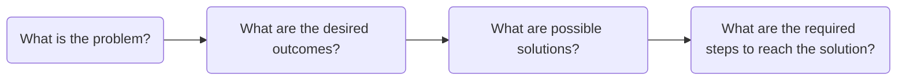
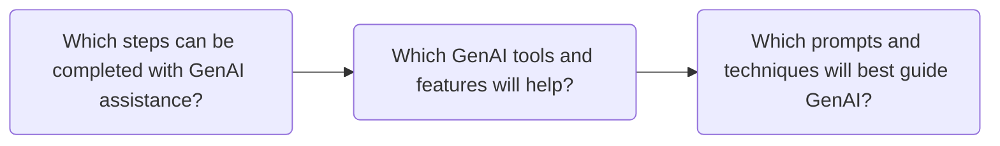

# AI Prompt Engineering For Copywriters

**What is a prompt?** Prompts are textual inputs that contain instructions, questions, or commands meant to elicit a specific response or perform a particular task using GenAI.

A prompt can be as simple as a word or phrase, or as complex as an elaborate essay. It can be a one-off prompt in the form of a simple question, or a chain of prompts in conversational style. Effective prompts are able to deliberately direct and guide GenAI to repeatably and predictably complete specific tasks. 

**How does GenAI respond to prompts?** When reading a textual input, the prompt is broken down into tokens, and each token is given a specific weight, which is used to probabilistically generate a response. 

Natural language processing allows for words to be treated like math equations and units of code, meaning that GenAI doesn't respond to the words of a prompt, but to the web of probability those prompts create. Responses can be robotic and impersonal, or they can imitate conversing with another human, except the interlocutor is GenAI.

**What is prompt engineering?** The foundation of productive human-AI communication is prompt engineering, which is the process of creating and refining effective prompts. 

It is extremely difficult to track how GenAI actually weighs tokens and calculates answers, but in general, simple outputs need simple inputs, and more complicated outputs need more complicated inputs. Prompt engineering is meant to force focused outputs by providing detailed instructions that mitigate the arbitrary nature of tokenization. 

Prompt engineering has three main components: *1. problem decomposition*, *2. designing effective prompts*, and *3. techniques for prompting*. Copywriters who utilize the three components of prompt engineering will not only be able to use GenAI more effectively and efficiently, but will also be able to recognize when GenAI is helpful.

## Problem Decomposition
Problem decomposition is the process of dividing a task into multiple smaller, manageable steps. Decomposition makes challenging tasks easier, allowing each step to be understood, tested, and solved individually.  

Copywriters should formulate a specific, actionable plan when facing a challenging task before resorting to GenAI for its own sake. When Copywriters become over-reliant on GenAI by jumping to use it for every problem, they increase the chance of misusing it in ineffective, inefficient, and unethical ways. Problem decomposition solves this problem because it encourages Copywriters to seek out intuitive solutions that may include an appropriate use case for GenAI.

Furthermore, problem decomposition helps prompt engineering because GenAI tends to work better when it has fewer tokens and steps, overwhelming it by giving it one specific task at a time instead of the whole problem all at once. Deciding when and how to use GenAI is an important step, but Copywriters will only find those instances if they are actively engaged with the problem themselves. 

Prompt Engineering breaks problem decomposition into two parts: first, understanding the problem and proposing solutions, and second, determining if and how to use GenAI.

#### *Part 1*
The copywriter breaks a problem into manageable pieces, and then they propose potential solutions.

##### Step 1: *What is the problem?* 
A Copywriter is working on revising the newsletter inviting students to a cultural event. The newsletter needs grammar, style, and tone revisions, and the copywriter was specifically requested to ensure that the text has inclusive language for a multicultural audience. 

The first step of problem decomposition identifies and defines a specific, clear outcome, its major components, its moving parts, and challenges involved in completing it. For the assignment above, there are multiple steps, but one clear outcome: revise the copy to be inclusive, persuasive, and inviting to a multicultural audience.

There are several ways to go about this assignment, but it may be helpful to break it down into its unique problems, for instance: the copywriter needs to understand what the multicultural audience entails, what inclusive language will appeal to that audience, and how to make the newsletter formal but inviting, while revising noninclusive terms and phrases. This immediately gives them a framework to work with, allowing them to plan sufficiently.

##### Step 2: *What are the desired outcomes?*
The copywriter begins to define the requirements for each component while also developing a stricter standard. Writing for a multicultural audience will first require research, then testing and revising the language for readability and inclusiveness. After copyediting, the newsletter should be completely polished, adhering to the BYU-Idaho writing style guide. The copywriter notices that BYU-Idaho's writing style guide may clash with some inclusive language practices and create unintended confusion.

The second step of problem decomposition involves critically evaluating the intended outcomes and assessing whether they will resolve pain points or create unintentional problems. This is where things become less clear, and the challenges of resolving the problem begin to manifest. Acknowledging these potential issues before revising or researching will help focus the copywriting process and reduce erroneous outcomes.

##### Step 3: *What are possible solutions?*
After identifying the tension between BYU-Idaho's writing style guide and multicultural inclusive writing practices, the copywriter plans to use alternative inclusive language practices with less friction. After reviewing the text, the copywriter lists what can be improved and areas that require further research. Editing for compliance with the style guide is straightforward, but the copywriter needs more information on the audience.

The third step of problem decomposition finds specific, alternative resolutions for each challenge and determines which ones are best suited to achieve the intended outcome. The uncertainty of possibility becomes clarified as the variety of choices is narrowed into solutions. Each solution should be skeptically evaluated to ensure that it resolves the issue without creating unforeseen problems.

##### Step 4: *What are the required steps to reach the solution?*
With a specific solution in mind, the copywriter takes a moment to outline the exact steps. For this assignment, the steps are relatively straightforward: research inclusive language for a multicultural audience, revise the newsletter accordingly, and edit for compliance with BYU-Idaho's style guide. 

However, when starting the process, the copywriter has to complete several sub-steps for each task. The copywriter will need to find examples and guides for inclusive language, create audience personas, mark pain points in the newsletter, create several revised drafts, test the drafts against the audience personas and standards for inclusive language, check for readability, formatting, and visual hierarchy, and edit it to meet the writing style guide. 

The fourth step of problem decomposition defines and clarifies each step required to achieve the task so that the task will be completed thoroughly and completely. This is where the copywriter begins to think about the best methods to complete the task. 

Notice that steps 1-4 do not require any GenAI involvement. This is because these steps are necessary for determining if GenAI would even be helpful or appropriate. Before Copywriters become involved with the work, they should already have critically reviewed the task with problem decomposition. Only afterward will the copywriter be able to judge the efficacy of GenAI. 

Sometimes, after trial and error, they may return to part 1 of problem decomposition because a certain outcome did not resolve the problem as they expected. The ability to discern and judge an outcome is an important part of problem decomposition and one more reason why Copywriters need to approach AI.

#### *Part 2*
When Copywriters start asking "Which steps can be completed with GenAI assistance?", they should take into account its limitations and weaknesses before deciding to use it to summarize articles or provide reliable information. 

The copywriter determines that one of the steps can be appropriately completed with AI assistance, and then they identify exactly how it can help. Copywriters should work along the lines of *Find*, *Challenge*, and *Inspect.*

##### Step 5: *Which steps can be completed with GenAI assistance?*
The copywriter identifies three ways they can use GenAI to *find*, *challenge*, and *inspect*. For researching inclusive language and multicultural personas, the copywriter plans to use GenAI to *find* reputable and relevant articles and even professional research papers. Next, for testing the drafts against audience personas, the copywriter plans to have GenAI adopt each persona and *challenge* the newsletters. Finally, to ensure that the final draft is compliant with the writing style guide, the copywriter plans to have GenAI *inspect* it and identify any issues.

The fifth step of problem decomposition focuses on planning what tasks to use GenAI for. Copywriters should use the *Find*, *Challenge*, and *Inspect* framework to guide what tasks are appropriate.

##### Step 6: *Which GenAI tools and features will help?* 
The Copywriter identities pre-created GenAI agents that are dedicated to the roles of *find*, *challenge*, and *inspect*. They plan to use these to help complete the tasks they defined earlier. Similar tools will be provided in the following sections of this manual.

The sixth step of problem decomposition identifies the GenAI tools and features that will help complete the task. Copywriters can refer to the tool guide to learn about the tools and features available to them.

##### Step 7: ***Which prompts and techniques will best guide GenAI?***
The Copywriter experiments with effective prompt engineering and prompting techniques. They ask different questions about inclusive language writing and explore different sources. Through their research, they are able to develop better questions and use the GenAI tool to find relevant sources. Afterward, the copywriter submits the text they created using various prompts to the GenAI chat to evaluate the text with the audience personas they cultivated. Finally, they send the revised newsletter, which identifies minor compliance and readability issues. 

The seventh step of problem decomposition is the only stage where Copywriters are actively working with and using GenAI. While it is easy to use the chat interface with basic requests, such as: "does this newsletter sound good" or "how will this perform with SEO", it is generally more difficult to predict those outputs or use them efficiently, effectively, and ethically. Problem decomposition takes into account the risks and limitations of GenAI. 

When Copywriters are using GenAI, they should take into account how GenAI best receives and responds to prompts. After problem decomposition, the next step for prompt engineering is designing effective prompts.

## Designing Effective Prompts
Designing effective prompts requires breaking down inputs into a framework for constructing instructions that guide outputs. While there is no definitive framework for constructing prompts, the method presented below encompasses several design practices that are especially effective within the **Find**, **Challenge**, and **Inspect** framework. There are six parts to designing effective prompts: **Goal**, **Format**, **Style**, **Role**, **Context**, and **Examples**. 

 The **Goal** identifies the task, **Format** organizes the output, **Style** controls how the response is written, **Role** establishes the model's perspective and boundaries, **Context** supplies the necessary information, and **Examples** demonstrate the expected result. 
 
If the output is still incomplete or unsuitable, the copywriter can refine the prompt again. As each task is different, not every prompt will require each part, but in order to reduce the randomness of GenAI outputs, you will generally need **Goal** plus two to three other parts.

### 1. Goal: The intent and objective of the prompt and the output.
Effectively prompting GenAI requires that one be sure to include a specific, actionable directive for the output. Problem decomposition already provides an achievable task, but without a clearly stated goal that GenAI can understand, it will be all the more difficult to accomplish.

Think of it like this: when using GenAI, users are able to prompt the machine with little to no detail. For instance, a user could type: "I really enjoyed my homemade pizza and want to make it again. Can you help me?" GenAI understands that the objective is to help, but it does not understand what is actually helpful. 

The original prompt had a goal, which was to help the user, but the specifics were vague, so it guesses the user's intention. A clear prompt states the desired outcome. Only then will the output be focused and helpful. To build off of the prior example, the revised prompt should include something along the lines of: "Help me organize the recipe for the homemade pizza I made. Here are the details..." 

Here are a few principles for creating strong goals while prompt engineering:

#### **State the task with a clear action verb**
Start the goal with a verb that tells the model what operation to perform. The verb signals the kind of work you expect and helps the model choose a useful response. Words such as *find*, *compare*, *evaluate*, *revise*, and *classify* give clearer direction than broad requests such as *help*, *discuss*, or *look at*.

For example:

* ***Vague:*** Help me find sources about copywriting,
* ***Clear:*** Locate blogs and articles on the web about outdated copywriting practices.

#### **Name the intended outcome**
Tell the model what the task should help you accomplish. A task verb says what action to take; the intended outcome explains why that action matters or what the result should make possible. This context helps the model select relevant information and focus its response.

For example: 

* ***Task only:*** Assess whether this event description clearly communicates the benefits to freshmen students.
* ***Task and Outcome:*** Assess whether this event description clearly communicates the benefits to freshmen students so I can revise parts that may not persuade them.

#### **Set the scope**
Define the boundaries of the task so the model knows what to include and where to stop. Scope can specify the topic, time period, location, source types, number of items, or parts of a document to examine. Clear boundaries help keep the response relevant and prevent the model from making the task broader or narrower than intended.

For example: 

* ***Broad:*** Check this page for readability.
* ***Scoped:*** Inspect this web article for readability according to the Flesch–Kincaid grade level calculator.

#### **Separate complicated goals into multiple steps**
When a task requires several kinds of work, break it into clear, ordered steps. A request that asks the model to research, analyze, draft, and revise all at once can make it harder to tell which parts matter most. A sequence helps the model complete each stage and use the results from one step in the next.

For example:

* ***Combined request:*** Determine whether the language used in this web page is appropriate according to BYU-Idaho's honor code, and react to it with different audience personas from BYU-Idaho to see if this is clear, friendly, and compliant.
* ***Step-by-step goal:*** First, identify BYU-Idaho's honor code. Next, review whether the web page's content is compliant with the honor code. Finally, test a variety of reactions from students at BYU-Idaho to see if this content is clear and friendly.

### 2. Format: The framework and structure of the output.
Even when guided with a strong goal, GenAI is still probabilistically selecting the format of the output. For certain tasks, this may not matter, but when crafting a prompt that requires a repetitive or specific outcome, including instructions for the format of the output will help hone similar results. The format and the goal are closely linked together, because the format ultimately frames what the completed task looks like. Even with the best goal, GenAI may still not generate a usable output.

Think of it like this: users can input any amount of instructions that the GenAI can interpret. For instance, a user could type: "Help me organize the recipe for the homemade pizza I made. Here are the details..." GenAI understands what the goal is with all the necessary details, but it does not know the best way to format it.

The original prompt had a specific goal, but it guesses the best way to format it in a way that completes the instructions. The instructions that a user provides should be compatible with the format provided. 

The original prompt had a goal, which was to help the user, but the specifics were vague, so it guesses the user's intention. A clear prompt states the desired outcome. Only then will the output be focused and helpful. To build off of the prior example, the revised prompt should include something along the lines of: "Help me organize the recipe for the homemade pizza I made. Here are 
the details..."

Here are a few principles for creating strong output formats while prompt engineering:

#### **Choose the format and structure**
Tell GenAI how to organize the copy and what type of deliverable to produce. A clear structure helps the model understand how the information should be arranged and makes the output easier for the copywriter to review. Words such as *organize*, *outline*, *format*, and *structure* give more direction than broad requests such as *edit*, *improve*, or *help*.

For example:

* ***Vague:*** Help me edit this announcement about a student writing workshop.
* ***Clear:*** Identify grammar mistakes in the written announcement by creating a bulleted list of each mistake.

#### **Define what the response must include**
Identify the information, sections, or elements that the response must contain. A format may explain the overall structure, but required elements explain what belongs inside that structure. This helps prevent GenAI from leaving out important information or emphasizing details that are less useful to the audience.

For example:

- **Vague:** Make this workshop announcement more useful for students.
- **Clear:** Review this announcement for the missing information students need to attend the workshop.
- **Specific:** Review this human-written announcement from the perspective of a student; check for the workshop name, date, time, location, intended audience, registration instructions, contact information, and call to action. List any missing information separately rather than creating details.

#### **Guide exact or incomplete outputs**

Explain how GenAI should handle requirements that must be followed exactly and information that is missing. Copywriting tasks may include character limits, a specific number of options, wording that must remain unchanged, or details that require verification. Without these instructions, GenAI may alter important information, exceed the required length, or fill gaps with unsupported claims.

For example:

- **Vague:** Inspect this social media copy from this workshop announcement.
- **Clear:** Inspect these three social media posts from this announcement, and identify confusing parts.
- **Specific:** Inspect these three social media post options from this announcement. Check for the workshop name, date, time, and registration link. Identify whether it contains a clear call to action; do not add information that is not in the source, and write **[NEEDS VERIFICATION]** wherever a required detail is missing. The copywriter will review and revise the options before publishing.

### 3. Style: The GenAI's tone, diction, and syntax choices in the output.
Even when the goal, format, and context are clear, GenAI still has to decide how the response should sound. It may produce an answer that is technically correct but too formal, too casual, too complex, or inconsistent with the audience. For certain tasks, this may not matter, but when the wording and tone are important, style instructions help guide the way the output is communicated.

Style is closely connected to the purpose of the prompt. A recipe written for a professional chef may use different language than a recipe written for someone who has never cooked before. Without guidance, GenAI guesses the appropriate level of formality, complexity, and detail based on the information it has received. Its guess may not match the user's expectations.

Think of it like this: a user could ask, "Help me organize the recipe for the homemade pizza I made." GenAI might organize the recipe correctly, but it could write the instructions in a formal cookbook style, use technical cooking terms, or explain the process in a way that is difficult for a beginner to understand.

The original prompt had a clear goal and may have included a useful format, but it did not explain how the response should sound. A stronger prompt would include style instructions such as: "Write the recipe in a friendly, simple tone for a beginner. Use short sentences and explain any cooking terms."

When creating a prompt, consider who will read the response and how the response should make them feel. Clearly naming the desired tone, voice, level of formality, and complexity helps GenAI produce an answer that is not only accurate, but also appropriate for its intended audience.

Here are a few principles for creating a strong style while prompt engineering:

#### **Name the desired tone and voice**
Tell GenAI how the copy should sound and what personality it should communicate. Tone describes the feeling or attitude of the writing, such as friendly, confident, reassuring, or urgent. Voice describes the consistent personality or character of the organization or brand. Naming both helps GenAI revise copy for a specific audience without relying on its own assumptions.

For example:

- **Vague:** Adopt the voice of the audience persona.
- **Clear:** While reviewing the announcement, be sure to use a casual voice that is appropriate for the audience persona.
- **Specific:** Review this blog from the perspective of a student. When gauging the audience reaction, be sure to preserve the original meaning, avoid exaggerated claims, and identify any wording that may not match their voice.

#### **Set the level of formality and complexity**
Tell GenAI how formal the copy should be and how difficult it should be for the audience to understand. Formality affects word choice, sentence structure, and professionalism. Complexity affects vocabulary, sentence length, technical language, and the amount of explanation provided. These instructions help GenAI create copy that is appropriate for the intended audience.

For example:

- **Vague:** React to this blog with a professional tone.
- **Clear:** Inspect this blog for writing errors. The output should be professional and avoid technical jargon.
- **Specific:** Inspect this blog for grammatical errors according to BYU-Idaho's style guide. Identify mistakes using plain language, short sentences, and familiar vocabulary. Avoid unnecessary technical terms, explain any specialized terms, and preserve the original facts and meaning.

### 4. Role: The persona GenAI adopts to direct its reasoning, context, and outcomes.
GenAI can approach the same task in many different ways depending on the role it is given. A role provides the model with a perspective from which to interpret the instructions, make decisions, and shape the final response. Without a role, GenAI may provide a general answer that does not reflect the expertise or priorities needed for the task.

The role and the goal are closely linked together. If a user asks GenAI to organize a recipe, the result may be different depending on whether the model is acting as a professional cookbook editor, a nutritionist, a food historian, or a beginner cooking instructor. Each role brings different responsibilities, questions, and standards to the task.

Think of it like this: a user could ask, "Help me organize the recipe for the homemade pizza I made." GenAI may arrange the ingredients and instructions, but it does not know what perspective should guide the process. It may not know whether to focus on readability, nutritional information, culinary accuracy, or teaching a new cook.

A stronger prompt might say: "Act as a cookbook editor who specializes in clear recipes for beginner cooks. Organize my pizza recipe, identify missing information, and make the instructions easy to follow without changing the ingredients or cooking method."

This role gives GenAI more than a title. It establishes responsibilities and boundaries. The model now knows what kind of expertise to apply, what to pay attention to, and what outcome to prioritize. A well-chosen role can make the response more focused, but an unnecessarily broad or inappropriate role can lead the model away from the user's actual goal.

Here are a few principles for choosing a strong role while prompt engineering:

#### **Choose a role that fits the task**
Assign GenAI a role that matches the type of copywriting work it is being asked to support. A relevant role gives the model a useful perspective and helps it focus on the priorities of the task. An unrelated or overly broad role may cause GenAI to emphasize information that is not relevant to the audience, message, or purpose.

A role should support the copywriter's work rather than replace the copywriter's judgment. For example, a copy editor may focus on clarity and grammar, while an audience researcher may focus on reader needs and expectations.

For example:

- **Vague:** Act as a marketing expert and improve this webpage copy.
- **Clear:** Act as a copy editor who specializes in higher education and review this human-written webpage copy.
- **Specific:** Act as a higher-education copy editor. Review this human-written webpage copy for clarity, audience awareness, grammar, and consistency with a professional university voice. Identify specific areas for improvement and explain your recommendations. Do not add claims, change factual information, or present a fully rewritten version as final copy.

#### **Define the role's responsibilities**
Explain what the assigned role should pay attention to, what actions it should take, and what boundaries it must follow. Giving GenAI a title alone may not be enough to produce a useful response. Responsibilities turn the role into a clear set of expectations and help prevent the model from making unsupported decisions.

Defining responsibilities makes the role more useful and accountable. GenAI can provide an informed review, but the copywriter remains responsible for evaluating the recommendations, verifying the information, and deciding which changes belong in the final copy.

For example:

- **Vague:** Act as a copy editor and fix this announcement.
- **Clear:** Act as a copy editor responsible for checking this announcement for clarity, grammar, and missing information.
- **Specific:** Act as a copy editor responsible for reviewing this human-written announcement. Check its grammar, sentence clarity, audience awareness, and call to action. List each recommended change with an explanation, preserve the Copywriter'scopywriter's intended meaning, and mark unsupported or incomplete details as **[NEEDS VERIFICATION]**. Do not invent facts or make the final publishing decision.

### 5. Context: The additional information required for the GenAI to complete the prompt.
GenAI can only work with the information it has been given or can reliably infer. A prompt may have a clear goal, format, style, and role, but the output can still be incomplete if the model does not have enough context. Context gives GenAI the background, details, limitations, and reference material it needs to complete the task accurately.

Context is closely connected to the quality of the output. When important information is missing, GenAI may fill in the gaps by making assumptions. Those assumptions may seem reasonable, but they may not reflect what actually happened or what the user intended. Providing too little context can produce a generic answer, while providing irrelevant or excessive information can make the important details harder to identify.

Think of it like this: a user could ask, "Help me organize the recipe for my homemade pizza," and provide only the ingredients. GenAI would still be missing important information, such as the amount of each ingredient, the oven temperature, the cooking time, the order of the steps, and the size of the pizza. It may guess some of these details, but the resulting recipe may not accurately describe the user's pizza.

A stronger prompt would provide relevant background: "I made a 12-inch pizza using store-bought dough. I baked it at 450 degrees Fahrenheit for 14 minutes on a baking sheet. The toppings were tomato sauce, mozzarella, mushrooms, and basil. Organize these details into a recipe, and mark any information that is missing instead of guessing."

Trusted reference material can also improve the response. For example, the user might provide an existing recipe, a cooking standard, or a source they want GenAI to follow. At the same time, context should be limited to information that is relevant to the task. Private or sensitive information should be removed, generalized, or protected whenever it is not necessary for completing the prompt.

Here are a few principles for providing strong context while prompt engineering:

#### **Provide relevant background**
Give GenAI the information it needs to understand the purpose, audience, subject, and requirements of the copywriting task. Relevant background helps the model make better suggestions and reduces the need for it to guess. However, context should serve the task rather than include every available detail.

For example:

- **Vague:** Inspect this announcement for our audience.
- **Clear:** Examine this human-written announcement for university students.
- **Specific:** Reevaluate this human-written announcement for first-year university students who may be unfamiliar with the event. The goal is to explain what the event offers, why it may be useful, and how students can attend.

#### **Supply trusted reference material**
Give GenAI reliable sources, approved documents, or established guidelines that should inform the copywriting task. Reference material can help the model understand facts, terminology, brand requirements, and organizational standards. The copywriter must still verify the information and ensure that the final copy does not reproduce protected material improperly.

For example:

- **Vague:** React to an announcement about the university's new writing resources.
- **Clear:** Use the university's writing-center webpage as a source when checking this announcement.
- **Specific:** Review this human-written announcement using the university's official writing center webpage as the factual reference. Compare the announcement against the source, identify unsupported or outdated claims, and recommend corrections. Do not copy sentences from the webpage or add information that cannot be verified from an approved source.

#### **Explain specialized terms and requirements**
Define unfamiliar terms, abbreviations, audiences, brand standards, and other requirements that affect the task. GenAI may interpret specialized language differently from the copywriter or the intended audience. Explaining these terms gives the model the context it needs to make appropriate recommendations.

For example:

- **Vague:** Analyze this copy using our usual terminology.
- **Clear:** Analyze this copy using our usual terminology:
Features vs. Benefits: A feature is a factual detail of what a product does; a benefit is how it improves the user's life.
Pain Point: A specific problem, frustration, or challenge the audience faces.
Unique Selling Proposition (USP): What makes an offer different from every competitor.
Social Proof: Testimonials, reviews, or logos showing that others trust the product.
Scarcity & Urgency: Using limited availability (scarcity) or time pressure (urgency) to drive immediate action.

#### **Minimize and protect private data**

Provide only the information that GenAI needs to complete the task, and remove or generalize private, confidential, or restricted information whenever possible. Using an approved account or tool does not mean that every piece of information should be entered into a prompt. Copywriters should follow institutional data-classification requirements, use approved tools for protected information, and ask for guidance when they are unsure.

Minimizing data protects people and organizations while still giving GenAI enough context to support the task. When information may be confidential or restricted, the safest approach is to remove it, use a fictional substitute, or ask a supervisor or authorized support team before entering it into an AI tool.

For example:

- **Inappropriate:** Analyze this student email. 
- **Appropriate:** Review this fictionalized student email and recommend a professional response.

### 6. Examples: The model that shows the GenAI what an output should look like.
Examples give GenAI a concrete model for how to complete a task. While written instructions explain what the model should do, examples demonstrate what the result should look like. This can be especially helpful when the desired organization, level of detail, wording, or transformation is difficult to describe with instructions alone. Examples can be used in different amounts:

1. Zero-Shot: Inputting a prompt with no examples
2. One-Shot: Inputting a prompt with one example
3. Few-Shot: Inputting a prompt with two or more examples

Examples are closely connected to both format and style. If a user asks GenAI to organize a recipe, the model may understand the general goal but still be uncertain about the exact structure. Should the recipe include a title, serving size, preparation time, ingredient list, numbered steps, or cooking notes? A clear example helps answer these questions by showing the model the expected pattern.

##### **1. Zero-Shot: Inputting a prompt with no examples**

A zero-shot prompt asks GenAI to complete a task using only written instructions. No sample input or output is provided. The model must interpret the goal, format, style, role, and context from the prompt itself.

For example:

> "Organize my homemade pizza details into a clear recipe for a beginner. Include a title, ingredient list, preparation steps, cooking temperature, and cooking time."

This prompt explains what the user wants, but it does not show GenAI exactly what the finished recipe should look like. GenAI must determine the best organization and wording based on the instructions.

Zero-shot prompting is useful when the task is simple, familiar, or easy to explain. It is also helpful when the user wants GenAI to create something original rather than follow a specific pattern. However, the more precise or repetitive the desired output is, the more likely it is that examples will improve consistency.

##### **2. One-Shot: Inputting a prompt with one example**

A one-shot prompt includes one example of the desired input and output. The example gives GenAI a model to follow while it completes the new task. It shows the expected format, style, level of detail, and organization more clearly than instructions alone.

For example:

> **Example input:**  
> Ingredients: dough, tomato sauce, mozzarella, mushrooms, and basil.  
>  
> **Example output:**  
> **Simple Mushroom Pizza**  
>  
> **Ingredients:**  
> - Dough  
> - Tomato sauce  
> - Mozzarella  
> - Mushrooms  
> - Basil  
>  
> **Instructions:**  
> 1. Prepare the dough.  
> 2. Add the sauce and toppings.  
> 3. Bake until the crust is fully cooked.

The user could then add:

> "Now organize my pizza recipe using the same structure: dough, olive oil, garlic, tomatoes, mozzarella, and spinach."

The example teaches GenAI to use a title, separate the ingredients from the instructions, and present the process as a numbered list. One-shot prompting is useful when the desired output has a specific pattern that may be difficult to describe completely with instructions.

##### **3. Few-Shot: Inputting a prompt with two or more examples**

A few-shot prompt includes two or more examples for GenAI to study before completing the task. Multiple examples help the model identify the underlying pattern instead of relying on only one sample. They are especially useful when the task has several possible outcomes or requires consistent results across different inputs.

For example:

> **Example 1 input:**  
> Ingredients: dough, tomato sauce, mozzarella, and basil.  
>  
> **Example 1 output:**  
> **Margherita Pizza**  
>  
> **Ingredients:**  
> - Dough  
> - Tomato sauce  
> - Mozzarella  
> - Basil  
>  
> **Instructions:**  
> 1. Prepare the dough.  
> 2. Add the sauce and mozzarella.  
> 3. Bake until the crust is golden.  
> 4. Add basil before serving.
>
> **Example 2 input:**  
> Ingredients: dough, olive oil, garlic, chicken, and spinach.  
>  
> **Example 2 output:**  
> **Garlic Chicken Pizza**  
>  
> **Ingredients:**  
> - Dough  
> - Olive oil  
> - Garlic  
> - Chicken  
> - Spinach  
>  
> **Instructions:**  
> 1. Prepare the dough.  
> 2. Brush it with olive oil and garlic.  
> 3. Add the chicken and spinach.  
> 4. Bake until the crust is golden.

The user could then ask:

> "Using the same pattern, organize this recipe: dough, pesto, mozzarella, roasted peppers, and onions."

The two examples show GenAI that each recipe should include a descriptive title, an ingredient list, and numbered instructions. They also demonstrate the expected level of detail and the type of language to use.

Few-shot prompting is useful when consistency is especially important, such as classifying information, transforming text, extracting details, or generating multiple items in the same format. The examples should be accurate, relevant, and consistent with one another. If the examples contradict each other, GenAI may not know which pattern to follow.

In general, use zero-shot prompting when the task is straightforward, one-shot prompting when one example clearly demonstrates the desired result, and few-shot prompting when multiple examples are needed to establish a reliable pattern.

Here are a few principles for using strong examples while prompt engineering:

#### **Choose examples that match the task**
Use examples that represent the type of copywriting work GenAI is being asked to support. Relevant examples help the model identify the right pattern, audience, tone, and level of detail. Examples should be human-created, accurate, and appropriate for reuse. They should not be copied from protected work or contain private information.

For example:

* **Input:** Act as an advanced search engine. Help me find Boolean terms to use
  * **Example output:** "BYU-Idaho" AND "student demographics" AND "higher education"

#### **Show the expected input and output**
Provide both the material GenAI should work from and an example of the desired result. Showing the input and output makes the transformation clear and reduces the amount of guesswork required. This is especially helpful for editing, restructuring, summarizing, classifying, or adapting copy for a different audience.

For example:

* **Input:** Act as a BYU-Idaho Writing Style Guide. Use this provided example as a reference for how you should evaluate it.
  * **Example Output:** "6.9 Em Dashes. *Accounting is more than just math–it's the process of analyzing, collecting, and processing financial information.* Explanation: Uses a hyphen or short dash instead of an em dash without surrounding spaces.   Suggestion: Replace the hyphen with a proper em dash: math—it's the process..."

#### **Identify what the model should learn from each example**

Explain which qualities GenAI should notice and apply. An example can demonstrate many features at once, including organization, tone, sentence length, word choice, level of detail, or method of transformation. Identifying the intended lesson prevents GenAI from copying features that are not relevant to the task.

For example:

* **Input:** Your primary objective is to help Copywriters anticipate audience reception by identifying potential friction points, unmet expectations, rhetorical weaknesses, credibility concerns, and awareness mismatches.
  * **Example output:** "Our revolutionary AI-powered platform will instantly eliminate all communication friction and double your team's output overnight." Audience Reaction: Skeptical and weary. Over-promising causes an immediate loss of trust for a busy founder who knows software transitions take effort. Exaggerated Claims: Promising "instant" elimination of friction and "overnight" doubled output triggers skepticism.

Clear examples teach GenAI how to approach a task without asking it to reproduce someone else's work. The copywriter should select appropriate examples, explain what each example demonstrates, verify the output, and make the final decisions about the copy.

### **Bringing It Together**
The purpose of these principles is to help Copywriters create and improve directives in prompts so GenAI can provide more useful and predictable support. Each principle can improve a prompt on its own, but the strongest prompts combine all six: **Goal, Format, Style, Role, Context, and Examples**.

Refining a prompt also helps the copywriter understand the task more clearly. As the prompt develops, the copywriter may discover that the original goal was too broad, the required information was incomplete, or the desired output needed a different structure. Prompt refinement is therefore part of problem decomposition. A directive is only one part of the Copywriter'scopywriter's larger process of thinking, researching, reviewing, and making decisions.

The following examples demonstrate how a prompt can develop through three stages. Each stage includes all six rules, but the instructions become more precise as the prompt is refined. The final prompt also clarifies the Copywriter'scopywriter's responsibilities and keeps GenAI in a supporting role.

---

**## Find**

### **First Prompt**

> **Goal:** Find official BYU-Idaho webpages about scholarship and financial aid applications for 2026–2027.  
> **Format:** Provide a list of the pages and their links.  
> **Style:** Write a concise, professional summary.  
> **Role:** Act as a research assistant.  
> **Context:** Focus on current BYU-Idaho information for students.  
> **Examples:** Use a basic list format with the page title and link.

This prompt identifies the general task, but it does not define the categories, required information, search boundaries, or level of detail.

### **Refined Prompt**

> Research official BYU-Idaho webpages and articles about scholarship and financial-aid applications for the 2026–2027 academic year—act as a research assistant supporting a Copywriter. Separate the results into three categories: scholarship, financial aid, and both. For each page, provide the title, URL, publication or update date if available, category, and a one-sentence description. Use a concise, professional tone and identify information that cannot be verified. Present the results in a table.

This version clarifies the goal, structure, role, context, and required information. It also tells GenAI how to handle missing information.

### **Final Prompt**

> **Goal:** Identify every official BYU-Idaho webpage or article that provides information about applying for scholarships or financial aid during the 2026–2027 academic year so the copywriter can review the institution's current information.  
>
> **Format:** Present the results in a table with these columns: page title, category, publication or update date, relevant topic, URL, and summary. Separate pages into **Scholarship**, **Financial Aid**, and **Both**. Conclude with a list of missing, outdated, or conflicting information that requires human verification.  
>
> **Style:** Use concise, neutral, professional language. Do not make claims that are not supported by the official pages.  
>
> **Role:** Act as a research assistant for a university copywriter. Locate, organize, and summarize sources, but do not write final publication copy or make editorial decisions.  
>
> **Context:** Search only official BYU-Idaho webpages and articles that address the 2026–2027 application process. Prioritize current pages and identify the date of each source when available.  
>
> **Examples:** Use this format for each result:  
> **Page title | Category | Date | Topic | URL | Summary**  
> Example: **Scholarship Application Guide | Scholarship | 2026 | Application deadlines and requirements | [URL] | Explains the steps students must follow to apply.**  
>
> Verify every link and distinguish between information stated directly on a source and information that requires further review. The copywriter will verify the findings before using them in published work.

---

**## Challenge**

### **First Prompt**

> **Goal:** Review BYU-Idaho webpages about scholarship and financial-aid applications.  
> **Format:** Identify what is helpful or confusing on each page.  
> **Style:** Write from the perspective of a student.  
> **Role:** Act as a BYU-Idaho student who needs financial assistance.  
> **Context:** Consider freshman, international, single, married, and married students with families.  
> **Examples:** Provide a short assessment for each page.

This prompt establishes a perspective, but it does not explain how to create or apply the student perspective consistently.

### **Refined Prompt**

> Review official BYU-Idaho webpages about applying for scholarships and financial aid for 2026–2027. Create a fictional student persona based on the needs of students who may require financial assistance. Use that persona to assess each page for clarity, usefulness, confusing language, missing information, and possible barriers. Summarize the assessment for each page and include its link. Use an empathetic but objective tone, and distinguish personal reactions from verifiable facts.

This version prevents GenAI from treating a fictional perspective as a factual representation of every student.

### **Final Prompt**

> **Goal:** Evaluate whether official BYU-Idaho webpages about applying for scholarships and financial aid during 2026–2027 are clear, informative, and useful to a student who needs financial assistance.  
>
> **Format:** First, create one clearly labeled fictional student persona using relevant characteristics from several possible audiences, such as a first-year student, international student, single student, married student, or married student with a family. Then present the assessment in a table with these columns: page title, URL, helpful information, confusing information, missing information, potential student pain points, and recommended questions for the copywriter to investigate.  
>
> **Style:** Use an empathetic, objective, and accessible tone. Clearly separate the persona's perspective from factual observations about the webpages. Do not exaggerate the student's situation or claim that the assessment represents all students.  
>
> **Role:** Act as a student-experience reviewer supporting a university copywriter. Evaluate the pages from the persona's perspective, identify communication problems, and explain why they may affect the reader. Do not rewrite the webpages or make official policy decisions.  
>
> **Context:** Review only official BYU-Idaho pages and articles about 2026–2027 scholarship and financial-aid applications. Use the page content as the source of factual claims. If a concern depends on information that is not provided, label it **[NEEDS VERIFICATION]** rather than assuming it is true.  
>
> **Examples:** Use this assessment pattern for each page:  
> **Observation:** The deadline is easy to locate.  
> **Reader impact:** The student can quickly determine when to apply.  
> **Question:** Does the page explain what happens after the application is submitted?  
>
> Review every identified page, include the link to each page, and provide evidence for each assessment. The copywriter will review the findings and decide which recommendations should be investigated further.

---

**## Inspect**

### **First Prompt**

> **Goal:** Review the attached blog post for publication.  
> **Format:** Create a checklist of errors.  
> **Style:** Use a professional editorial tone.  
> **Role:** Act as a copy editor.  
> **Context:** Compare the blog post with BYU-Idaho's style guide.  
> **Examples:** List each error and explain how to fix it.

This prompt identifies the task, but it does not specify which standards to use, what kinds of issues to inspect, or how the findings should be organized.

### **Refined Prompt**

> Review the attached blog post for publication readiness using BYU-Idaho, CES, and AP style guidelines. Act as a copy editor supporting a university copywriter. Conduct a line-by-line review for grammar, punctuation, syntax, tone, brand terminology, number formatting, and trademark usage. Present each finding in a table with the line number, original text, issue, applicable rule, explanation, and recommended revision. Do not change the author's meaning or invent information.

This version defines the scope of the inspection and provides a usable output format.

### **Final Prompt**

> **Goal:** Conduct a publication-readiness inspection of the attached blog post using the applicable BYU-Idaho, CES, and AP style guidelines. Identify problems that could affect grammar, clarity, accuracy, tone, brand consistency, or publication standards.  
>
> **Format:** Present the findings in a structured table with these columns: line number, original text, issue category, applicable style rule, explanation, recommended revision, and verification status. Organize the findings by line number. Conclude with a summary of recurring issues and a list of questions that require the copywriter or editor to verify.  
>
> **Style:** Use a neutral, precise, and professional editorial tone. Explain each recommendation clearly without criticizing the author. Preserve the author's meaning and do not make unsupported factual changes.  
>
> **Role:** Act as a university copy editor conducting an audit for a Copywriter. Identify and explain potential problems, but do not present the edited blog post as final publication copy. The Copywriter or authorized editor will review and approve every change.  
>
> **Context:** Use the attached blog post as the material being inspected. Apply the relevant BYU-Idaho, CES, and AP style guidance available to the reviewer. Check grammar, punctuation, syntax, tone, brand terminology, number formatting, trademark usage, and consistency. If a rule or source cannot be verified, label it **[NEEDS VERIFICATION]** rather than presenting an assumption as fact.  
>
> **Examples:** Use this format for each finding:  
> **Line:** 12  
> **Original text:** "Students can access the resources online."  
> **Issue category:** Clarity  
> **Applicable rule:** Identify the specific style or editorial requirement.  
> **Explanation:** Explain why the wording may be unclear.  
> **Recommended revision:** Provide a concise revision for the copywriter to review.  
> **Verification status:** Confirmed by source or **[NEEDS VERIFICATION]**.  
>
> Inspect the blog post line by line, cite the relevant source or rule when possible, and distinguish confirmed errors from editorial recommendations. The final copywriter or editor remains responsible for verifying the findings and approving the published version.

## Prompt Techniques
Problem decomposition helps Copywriters determine what problem they are solving and which steps may benefit from GenAI. Prompt engineering then helps them construct a directive that communicates the task. Prompt techniques are the next part of the process: they are repeatable strategies for using prompts to guide, test, compare, and improve GenAI responses. Prompt techniques are different from prompt components:

* **Components** are what a prompt contains: Goal, Format, Style, Role, Context, and Examples.
* **Techniques** are how the copywriter uses prompts across one or more interactions. They should be selected according to the task, tested, and refined through human review. 

Techniques describe how the copywriter uses prompts across one or more interactions. For example, a Copywriter may use a role component in a single prompt, but perspective prompting is a technique when the copywriter asks GenAI to evaluate the same copy from several audience perspectives. Similarly, examples are a prompt component, while in-context learning is a technique that uses examples to guide GenAI's performance.

Techniques should be selected according to the task. Copywriters should test whether a technique improves the response, review the result against the original goal, and refine the process when necessary. No technique guarantees that GenAI will be accurate, unbiased, or suitable for publication. Human review remains necessary throughout the process.

The source organizes text-based prompting techniques into five broad categories: in-context learning, thought generation, decomposition, ensembling, and self-criticism. These categories include techniques for giving examples, encouraging structured reasoning, dividing complex problems, comparing multiple outputs, and revising responses.

### Responsible Use of Techniques
Responsible prompting requires more than selecting a technique that produces a fluent answer. Copywriters should decide whether GenAI is appropriate for the task, provide only the necessary information, protect confidential material, and verify the output before using it. The following techniques can help Copywriters obtain more useful responses while keeping human judgment central.

### 1. Decomposition and planning
Decomposition divides a complex task into smaller tasks that GenAI can address one at a time. This technique follows directly from the problem-decomposition process described earlier. Instead of asking GenAI to solve an entire communication problem, the copywriter identifies the individual questions, decisions, and actions that make up the work.
For example, revising a student newsletter may involve several separate tasks:

1. Identify the newsletter's purpose and intended audience.
2. Review the draft for grammar and syntax.
3. Evaluate whether the tone is warm and professional.
4. Check whether the language is inclusive and accessible.
5. Compare the content with the applicable style guide.
6. Identify missing information.
7. Develop revision recommendations.
8. Produce a final draft for human review.

The copywriter may use GenAI to assist with some of these steps, but should not assume that GenAI should complete all of them. The copywriter first determines what needs to be done and then decides which steps require human judgment, research, or approval.

Decomposition can also be performed within a prompt. For example:

> First identify the newsletter's primary audience and communication goal. Next, list any information that appears to be missing. Then evaluate the draft for tone, clarity, and inclusive language. Do not rewrite the newsletter.

This approach gives GenAI a plan and makes the response easier to inspect. For particularly complex tasks, the copywriter can use a sequence of prompts in which the output from one step becomes context for the next.

Decomposition is most useful when the task involves several types of work, such as research, analysis, drafting, and editing. It is less useful when a task is already simple and well-defined. Adding unnecessary steps can make the process slower without improving the result.

### 2. Clarification and rephrasing
Clarification and rephrasing techniques help resolve ambiguity before GenAI produces a final response. GenAI may respond to an unclear prompt by making assumptions about the audience, purpose, tone, source material, or desired output. Those assumptions may not match the Copywriter'scopywriter's intentions.

A Copywriter can ask GenAI to identify ambiguity before beginning the task:

> Review this assignment and identify any unclear instructions, missing information, or conflicting requirements. Ask no more than three questions that would materially improve the result.

The copywriter can also ask GenAI to restate the task:

> Rephrase the assignment as a specific editing task. State the goal, audience, required changes, and expected format. Do not begin editing yet.

Rephrasing can expose problems in the original prompt. The copywriter may discover that "make this better" actually means "make this shorter," "make this more persuasive," "align it with the style guide," or "make it easier for first-year students to understand." These are different tasks and require different evaluation criteria.

Clarification is especially important when the prompt contains broad verbs such as help, improve, review, or make better. More precise verbs, such as compare, classify, revise, evaluate, summarize, or identify, make the requested operation easier to interpret.

A clarification technique should not be used to avoid making decisions. The copywriter remains responsible for answering the questions, confirming assumptions, and deciding whether the proposed interpretation is appropriate.

### 3. Prompt chaining
Prompt chaining uses two or more connected prompts to complete a larger workflow. Each prompt performs a particular operation, and the response from one interaction may become the context for the next.

For example, a Copywriter evaluating a webpage could use this chain:

**Prompt 1: Identify the audience**

> Identify the likely audiences for this webpage. For each audience, describe its information needs and possible questions.

**Prompt 2: Evaluate the content**

> Using the audience analysis above, identify information that is clear, confusing, missing, or difficult to locate.

**Prompt 3: Evaluate the content**

> Based on the evaluation, create a prioritized list of recommendations—separate confirmed problems from issues that require human verification.

Prompt chaining gives the Copywriter opportunities to review the work between stages. The copywriter can correct a mistaken audience assumption before allowing it to influence the recommendations or draft.

A chain should have a clear stopping point and a defined purpose for each prompt. If a response contains unsupported information, the copywriter should correct or remove it before passing it into the next step. Errors can otherwise move through the chain and become increasingly difficult to identify.

### 4. Multiple responses and comparison
Ensembling is a technique in which multiple prompts or multiple responses are used to address the same task. The responses can then be compared or combined into a final result. In practical copywriting work, this technique is useful for ideation, alternative perspectives, and identifying possible weaknesses.

For example, a Copywriter might ask GenAI to create three calls to action:

> Write three calls to action for this webpage. Version one should emphasize clarity, version two should emphasize urgency, and version three should emphasize reassurance. Preserve the original facts and audience.

The copywriter can then compare the responses using criteria such as:
- Does the wording communicate the intended action?
- Does it match the audience's knowledge and expectations?
- Does it preserve the organization's voice?
- Does it make unsupported promises?
- Is it accessible and easy to understand?
- Does it fit the available space?

Multiple responses can also be used to examine a factual or editorial question from different perspectives:
Evaluate this announcement as a first-year student, an international student, and an editor responsible for institutional style. Identify points of agreement and disagreement among the three evaluations.

The purpose of comparison is not to assume that the most common answer is correct. GenAI can produce the same incorrect claim multiple times, and several similar responses may reflect the same assumption. The copywriter must compare responses against reliable sources, project requirements, and human expertise.

Generating multiple responses also requires additional time and resources. It should be used when the value of comparison justifies that cost, such as when the task is creative, ambiguous, high-impact, or difficult to evaluate using only one response.

### 5. Critique, refinement, and verification
Critique and refinement techniques use one response to produce feedback, identify weaknesses, and develop a better response. A basic workflow is:

1. Generate an initial response.
2. Ask GenAI to identify errors, omissions, risks, or inconsistencies.
3. Review the critique.
4. Ask GenAI to revise the response using valid feedback.
5. Verify the revised response against the original task and reliable sources.

For example:

> Review the draft for unclear claims, unsupported information, audience barriers, inconsistent tone, and style-guide concerns. Identify each issue, explain why it matters, and label whether it is confirmed or requires human verification. Do not revise the draft yet.

After reviewing the critique, the copywriter might prompt:

> Revise only the issues supported by the source material and the approved style requirements. Preserve the author's meaning. Mark any unresolved issue as [NEEDS VERIFICATION].

This technique can improve a response, but GenAI's critique is not independent evidence. The same system may overlook an error in its first response and fail to identify it during the critique. Verification is therefore a separate human responsibility.

Verification may include checking claims against official sources, confirming links, reviewing dates, consulting a style guide, testing the copy with the intended audience, or asking an authorized subject-matter expert to review the result. GenAI should not be treated as the final authority for factual, legal, ethical, medical, financial, or institutional decisions.

#### Perspective and style prompting
Perspective prompting asks GenAI to evaluate or develop copy from a defined point of view. A Copywriter might request an assessment from the perspective of a first-year student, accessibility reviewer, subject-matter expert, or copy editor.

A useful perspective prompt defines both the perspective and its limits:

> Act as a student-experience reviewer supporting a university copywriter. Evaluate this webpage from the perspective of a first-year student who is unfamiliar with the institution. Identify confusing language, missing information, and possible barriers. Do not claim that the assessment represents every student, and do not make official policy decisions.

Style prompting controls the characteristics of the response, such as tone, level of formality, sentence length, vocabulary, or reading level. Style instructions should be specific:

> Use a concise, welcoming, and professional tone. Prefer plain language and active voice. Do not use exaggerated claims or informal humor.

A role or perspective does not give GenAI real expertise or lived experience. Copywriters should treat role prompting as a way to organize an evaluation, not as evidence that GenAI genuinely represents a particular audience.

#### Output-control techniques
Output-control techniques specify how GenAI should organize its response. They can request a table, checklist, outline, ranked list, revision log, or labeled assessment.

For example:

> Present the findings in a table with these columns: issue, original wording, category, explanation, recommended revision, and verification status. Separate confirmed issues from editorial recommendations.

Output controls make responses easier to compare and review. They can also prevent GenAI from omitting important categories. However, a required format does not guarantee that the information in the format is accurate. Copywriters should inspect whether each field is complete and whether the categories are being applied consistently.

A useful output-control prompt also defines what GenAI should not do:

> Do not invent sources, add facts, rewrite sections that do not require revision, or present recommendations as confirmed errors.

#### Iterative prompt refinement
Iterative prompt refinement involves improving a prompt based on the response it produces. The copywriter begins with a reasonable directive, reviews the result, identifies what was missing or misunderstood, and adjusts the prompt.

For example:

- **Initial prompt:** "Review this announcement for clarity."
- **Refined prompt:** "Review this announcement for clarity for first-year students. Identify sentences that may be difficult to understand and explain why."
- **Further refined prompt:** "Review this announcement for first-year students who may be unfamiliar with university terminology. Present each concern in a table with the original sentence, concern, reader impact, and recommended revision. Preserve the original facts and identify missing information separately."

Each refinement addresses a specific weakness in the earlier instruction. The copywriter should avoid adding instructions to make the prompt longer. The goal is to make the task, criteria, boundaries, and expected output clearer.

Prompt refinement is also a form of problem decomposition. As the copywriter revises a prompt, they may discover that the original goal was too broad, the audience was undefined, the source material was incomplete, or the output required several separate tasks. In this way, prompting remains part of the copywriter's larger process of thinking, researching, reviewing, and making decisions.

The final response is not necessarily the final product. Prompt techniques help GenAI provide more useful support, but the copywriter remains responsible for evaluating the output, verifying important information, applying professional judgment, and approving any copy before publication.

