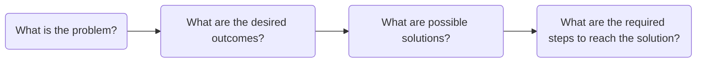
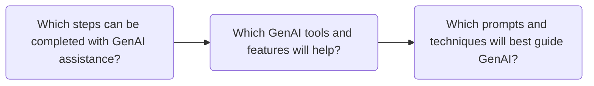

# AI Skills For Copywriters

1. Input -> Output

**What is A Prompt?** A prompt is an input that uses GenAI's natural language processing to request it to perform a specific task. This is the foundation of modern human-AI communication, which  can be robotic and impersonal, or like conversing with another human, except the interlocutor is GenAI. 

A prompt can be as simple as a word or phrase, or as complex as an elaborate essay. It can be a one-off prompt in the form of a simple question, or a chain of prompts in conversational style. Simple tasks need simple prompts, but more complicated tasks need more complicated prompts. Effective prompts are able to deliberately direct and guide GenAI to complete specific tasks. 

**How Does AI Respond to Prompts?** All GenAI answers are randomly generated responses. Natural language processing allows for words to be treated like math equations and units of code, meaning that GenAI doesn't respond to the words of a prompt, but to the web of probability those prompts create.

Writing effective prompts requires understanding how GenAI reads, analyzes, and responds to prompts. Each prompt is broken down into tokens, and each token is given a specific weight. It is extremely difficult to track how GenAI actually weighs tokens and calculates answers, but to put it simply, it uses probability. It is meant to mitigate the randomness of GenAI responses by providing instructions to reinforce the tokenization process and generate relevant and focused responses.

The process of creating and refining prompts is known as prompt engineering. Prompt engineering has three main components: *1. problem decomposition*, *2. the parts of prompts*, and *3. techniques for prompting*. Copywriters who utilize the three components of prompt engineering will not only be able to use GenAI more effectively and efficiently, but will also be able to recognize when GenAI is helpful.

## Prompt Engineering

### Problem Decomposition
Before using GenAI for its own sake, Copywriters should have a specific plan with a problem that they want to solve with GenAI. The should not become over reliant on GenAI by jumping to it for every problem. That increases the chances of misusing it in ineffective, inefficient, and unethical ways. GenAI tends to work better when it has less tokens and steps overwhelming it, so prompt engineering aims to give it one specific task at a time instead of the whole problem all at once. 

The first step of prompt engineering is problem decomposition. Deciding when and how to use GenAI is an important step, but Copywriters will only find those instances if they are actively engaged with the problem themselves. Prompt Engineering breaks problem decomposition into two parts.

**Part 1:** The Copywriter breaks a problem into manageable pieces, and then they propose potential solutions.

***What is the problem?*** Copywriters identify and define a goal in their own words, and then they identify its moving parts, major components, and potential challenges.

* **Example:** A Copywriter is working on revising the newsletter inviting students to a cultural event . The newsletter needs grammar, style, and tone revisions, and the Copywriter was specifically requested to ensure that the text has inclusive language for a multicultural audience.

***What are the desired outcomes?*** Copywriters think beyond the problem by critically evaluating the intended outcomes and whether they resolve pain points or create unintentional problems.

* **Example:** After copyediting, the newsletter should be completely polished, adhere to BYUI style guides, and be warm and inviting — but still professional — to the multicultural student audience.

***What are possible solutions?*** Copywriters find specific and alternative ways to meet the intended outcomes and then select the best one to resolve the problem.

* **Example:** After reviewing the text, the Copywriter lists where it can be improved well as areas that the Copywriter needs to do more research in. Editing for compliance with the BYUI style guide is straightforward, but the Copywriter needs more information on the audience.

***What are the required steps to reach the solution?*** Copywriters define each step to reaching the solution so they can work towards it efficiently and ethically.

* **Example:** The Copywriter must review and revise the text, then research the audience, find inclusive language, and test possible edits with audience personas before selecting the final version.

All of these steps do not require GenAI involvement to complete because they are here to determine if GenAI would even be required. Before GenAI becomes involved with the work, Copywriters should already have critically reviewed the work to their best ability.

**Part 2:** The Copywriter determines that one of the steps can be appropriately completed with AI assistance, and then they identify exactly how it can help. Copywriters should work along the lines of *Find*, *Challenge*, and *Inspect.*

***Which steps can be completed with GenAI assistance?*** Copywriters define which specific steps can be completed with GenAI assistance.

* **Example:** The Copywriter uses GenAI to *inspect* the edits they made to the text, finding anything they might have missed, and double-checking style guide nuances. They can also use *find* to locate sources for research and *challenge* to try out different audience personas for the final text.

***Which GenAI tools and features will help?*** Copywriters explore the various tools and features to determine which one will help complete the specific task.

* **Example:** The Copywriter finds pre-created GenAI agents that are dedicated to the roles of *Find*, *Challenge*, and *Inspect.* They use these to help complete the tasks they defined earlier.

***Which prompts and techniques will best guide GenAI?*** Copywriters experiment with effective prompt writing and prompting techniques. This is the only stage they are directly using the GenAI tools.

* **Example:** The Copywriter submits the text they created with multiple prompts instructing the GenAI chat to evaluate the text from multiple audience personas. They include specific instructions and use prompting techniques to improve outputs. Since they are using pre-made agents, they don't have to start prompting from scratch.

While it is easy to use the chat interface with basic requests, such as: "does this newsletter sound good" or "how will this perform with SEO", it is generally more difficult to predict those outputs or use them efficiently, effectively, and ethically. Problem decomposition takes into account the risks and limitations of GenAI.

When Copywriters start asking "Which steps can be completed with GenAI assistance?", they should take into account hallucinations before deciding to use it to summarize articles or provide reliable information. When they are using GenAI to assist them they should take into account how GenAI best receives instructions. Hence, after problem decomposition the next part of prompt engineering is writing the right prompt.

### Designing Effective Prompts
Designing effective prompts is straightforward because LLMs were primarily designed to process natural language. Overall, plain text is the most effective way to prompt GenAI tools, even when compared with other formats like Markdown or JSON. In other words, using natural, grammatically correct text is the best known way to prompt GenAI.

https://arxiv.org/pdf/2607.19257
https://arxiv.org/abs/2505.12837
https://arxiv.org/abs/2411.10541

Well constructed prompts can be broken down into several parts. There is not a single definitive method for breaking prompts down into parts. The method presented here is meant to encompass parts of effective prompts that can help with Find, Challenge, and Inspect. Not every part will be required for every prompt because each task is different, but Copywriters that understand each part will be able to reduce the randomness of GenAI outputs.

#### 1. Goal: The intent and objective of the prompt and the output.
Effectively prompting GenAI requires that one be sure to include a specific, actionable directive for the output. Problem decomposition already provides an achievable task, but without a clearly stated goal that GenAI can understand, it will all the more difficult to accomplish.

Think of it like this: when using GenAI chat, users are able to prompt the machine with little to no detail. For instance, a user could type "I really enjoyed my homemade pizza and want to make it again. Can you help me?" GenAI understands that the objective is to help, but it does not understand what actually is helpful. 

The original prompt had a goal, which was to help the user, but the specifics were vague, so it guesses the users intention. A clear prompt states the desired outcome. Only then will the output be focused and helpful. To build off of the prior example, the revised prompt should include something along the lines of: "Help me organize the recipe for the homemade pizza I made. Here are the details..." 

Here are a few principles for creating strong principles while prompt engineering:

##### **State the task with a clear action verb**
Start the goal with a verb that tells the model what operation to perform. The verb signals the kind of work you expect and helps the model choose a useful response. Words such as *find*, *compare*, *evaluate*, *revise*, and *classify* give clearer direction than broad requests such as *help*, *discuss*, or *look at*. For example:

**Find:**

* ***Vague:*** Help me find sources about copywriting,
* ***Clear:*** Locate blogs and articles on the web about outdated copywriting practices.
* ***Specific:*** Identify blogs and articles on the web that detail outdated copywriting practices and provide the five most recently published.

**Challenge:**

* ***Vague:*** React to this blog.
* ***Clear:*** Evaluate this blog for readability.
* ***Specific:*** Evaluate this blog for readability, identify sentences that are difficult to follow, and then explain why.

**Inspect:**

* ***Vague:*** Check the grammar.
* ***Clear:*** Verify this blog according to BYU-Idaho's style guide.
* ***Specific:*** Evaluate the grammar, syntax, and style guide of this blog according to BYU-Idaho's style guide and create a revision checklist.

##### **Name the intended outcome**
Tell the model what the task should help you accomplish. A task verb says what action to take; the intended outcome explains why that action matters or what the result should make possible. This context helps the model select relevant information and focus its response. For example: 

**Find:**

* ***Task only:*** Find examples of effective calls to action on nonprofit donation pages.
* ***Task and Outcome:*** Find examples of effective calls to action on nonprofit donation pages so I can improve the donation page I’m writing.
  
**Challenge:**

* ***Task only:*** Assess whether this event description clearly communicates the benefits to freshmen students.
* ***Task and Outcome:*** Assess whether this event description clearly communicates the benefits to freshmen students so I can revise parts that may not persuade them.

**Inspect:**

* ***Task only:***  Check this email campaign for consistent product names, prices, and calls to action.
* ***Task and Outcome:***  Check this email campaign for consistent product names, prices, and calls to action, then create a correction list so I can prepare it for publication.

##### **Set the scope**
Define the boundaries of the task so the model knows what to include and where to stop. Scope can specify the topic, time period, location, source types, number of items, or parts of a document to examine. Clear boundaries help keep the response relevant and prevent the model from making the task broader or narrower than intended.

**Find:**

* ***Broad:*** Find sources about student experiences at BYU-Idaho.
* ***Scoped:*** Find five journal articles published since 2020 about student experiences at BYU-Idaho.

**Challenge:**

* ***Broad:*** Evaluate this from the perspective of a freshman student.
* ***Scoped:*** Evaluate this web page's content from the perspective of a freshman student at BYU-Idaho from ages 18-22.

**Inspect:**

* ***Broad:*** Check this page for readability.
* ***Scoped:*** Inspect this web article for readability according to the Flesch–Kincaid grade level calculator.

##### **Separate complicated goals into multiple steps**
When a task requires several kinds of work, break it into clear, ordered steps. A request that asks the model to research, analyze, draft, and revise all at once can make it harder to tell which parts matter most. A sequence helps the model complete each stage and use the results from one step in the next.

**Find:**

* ***Combined request:*** Research the audience, review our web page information, and find relevant sources about the topic.
* ***Step-by-step goal:*** First, research the target audience and web page topics. Next, find the most relevant information about those topics.

**Challenge:**

* ***Combined request:*** Determine whether the language used in this web page is appropriate according to BYU-Idaho's honor code, and react to it with different audience personas from BYU-Idaho to see if this is clear, friendly, and compliant.
* ***Step-by-step goal:*** First, identify BYU-Idaho's honor code. Next, review the web page's content is compliant with the honor code. Finally, test a variety of reactions from students at BYU-Idaho to see if this content is clear and friendly.

**Inspect:**

* ***Combined request:*** Review the email I am preparing to see if it is error-free and write me a checklist of all the mistakes. Also, look for sentences that are too long or confusing.
* ***Step-by-step goal:*** First, identify BYU-Idaho's style guide. Second, review this email according to the style guide and conventional grammar rules and sentence structure. Third, identify sentences that are longer than 10 words, have passive voice misuse, or are not clearly stated. Finally, write an editing checklist.

##### Bringing It Together
The purpose of these principles is to provide an outline for creating and improving directives in prompts so that GenAI will generate better outputs. Each principle is effective on its own, but the best directives implement each of them. One reason for refining directives is that it forces the Copywriter to think deeper about the problem they are trying to solve, and they may find that the solution they have been considering can be improved or altered. The reason Copywriters start here is because they have not left problem decomposition, and creating a good directive is only one part.

Even when bringing all the principles together, the process of refinement is still necessary. As demonstrated below, each prompt includes all four of the principles, and represent a real copywriting task. Copywriters may find that the first iteration is satisfactory, but depending on the output, further iterations may be needed:

**Find:**

***All Four Principles (First Goal):*** 

To help me refine BYU-Idaho's scholarship information on their webpage, first, investigate official BYU-Idaho content that covers scholarship application for students from 2026; next, provide the relevant sources with links to those pages; and finally, identify all the official pages where this information can be found.

***All Four Principles (Refined Goal):***

I need to review all of BYU-Idaho's information regarding student scholarship application in 2026. Follow these steps: first, find official web pages and web articles from BYU-Idaho published during 2026 that discuss scholarship application; second, identify the pages that discuss the different types of scholarships; third, separate pages that discuss financial aid; forth, provide links to all of the pages.

***All Four Principles (Final Goal):***

Provide a comprehensive list to every page discussing scholarship and financial aid application for 2026-2027 at BYU-Idaho so that I can review them all; first, research every web page and article that addresses 2026-2027 scholarship and financial aid; second, separate those into three categories, pages that discuss scholarship, financial aid, or both: forth, provide links to all of the pages.

**Challenge:**

***All Four Principles (First Goal):*** 

To help me review the revised web pages discussing financial aid and scholarship application for 2026-2027 at BYU-Idaho react as if you were a freshman student, international student, single student, married student, and married student starting a family; first, research student persona's and how they might react if they were in need of scholarship or financial aid; second, review the text from that perspective; third, identify pain points that this student persona might have and the specific pages that caused each pain point.

***All Four Principles (Refined Goal):***

To help me revise the official BYU-Idaho web pages discussing the 2026-2027 application for financial aid and scholarship, react as if you were a student at BYU-Idaho and desperately needed the information. First, research a variety of student persona's such as: freshman student, international student, single student, married student, and married student starting a family; second, choose one general persona; third, review all the official BYU-Idaho pages and articles about applying for scholarship and financial aid; third, react from the perspective of the student both positive and negative and point out what was clear or confusing, helpful or misleading; fourth, summarize each reaction to each page, and be sure to provide the page.

***All Four Principles (Final Goal):***

To ensure the BYU-Idaho web pages discussing the 2026-2027 application for financial aid and scholarship are informative, clear, and helpful, adopt a persona as a student BYU-Idaho who desperately needs the information. First, research a variety of student personas who need financial assistance and adopt them into your persona; second, research and review each official BYU-Idaho page about applying for scholarship and financial aid for 2026-2027; third, react to each page according to the persona: identify pain points, misleading sections, or missing information; and forth, provide the link to the page and the assessment of the page.

**Inspect:**

***All Four Principles (First Goal):*** 

I have attached a blog post. To ensure it is ready for publication and that it meets BYU-Idaho's current style guide perfectly first, research BYU-Idaho's style guide; second, review the blog line-by-line and look for minor grammar, syntax, style, and tone mistakes; third, create a complete checklist of each mistake, explain why it doesn't align with the style guide, highlight what rule it is breaking, and identify the line it originates from in the blog. 

***All Four Principles (Refined Goal):***

To ensure it is ready for publication, review the attached blog post using the following process: First, reference BYU-Idaho's editorial style guide (including CES and AP style rules). Second, conduct a line-by-line audit for minor errors in grammar, syntax, punctuation, tone, and brand style. Third, provide a complete audit checklist. For every error found, list the line number, the original text, the specific style rule broken, and an explanation of why it fails standards.

***All Four Principles (Final Goal):***

Please perform a publication-readiness edit on the attached blog post following BYU-Idaho, CES, and AP Style guidelines. Conduct a line-by-line audit covering grammar, punctuation, brand terminology, number formatting, trademark usage, and tone. Conclude by providing your findings in a structured table listing the line number, original text, style rule violated, and reason/fix.

#### 2. Format: The framework and structure of the output.

#### 3. Style: The GenAI's tone, diction, and syntax choices in output.

#### 4. Role: The persona GenAI adopts to help direct the reasoning process, the context of the conversation, the outcomes of said conversation.

#### 5. Context: The additional information required for the GenAI to complete the prompt.

#### 6. Examples: The model that shows the GenAI what an output should look like.

1. Zero-Shot: Inputting a prompt with no examples
2. One-Shot: Inputting a prompt with one example
3. Few-Shot: Inputting a prompt with two or more examples

### Efficient vs Effective Prompting
Writing effective prompts requires some revision. To keep GenAI use efficient, the previous principles should be employed on the first draft to reduce token expense and revision time. It may take several tries to get it 

### Prompt Techniques

#### 

## 

https://arxiv.org/abs/2511.05764
https://learnprompting.org/docs/advanced/decomposition/introduction
https://mitsloanedtech.mit.edu/ai/basics/effective-prompts/
https://arxiv.org/pdf/2406.06608
https://www.cell.com/patterns/fulltext/S2666-3899(25)00108-4
file:///Users/andersoncullen/Downloads/161283-prompt-engineering-for-chatgpt-a-quick-guide-to-techniques-tips-and-best-practices.pdf
https://jet.scholasticahq.com/article/161283.pdf

How to Use AI to Create Content Outlines
How to Get Ideas from AI without the Output Sounding Generic, Formulaic, or Robotic
How to Write Effective Prompts that Captures Specific Brand, Tone, Voice, and Audience Pain Points

Be Specific
The more detailed your prompt is, the more on-target your answer will be.
Provide Context
If you ask an LLM what the weather is, it will respond by asking you where you are located.
Use Examples
Using an example of the format you want your output to resemble gives the LLM a reference point to refer to when generating an answer.
Explain Desired Output
AI can theoretically produce an infinite number of different outputs. Telling it how to format your output will help you reach your desired result.

Define a Role
It is often helpful to tell an AI who to be. For example “you are a UX researcher…”
Iterate and Refine
Engineering prompts is not asking a question, it is crafting a conversation. Sometimes it takes multiple adjustments to your prompt to get the right output.
Experiment & Understand Limitations
AI is powerful, but not perfect. Watch out for hallucinations and cross-check your information.

  
Use when…
Example
Zero-Shot Prompting
Use when the task is simple, well-understood, or frequently encountered.
Doing math, finding quick definitions, summarizing, etc.
One-Shot Prompting
Tasks that need more specific guidance or when the model struggles with ambiguity.
Creating a user persona template, content generation, etc.
Few-Shot Prompting
Complex tasks requiring multiple examples to establish patterns.
Writing a usability testing script, performing analysis, etc.

Zero-Shot Prompting:
Asking an LLM a question or task without providing examples.
The LLM relies on it’s trained knowledge to respond.
One-Shot Prompting:
You provide one example to the LLM before asking it to perform a similar task.
This gives the LLM a basic idea of what you expect.
Few-Shot Prompting
You provide multiple examples (2+) to the LLM.
This helps the LLM understand patterns and nuances for more accurate and relevant responses.

LLM-friendly content is designed to be easily understood by computer models, lowering the risk of miscommunication. Using LLM-friendly content will result in:

Improved parsing and interpretation
Enhanced accuracy
Reduced ambiguity
Consistency and reproducibility

What is easier to read: a single, unconnected paragraph or a bulleted list?

[BYU-Idaho Prompt Library](https://promptlibrary.byui.edu/welcome)

Prompt Engineering: Key Takeaways

How AI Reads: AI models break down your words into "tokens." The way your prompt is tokenized affects how the AI interprets it. Clear formatting and correct spelling help the AI "see" your prompt accurately.
Tips for Great Prompts:
Be Specific: The more detail you give, the closer the AI's answer will be to what you want.
Give Context: Don't make the AI guess! Tell it what it needs to know (like your location for weather).
Show, Don't Just Tell: Use examples of the output format you're looking for. This is a super effective way to guide the AI.
Explain the Output: Clearly describe how you want the final response to look or be organized.
Setting Rules (Be Firm!): You can tell the AI exactly what to do or not to do.
Use "YOU MUST" to enforce a rule.
Use "YOU MUST NOT" to prevent something.

Make Content "AI-Friendly": Writing clearly and using formatting like bullet points makes it easier for the AI to understand, leading to more accurate and consistent results.
Additional Tips for Prompt Engineering
Here are a few more things that can help you get the best results when working with AI:
Iterate and Refine: Your first prompt might not be perfect. Think of it as a conversation – try a prompt, see the result, and then make small adjustments to get closer to what you want. It's a process of tweaking and improving!
Define the AI's Role: Sometimes it helps to tell the AI who it should be. For example, you could say "Act as a helpful study buddy" or "You are a creative writing assistant." This can guide its style and focus.
Understand Limitations: Remember that AI models are powerful tools, but they aren't perfect. They can sometimes generate incorrect information (called "hallucinations") or reflect biases from the data they were trained on. Always double-check important details.
Experiment! Don't be afraid to try different ways of phrasing your prompts, using different formats, or experimenting with the zero-shot, one-shot, and few-shot techniques. The more you practice, the better you'll get at understanding how the AI responds.
Remember, practicing with different prompts and seeing how the AI responds is the best way to improve your prompt engineering skills!

